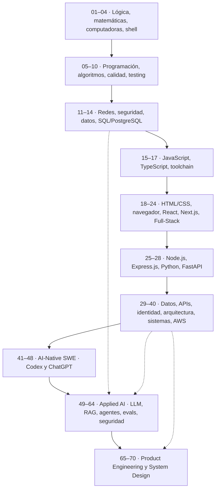

# ROADMAP E2E — SOFTWARE ENGINEER

> **Perfil objetivo:** Software Engineer — Full-Stack con profundidad en Backend, especializado en Applied AI y desarrollo AI-native, con criterio de Product Engineer.
>
> **Versión:** 1.0 · 26 de octubre de 2026 · **Formato:** mapa de conocimientos secuencial, no calendario ni plan de estudios.
# Propósito y contexto de este roadmap

## 1. Punto de partida

El propósito de este roadmap es prepararme para acceder a un empleo bien remunerado en la industria del software, trabajando **100 % de forma remota desde casa**, preferentemente para empresas o equipos internacionales. No tengo inconveniente en participar en reuniones, colaborar con equipos distribuidos o realizar viajes puntuales cuando sean necesarios.
Mi motivación principal es económica: **conseguir un buen trabajo, generar ingresos y alcanzar estabilidad financiera**. No busco emprender necesariamente, construir una marca personal, convertirme en una figura reconocida dentro de la comunidad tecnológica ni hacer de la programación el centro de mi vida.
Quiero desarrollar competencias profesionales que tengan valor para quienes contratan, permitan resolver problemas reales y me den acceso a mejores oportunidades laborales.

## 2. Por qué existe este roadmap

Este documento surge después de experiencias previas buscando empleo en desarrollo de software, particularmente en desarrollo móvil.
Esa búsqueda incluyó postulaciones, contacto directo con reclutadores y posibles empleadores, exploración de empresas y distintas estrategias de búsqueda digital. Aunque conseguí algunas entrevistas, los esfuerzos no se tradujeron en una contratación.
La dificultad no ha sido únicamente identificar qué tecnologías aprender, sino encontrar oportunidades reales, acceder a los procesos de selección y conseguir que las capacidades técnicas se conviertan en una oferta laboral.
Por eso decidí ampliar mi campo profesional hacia Software Engineering, en lugar de limitarme a una única plataforma o especialización.
Este roadmap representa una decisión de formación técnica, pero **no debe confundirse con una solución automática al problema de encontrar empleo**. Tener conocimientos y conseguir una contratación son problemas relacionados, aunque diferentes.

## 3. Objetivo profesional

Mi objetivo es desarrollar un perfil de **Software Engineer con capacidades Full-Stack, profundidad en Backend, especialización en Applied AI, dominio del desarrollo AI-native y competencias de Product Engineering**.
No pretendo ejercer cinco empleos simultáneamente. Busco una formación suficientemente amplia y profunda para comprender sistemas completos, asumir distintas responsabilidades y acceder a oportunidades laborales que requieran combinaciones de estas capacidades.
No considero necesario identificarme permanentemente con un lenguaje, framework o título laboral. Las tecnologías son herramientas profesionales, no objetivos personales.
Tampoco busco dedicar toda mi carrera exclusivamente a escribir código. Me interesan especialmente las actividades que involucran arquitectura, análisis, resolución de problemas, diseño de sistemas, especificación, coordinación técnica y utilización de herramientas de IA para desarrollar software.
Eso no elimina la necesidad de dominar programación y fundamentos de ingeniería. Al contrario: necesito comprenderlos suficientemente bien para trabajar con autonomía y asumir responsabilidades técnicas reales.

## 4. Propósito de la formación

El objetivo de estudiar este roadmap no es acumular tecnologías ni completar una lista de contenidos.
Es adquirir una base de conocimientos que permita:

- Comprender el funcionamiento del software, desde sus fundamentos hasta sistemas complejos.
- Diseñar, desarrollar, integrar, mantener y operar aplicaciones profesionales.
- Comprender las decisiones de arquitectura y sus consecuencias.
- Utilizar herramientas y agentes de IA sin depender ciegamente de sus resultados.
- Participar en el desarrollo de productos y asumir responsabilidades técnicas completas.
- Adaptarse a distintas tecnologías, equipos, empresas y requisitos laborales.

No quiero reducir la formación a lo mínimo necesario para una entrevista ni limitarme a tutoriales superficiales.
El alcance es deliberadamente amplio porque busco construir un perfil profesional completo. Eso no implica aprender todas las herramientas existentes: implica dominar los fundamentos y seleccionar tecnologías concretas sin perder conocimientos importantes por simplificar el recorrido.

## 5. Objetivos laborales y personales

El resultado que busco es concreto: **trabajar para una empresa, un equipo o distintos clientes, de manera remota, con una remuneración competitiva y condiciones sostenibles**.
No tengo una preferencia estricta por el tamaño de la empresa, su sector, el modelo de contratación o una estructura particular de equipo. Lo importante es que el trabajo sea legítimo, económicamente conveniente y compatible con la modalidad remota que busco.
También quiero que las competencias adquiridas me proporcionen flexibilidad profesional. Si una tecnología pierde relevancia o una especialización deja de ofrecer buenas oportunidades, debería contar con los conocimientos necesarios para adaptarme sin reconstruir toda mi formación desde cero.
El empleo es el objetivo inmediato. La autonomía económica y la posibilidad de decidir cómo utilizar mi tiempo son las razones prácticas para perseguirlo.

## 6. Intereses personales más allá del software profesional

Aunque este roadmap está orientado al empleo en ingeniería de software, mis intereses intelectuales no se limitan a esta industria.
Me interesan especialmente la **robótica, la inteligencia artificial, la investigación científica, la biotecnología y los sistemas inteligentes**, incluyendo las posibilidades de integración entre organismos biológicos, componentes electrónicos y sistemas computacionales.
En particular, me interesa comprender cómo podrían interactuar la inteligencia, los sistemas físicos, la computación y los procesos biológicos.
Estos intereses no constituyen el objetivo laboral inmediato de este documento ni justifican añadir disciplinas ajenas al perfil profesional elegido. Son áreas que me gustaría explorar en otras etapas, cuando mis circunstancias y prioridades lo permitan.

## 7. Criterios que rigen este roadmap

Este documento debe funcionar como un mapa técnico de referencia, no como un calendario de estudios ni como una lista de actividades académicas.
Su organización seguirá las dependencias entre conocimientos, desde fundamentos universales de informática e ingeniería hasta especializaciones avanzadas.

Los principios de construcción son:

- Priorizar la comprensión de fundamentos sobre la memorización de herramientas.
- Conservar conceptos, protocolos, patrones y principios importantes, aunque se seleccione una sola tecnología para implementarlos.
- Evitar aprender múltiples frameworks equivalentes sin una justificación técnica.
- Profundizar en cada especialización sin reducirla a conocimientos introductorios.
- Distinguir capacidades de ingeniería duraderas de herramientas sujetas a cambios.
- Utilizar IA como instrumento de productividad y desarrollo, manteniendo criterio técnico propio.
- Mantener el documento enfocado en conocimientos y competencias, sin convertirlo en un plan de estudios con plazos, tareas o evaluaciones obligatorias.

Ya sé que el roadmap no garantiza un empleo, una remuneración específica ni un determinado nivel profesional por el simple hecho de recorrerlo.

**Su función es definir qué conocimientos necesito desarrollar para construir el perfil técnico elegido.** La búsqueda de oportunidades, los procesos de selección y la contratación requerirán estrategias específicas, independientes de este documento.

## Navegación por bloques

| Bloque | Secciones | Enfoque |
|---|---:|---|
| I. Fundamentos universales | 01–14 | Lógica, matemáticas, computación, programación, algoritmos, arquitectura, Git, calidad, redes, seguridad y SQL |
| II. Lenguajes y Full-Stack | 15–24 | JavaScript, TypeScript, HTML/CSS, navegador, React, Next.js e interfaces profesionales |
| III. Backend profundo | 25–40 | Node/Express, Python/FastAPI, datos, APIs, seguridad, distribuidos, producción, AWS |
| IV. AI-Native SWE | 41–48 | Codex/ChatGPT, contexto, delegación, revisión, gobernanza y MCP |
| V. Applied AI | 49–64 | ML/LLM, inferencia, RAG, agentes, memoria, evaluaciones, seguridad y serving |
| VI. Product Engineering | 65–70 | Product Thinking, requisitos, System Design, ownership e instrumentación técnica |

## Cómo leer este documento

- **Secuencia:** avanzar de arriba abajo dentro de cada capítulo; los capítulos anteriores suministran prerrequisitos a los posteriores. Las disciplinas avanzadas reutilizan fundamentos sin volver a enseñarlos de cero.
- **`[CONCEPTO]`:** principio, mecanismo, estándar, algoritmo o marco mental que debe comprenderse incluso si cambia la tecnología usada.
- **`[TEC]`:** lenguaje, framework, biblioteca, servicio o herramienta seleccionada para el stack.
- **`[PRÁCTICA]`:** actividad o capacidad cotidiana de ingeniería; describe qué se debe saber hacer, no un ejercicio que haya que entregar.
- **`[PATRÓN]`:** solución arquitectónica recurrente cuya idoneidad y límites se deben entender.
- **`[AVANZADO]`:** conocimiento avanzado incluido deliberadamente, **no** una excusa para omitirlo.
- **Cada elemento:** nombre + explicación de qué significa y por qué pertenece al perfil. No hay fechas, proyectos obligatorios, tareas, evaluaciones, pruebas de aprobación ni capítulo de proyecto final.
- **Herramientas elegidas ≠ únicas existentes:** consolidamos alternativas equivalentes. Los estándares y patrones conceptualmente distintos permanecen, aunque compartan implementación.
- **Cinco ámbitos cubiertos:** fundamentos SWE, Full-Stack, Backend, AI-Native, Applied AI y Product Engineering. La profundidad no se reduce por ser un ámbito complementario.

### Stack seleccionado — fuente de verdad

| Dominio | Elección consolidada |
|---|---|
| Lenguajes | JavaScript, TypeScript, Python, SQL; HTML y CSS para web; Bash/PowerShell como shell |
| Web | React, Next.js App Router, Tailwind CSS, componentes accesibles, Zustand, TanStack Query, React Hook Form, Zod |
| Servidor TypeScript | Node.js, **Express.js**, REST, OpenAPI, WebSockets/SSE |
| Servidor Python | Python, **FastAPI**, Pydantic, SQLAlchemy, Alembic, asyncio |
| Datos | PostgreSQL, Prisma para TypeScript, SQLAlchemy para Python, Redis, MongoDB; pgvector para vectores |
| Calidad | Git, GitHub, ESLint, Prettier, Ruff, mypy, Vitest, React Testing Library, Playwright, pytest, Supertest, Testcontainers, k6 |
| Seguridad | Fundamentos OWASP, OAuth 2.0, OpenID Connect, sesiones, JWT, RBAC, ABAC, criptografía aplicada y gestión de secretos |
| Infraestructura | Docker, AWS, Terraform, GitHub Actions, OpenTelemetry, Prometheus, Grafana, Sentry, CloudWatch |
| Trabajo asincrónico | Redis/BullMQ para colas Node, AWS SQS/EventBridge para integración de servicios, Temporal para flujos duraderos; Kafka solo como concepto/tecnología avanzada cuando el *event streaming* lo justifique |
| AI-native | ChatGPT, Codex, `AGENTS.md`, habilidades/instrucciones, MCP, terminal, Git y herramientas de validación |
| Applied AI | Python, OpenRouter/API compatible, Hugging Face Transformers, PyTorch, LangGraph, embeddings, PostgreSQL + pgvector, Langfuse, Ragas, promptfoo, vLLM para serving avanzado |
| Producto | System Design, Product Thinking, Technical Ownership, ingeniería de requisitos y PostHog (instrumentación, uso técnico y feature flags) |

### Exclusiones intencionales

No forman parte del stack que se estudiará: **Java/Spring, C#/.NET, Go, Vue, Angular, Laravel, Django, NestJS, Fastify, MySQL, Oracle, bases NoSQL diferentes de MongoDB, Azure, Google Cloud, Jenkins, administración de Linux, Figma/FigJam, investigación de usuarios, carrera de Product Manager y plataformas rivales de agentes de programación**. No se elimina por ello el conocimiento de conceptos universales: entender qué es un sistema operativo, un lenguaje estáticamente tipado, un motor relacional, un hipervisor o un proveedor cloud sigue siendo necesario.

**Precisiones de consolidación:** Express.js se estudia directamente; Next.js complementa React (no compite con él); Python + FastAPI son una segunda base backend completa, no una nota secundaria; herramientas de IA se aprenden a profundidad con Codex/ChatGPT, no como catálogo de marcas; las APIs de modelos se consumen mediante OpenRouter y se estudia el protocolo subyacente. PostgreSQL es el almacén transaccional principal; Redis, MongoDB y pgvector no son sustitutos intercambiables. No se exige instalar ni administrar una distribución Linux: se conservan fundamentos de procesos, sistema de archivos, señales, redes y shell indispensables para ejecutar software.

---

# PARTE I — FUNDAMENTOS UNIVERSALES DE CIENCIAS DE LA COMPUTACIÓN E INGENIERÍA DE SOFTWARE

## 01. Pensamiento computacional, lógica y matemáticas discretas

### 01.1. Pensamiento computacional

- **[CONCEPTO] Problemas computables:** reconocer entradas, restricciones, transformaciones y salidas antes de elegir tecnología.
- **[CONCEPTO] Abstracción:** conservar propiedades esenciales y ocultar detalles accidentales.
- **[CONCEPTO] Descomposición:** dividir problemas complejos en subproblemas con interfaces explícitas.
- **[CONCEPTO] Reconocimiento de patrones:** detectar estructuras y soluciones reutilizables sin copiar indebidamente.
- **[CONCEPTO] Algoritmo:** procedimiento finito con pasos definidos y criterios de terminación.
- **[CONCEPTO] Corrección parcial y total:** distinguir resultado correcto de garantía de terminación.
- **[CONCEPTO] Invariantes:** propiedades que deben permanecer verdaderas durante una ejecución.
- **[CONCEPTO] Precondiciones y postcondiciones:** contratos que delimitan operaciones y resultados.
- **[CONCEPTO] Casos límite:** entradas vacías, nulas, máximas, mínimas, duplicadas y contradictorias.
- **[CONCEPTO] Determinismo e indeterminismo:** saber cuándo la misma entrada garantiza la misma salida.
- **[CONCEPTO] Estado mutable e inmutable:** entender cómo los cambios se propagan y afectan corrección.
- **[CONCEPTO] Complejidad conceptual vs accidental:** distinguir dificultad del problema de dificultad introducida por el diseño.

### 01.2. Lógica y demostración

- **[CONCEPTO] Lógica proposicional:** conectores, tablas de verdad, equivalencia e implicación.
- **[CONCEPTO] Lógica de predicados:** cuantificadores, dominios y formulación de condiciones formales.
- **[CONCEPTO] Álgebra booleana:** simplificación de expresiones y condiciones del código.
- **[CONCEPTO] Conjuntos:** pertenencia, unión, intersección, diferencia y producto cartesiano.
- **[CONCEPTO] Relaciones:** equivalencia, orden, reflexividad, simetría y transitividad.
- **[CONCEPTO] Funciones:** dominio, codominio, composición, inyectividad y sobreyectividad.
- **[CONCEPTO] Inducción matemática:** demostrar propiedades sobre secuencias, estructuras y algoritmos.
- **[CONCEPTO] Contradicción y contraposición:** razonamiento útil para validar algoritmos y requisitos.
- **[CONCEPTO] Lógica de tres valores:** comprender `NULL` en SQL y condiciones desconocidas.
- **[CONCEPTO] Lógica temporal básica:** expresar propiedades de secuencias, eventos y estados distribuidos.

### 01.3. Combinatoria, grafos y fundamentos cuantitativos

- **[CONCEPTO] Conteo y combinatoria:** permutaciones, combinaciones y principio multiplicativo.
- **[CONCEPTO] Probabilidad:** eventos, probabilidad condicional, independencia y regla de Bayes.
- **[CONCEPTO] Estadística descriptiva:** media, mediana, percentiles, varianza, dispersión y sesgos.
- **[CONCEPTO] Distribuciones:** Bernoulli, binomial, normal, Poisson y colas pesadas; útiles para tráfico, latencia y evaluación.
- **[CONCEPTO] Muestreo e intervalos de confianza:** interpretar incertidumbre sin confundir estimación con certeza.
- **[CONCEPTO] Correlación y causalidad:** no atribuir efectos a cambios de producto solo por asociación.
- **[CONCEPTO] Grafos:** vértices, aristas, caminos, ciclos, componentes y representaciones.
- **[CONCEPTO] Árboles:** jerarquías, recorridos, profundidad, balanceo y usos en parsers/índices.
- **[CONCEPTO] Álgebra lineal:** vectores, matrices, productos, normas, proyecciones y similitud; fundamento de embeddings.
- **[CONCEPTO] Geometría vectorial:** producto punto, coseno, distancia y espacio de alta dimensión.
- **[CONCEPTO] Derivadas y gradientes:** tasas de cambio y noción de optimización; luego se aplican a modelos.
- **[CONCEPTO] Optimización:** objetivos, restricciones, mínimos, máximos y trade-offs multiobjetivo.
- **[CONCEPTO] Entropía e información:** incertidumbre, codificación y nociones útiles para redes y modelos.

## 02. Representación de información y arquitectura de computadoras

### 02.1. Información digital

- **[CONCEPTO] Bits y bytes:** unidades de información, almacenamiento y transferencia.
- **[CONCEPTO] Bases numéricas:** binario, decimal y hexadecimal para entender memoria y protocolos.
- **[CONCEPTO] Enteros con signo:** complemento a dos, rangos y desbordamientos.
- **[CONCEPTO] Punto flotante IEEE 754:** precisión finita, redondeo, NaN e infinitos.
- **[CONCEPTO] Decimales exactos:** representación monetaria y límites del flotante binario.
- **[CONCEPTO] Texto y Unicode:** code points, UTF-8, normalización y caracteres combinantes.
- **[CONCEPTO] Codificación de datos:** JSON, CSV, XML, binario, Base64 y serialización.
- **[CONCEPTO] Compresión:** sin pérdida/con pérdida, gzip/Brotli y costo CPU-ancho de banda.
- **[CONCEPTO] Checksums y hashes:** detectar alteraciones; distinguir integridad de autenticidad.
- **[CONCEPTO] Endianness y alineación:** orden de bytes y representación interna.

### 02.2. Hardware y ejecución

- **[CONCEPTO] CPU e instrucciones:** ciclo de ejecución, registros y conjunto de instrucciones.
- **[CONCEPTO] Memoria jerárquica:** registros, cachés L1/L2/L3, RAM y almacenamiento secundario.
- **[CONCEPTO] Localidad de referencia:** por qué importa el acceso secuencial y la estructura de datos.
- **[CONCEPTO] Dispositivos e I/O:** diferencias entre trabajo computacional y espera de operaciones externas.
- **[CONCEPTO] Núcleos y paralelismo:** procesadores multinúcleo y límites del procesamiento concurrente.
- **[CONCEPTO] Procesamiento vectorial/GPU:** ejecución masivamente paralela y relación con inferencia de IA.
- **[CONCEPTO] Máquina virtual, intérprete y compilador:** formas distintas de ejecutar un lenguaje.
- **[CONCEPTO] Compilación y linking:** código fuente, intermedio, binarios y dependencias.
- **[CONCEPTO] JIT y AOT:** compilación durante ejecución frente a compilación anticipada.
- **[CONCEPTO] Runtime y ABI:** servicios de ejecución e interfaces binarias.

## 03. Sistemas operativos y entornos de ejecución — sin administración de Linux

- **[CONCEPTO] Kernel y espacio de usuario:** separación entre programas y servicios privilegiados.
- **[CONCEPTO] Procesos:** aislamiento, PID, creación, finalización y códigos de salida.
- **[CONCEPTO] Hilos:** concurrencia dentro de un proceso y memoria compartida.
- **[CONCEPTO] Scheduling:** cómo el sistema reparte tiempo de CPU entre tareas.
- **[CONCEPTO] Memoria virtual:** espacios de direcciones, páginas y traducción de memoria.
- **[CONCEPTO] Stack vs heap:** duración de datos, llamadas y asignaciones dinámicas.
- **[CONCEPTO] Garbage collection:** gestión automática de memoria y pausas potenciales.
- **[CONCEPTO] Fugas de memoria:** retención accidental y consumo creciente de recursos.
- **[CONCEPTO] Descriptores y handles:** referencias a archivos, sockets y recursos del sistema.
- **[CONCEPTO] File systems:** archivos, rutas, permisos básicos, enlaces, metadata y atomicidad.
- **[CONCEPTO] Variables de entorno:** configuración de procesos y distinción entre secretos/configuración pública.
- **[CONCEPTO] Señales y finalización ordenada:** interrupciones, SIGTERM conceptual y cierre de servidores.
- **[CONCEPTO] System calls:** cómo programas solicitan servicios al sistema operativo.
- **[CONCEPTO] Bloqueo vs no bloqueo:** efecto de I/O sobre ejecución y rendimiento.
- **[CONCEPTO] Containers vs virtual machines:** aislamiento del sistema y empaquetado de aplicaciones.
- **[PRÁCTICA] Inspección de procesos y puertos:** reconocer programas, recursos y conflictos durante depuración.
- **[PRÁCTICA] Lectura de logs y códigos de salida:** localizar fallos sin depender de interfaces gráficas.
- **[PRÁCTICA] Uso de shell sin administrar servidores:** ejecutar utilidades indispensables en entorno local, CI, Docker y AWS.

## 04. Terminal, herramientas y automatización básica

- **[TEC] Terminal integrada y PowerShell:** interfaz principal en Windows para comandos y scripts locales.
- **[TEC] Bash básico:** sintaxis común en CI y contenedores; no requiere instalar ni administrar Linux.
- **[CONCEPTO] Shell y proceso:** interpretación de comandos, expansión de argumentos y código de retorno.
- **[PRÁCTICA] Navegación de directorios:** rutas absolutas/relativas, creación, movimiento y eliminación segura de archivos.
- **[PRÁCTICA] Redirecciones y pipes:** combinar herramientas sin escribir programas completos.
- **[PRÁCTICA] Variables, quoting y escape:** evitar errores por espacios, caracteres especiales y secretos.
- **[PRÁCTICA] Buscar y filtrar archivos/texto:** `find`/`grep` o equivalentes PowerShell y búsquedas con `rg`.
- **[TEC] ripgrep (`rg`):** búsqueda rápida dentro de repositorios grandes.
- **[TEC] curl:** inspección reproducible de solicitudes HTTP y respuestas.
- **[TEC] jq:** consulta y transformación de JSON desde terminal.
- **[PRÁCTICA] Scripts pequeños e idempotentes:** automatizar operaciones repetitivas sin efectos duplicados.
- **[CONCEPTO] PATH, variables y permisos básicos:** explicar por qué un comando o proceso no se ejecuta.
- **[CONCEPTO] Exit codes y manejo de fallos:** propagar correctamente errores a shells y pipelines.

## 05. Fundamentos de programación independientes del lenguaje

### 05.1. Sintaxis y modelo de ejecución

- **[CONCEPTO] Variables y constantes:** representar datos y distinguir reasignación de inmutabilidad.
- **[CONCEPTO] Tipos primitivos y compuestos:** números, booleanos, texto, colecciones, objetos y valores ausentes.
- **[CONCEPTO] Expresiones y sentencias:** cálculo de valores frente a instrucciones con efectos.
- **[CONCEPTO] Operadores y precedencia:** aritmética, comparación, lógica y evaluación.
- **[CONCEPTO] Condicionales:** selección de flujo y reducción de ramas difíciles de mantener.
- **[CONCEPTO] Iteraciones:** bucles, iteradores y condiciones de salida.
- **[CONCEPTO] Funciones:** parámetros, argumentos, retornos, scope y composición.
- **[CONCEPTO] Recursión:** casos base, pila de llamadas y transformación en iteración.
- **[CONCEPTO] Paso por valor y referencia:** distinguir copia de valor y referencias a objetos.
- **[CONCEPTO] Mutabilidad y aliasing:** efectos de múltiples referencias al mismo estado.
- **[CONCEPTO] Errores y excepciones:** diferencias entre fallo esperado, condición excepcional y bug.
- **[CONCEPTO] Contratos de interfaces:** entradas válidas, tipos de resultado y errores posibles.
- **[CONCEPTO] Side effects y pureza:** separar cálculos deterministas de operaciones externas.
- **[CONCEPTO] Identidad vs igualdad:** referencias físicas/lógicas y comparación de contenido.
- **[CONCEPTO] Debugging básico:** reproducir, aislar, formular hipótesis y corregir causas.

### 05.2. Paradigmas

- **[CONCEPTO] Programación imperativa:** describir mutaciones y secuencias de instrucciones.
- **[CONCEPTO] Programación declarativa:** expresar resultados esperados en vez de instrucciones detalladas.
- **[CONCEPTO] Orientación a objetos:** identidad, encapsulación, interfaces, composición y polimorfismo.
- **[CONCEPTO] Programación funcional:** funciones puras, composición, inmutabilidad y funciones de orden superior.
- **[CONCEPTO] Programación orientada a eventos:** reaccionar a mensajes y cambios de estado.
- **[CONCEPTO] Programación asíncrona:** ejecutar trabajo concurrente sin bloquear operaciones de espera.
- **[CONCEPTO] Tipado estático y dinámico:** momento de comprobación y garantías disponibles.
- **[CONCEPTO] Tipado estructural y nominal:** compatibilidad por forma frente a identidad declarada.
- **[CONCEPTO] Genéricos y abstracción paramétrica:** reutilización preservando restricciones de tipos.
- **[CONCEPTO] Herencia vs composición:** elegir mecanismos de reutilización según acoplamiento.
- **[CONCEPTO] Principio de menor sorpresa:** APIs y estructuras predecibles para otros desarrolladores.

## 06. Estructuras de datos y algoritmos — base profunda

### 06.1. Análisis de algoritmos

- **[CONCEPTO] Big O, Ω y Θ:** cotas de tiempo y memoria según tamaño de entrada.
- **[CONCEPTO] Casos mejor, medio y peor:** evitar optimizaciones basadas únicamente en ejemplos favorables.
- **[CONCEPTO] Complejidad amortizada:** costo promedio distribuido sobre secuencias de operaciones.
- **[CONCEPTO] Recurrencias:** analizar algoritmos recursivos, recursión dividida y algoritmos por niveles.
- **[CONCEPTO] Time-space trade-off:** intercambiar memoria por velocidad de cálculo o búsqueda.
- **[CONCEPTO] Estabilidad algorítmica:** resultados consistentes en ordenamientos y transformaciones.
- **[CONCEPTO] Límites inferiores:** reconocer cuándo un problema no puede resolverse mucho más rápido.

### 06.2. Estructuras fundamentales

- **[CONCEPTO] Arrays y listas dinámicas:** acceso indexado, memoria contigua y costo de inserciones.
- **[CONCEPTO] Listas enlazadas:** nodos, punteros/referencias y recorrido.
- **[CONCEPTO] Stack:** disciplina LIFO; parser, backtracking y seguimiento de ejecución.
- **[CONCEPTO] Queue y deque:** disciplina FIFO y variantes para procesamiento asincrónico.
- **[CONCEPTO] Hash tables:** hashes, colisiones, buckets, factor de carga y búsqueda promedio.
- **[CONCEPTO] Sets y maps:** unicidad de claves y búsqueda asociativa.
- **[CONCEPTO] Binary search trees:** invariantes de orden y recorrido eficiente.
- **[CONCEPTO] Árboles balanceados:** AVL/red-black como fundamento conceptual de índices ordenados.
- **[CONCEPTO] B-trees y B+ trees:** almacenamiento por bloques e índices de bases de datos.
- **[CONCEPTO] Heaps y priority queues:** extracción eficiente de máximos/mínimos y scheduling.
- **[CONCEPTO] Tries:** búsqueda por prefijos y estructuras de texto.
- **[CONCEPTO] Grafos dirigidos/no dirigidos:** modelar dependencias y relaciones.
- **[CONCEPTO] Grafos ponderados:** expresar costos, rutas y optimización.
- **[CONCEPTO] Union-find:** conectividad dinámica y componentes.
- **[CONCEPTO] Bitsets y bitwise operations:** representación compacta y algoritmos eficientes.

### 06.3. Técnicas algorítmicas

- **[CONCEPTO] Búsqueda lineal y binaria:** elección según organización de datos.
- **[CONCEPTO] Ordenación:** inserción, selección, merge sort, quicksort y heapsort; complejidad y estabilidad.
- **[CONCEPTO] Two pointers:** recorridos eficientes con límites coordinados.
- **[CONCEPTO] Sliding window:** procesar segmentos contiguos sin recomputación completa.
- **[CONCEPTO] Prefix sums y difference arrays:** consultas y modificaciones de rangos.
- **[CONCEPTO] Hashing aplicado:** detección de duplicados, índices y agrupación.
- **[CONCEPTO] Divide and conquer:** dividir, resolver y combinar resultados.
- **[CONCEPTO] Greedy algorithms:** decisiones locales y condiciones de optimalidad.
- **[CONCEPTO] Backtracking:** exploración sistemática con poda de ramas.
- **[CONCEPTO] Dynamic programming:** subproblemas superpuestos, memoización y tabulación.
- **[CONCEPTO] BFS y DFS:** recorridos de grafos y árboles.
- **[CONCEPTO] Ordenamiento topológico:** planificación de dependencias sin ciclos.
- **[CONCEPTO] Dijkstra y caminos mínimos:** rutas óptimas con pesos no negativos.
- **[CONCEPTO] Detección de ciclos:** prevenir dependencias irresolubles.
- **[CONCEPTO] Algoritmos de cadenas:** substring, prefijos, KMP conceptual y expresiones regulares.
- **[CONCEPTO] Heap-based scheduling:** selección de tareas prioritarias.
- **[CONCEPTO] Algoritmos de streaming:** agregación incremental y memoria acotada.
- **[CONCEPTO] Algoritmos aproximados:** Bloom filters, sketches y error controlado en grandes volúmenes.
- **[PRÁCTICA] Elegir estructuras por patrón de acceso:** diseñar según lecturas, escrituras, cardinalidad y orden requerido.
- **[PRÁCTICA] Razonar sin ejecutar código:** evaluar corrección, complejidad e invariantes de una implementación.

## 07. Ingeniería de software: diseño, calidad y mantenibilidad

### 07.1. Diseño modular

- **[CONCEPTO] Responsabilidad única:** mantener módulos enfocados en una razón de cambio.
- **[CONCEPTO] Alta cohesión y bajo acoplamiento:** reducir propagación de cambios.
- **[CONCEPTO] Abstracción y encapsulación:** exponer capacidades sin filtrar detalles internos.
- **[CONCEPTO] Separación de responsabilidades:** diferenciar presentación, aplicación, dominio e infraestructura.
- **[CONCEPTO] Interfaces y contratos:** limitar dependencias y permitir sustitución de implementaciones.
- **[CONCEPTO] Dependency inversion:** dependencias dirigidas a abstracciones estables.
- **[CONCEPTO] Dependency injection:** suministrar colaboradores desde fuera del componente.
- **[CONCEPTO] SOLID:** comprender los cinco principios y cuándo podrían empeorar un diseño por exceso.
- **[CONCEPTO] DRY:** eliminar duplicación de conocimiento, no toda similitud textual.
- **[CONCEPTO] KISS:** preferir soluciones simples dentro de requisitos y restricciones reales.
- **[CONCEPTO] YAGNI:** evitar abstracciones y capacidades especulativas.
- **[CONCEPTO] Composition over inheritance:** favorecer relaciones explícitas cuando reducen acoplamiento.
- **[CONCEPTO] Design by contract:** declarar garantías y condiciones de componentes.
- **[CONCEPTO] Diseño orientado a cambios:** ubicar puntos volátiles detrás de límites estables.

### 07.2. Patrones y antipatrones

- **[PATRÓN] Strategy:** encapsular políticas y algoritmos intercambiables.
- **[PATRÓN] Factory:** desacoplar creación de objetos y selección de variantes.
- **[PATRÓN] Adapter:** integrar contratos incompatibles sin contaminarlos.
- **[PATRÓN] Facade:** ofrecer una interfaz sencilla sobre subsistemas complejos.
- **[PATRÓN] Decorator:** extender comportamiento preservando la interfaz.
- **[PATRÓN] Observer/Pub-Sub:** distribuir notificaciones entre consumidores.
- **[PATRÓN] Command:** representar acciones como datos o unidades ejecutables.
- **[PATRÓN] Repository:** aislar consultas/persistencia de reglas de dominio cuando aporta claridad.
- **[PATRÓN] Unit of Work:** coordinar operaciones de persistencia en una transacción lógica.
- **[PATRÓN] Dependency injection/composition root:** construir el grafo de dependencias de la aplicación.
- **[CONCEPTO] Antipatrones comunes:** god objects, lógica duplicada, acoplamiento circular, shotgun surgery, premature optimization.
- **[CONCEPTO] Refactoring:** mejorar estructura interna sin cambiar comportamiento observable.
- **[CONCEPTO] Technical debt:** costo futuro de compromisos de diseño y mantenimiento.
- **[CONCEPTO] Evolución de APIs:** compatibilidad hacia atrás, deprecación y migración de consumidores.

### 07.3. Modelado y especificaciones

- **[CONCEPTO] Requisitos funcionales:** comportamiento que el software debe ofrecer.
- **[CONCEPTO] Requisitos no funcionales:** rendimiento, disponibilidad, seguridad, accesibilidad y mantenibilidad.
- **[CONCEPTO] Casos de uso y escenarios:** interacciones con resultados, alternativas y errores.
- **[CONCEPTO] User stories y acceptance criteria:** comunicar intención de funcionalidad y comportamiento esperado.
- **[CONCEPTO] Domain modeling:** entidades, valores, reglas, eventos y lenguaje común.
- **[CONCEPTO] State machines:** transiciones legales, invariantes y estados terminales.
- **[CONCEPTO] Diagramas UML útiles:** clases, secuencia, actividad y estados como herramientas de razonamiento.
- **[CONCEPTO] C4 Model:** contexto, contenedores, componentes y código en documentación arquitectónica.
- **[CONCEPTO] ADR (Architecture Decision Record):** registrar decisiones, alternativas y consecuencias.
- **[CONCEPTO] RFC técnico:** proponer cambios complejos de forma revisable.
- **[CONCEPTO] Trazabilidad de requisitos:** vincular intención, diseño, código y comportamiento.

## 08. Control de versiones, colaboración y herramientas de ingeniería

- **[TEC] Git:** modelo distribuido de versiones, objetos, commits, árboles y referencias.
- **[PRÁCTICA] Working tree, staging y commit:** separar estado local, cambios seleccionados e historial.
- **[PRÁCTICA] Branch, merge y rebase:** integrar trabajo entendiendo reescritura de historia y conflictos.
- **[PRÁCTICA] Resolución de conflictos:** reconciliar cambios semánticos, no solo texto.
- **[PRÁCTICA] Git diff, blame, log y bisect:** investigar cuándo y por qué apareció una regresión.
- **[PRÁCTICA] Revert, reset y restore:** deshacer cambios con conocimiento de sus efectos.
- **[CONCEPTO] Cherry-pick y tags:** reutilizar commits y señalar versiones.
- **[CONCEPTO] Semantic Versioning:** MAJOR/MINOR/PATCH y contratos públicos.
- **[CONCEPTO] Conventional Commits:** nomenclatura legible y automatización opcional de releases.
- **[TEC] GitHub:** repositorios, issues, pull requests, protecciones de rama y revisiones.
- **[CONCEPTO] Trunk-based development:** integración frecuente en rama compartida.
- **[CONCEPTO] Feature branches:** aislamiento y coordinación temporal de cambios.
- **[PRÁCTICA] Code review:** verificar corrección, claridad, seguridad, regresiones y mantenibilidad.
- **[PRÁCTICA] Documentación de README y API:** hacer uso, operación y diseño comprensibles.
- **[CONCEPTO] Licencias y dependencias:** obligaciones de software abierto y mantenimiento de paquetes.
- **[CONCEPTO] Reproducibilidad:** lockfiles, versiones y determinismo de builds.
- **[CONCEPTO] Supply chain de software:** procedencia y riesgos de dependencias y artefactos.

### 08.1. Ciclo de vida y colaboración de ingeniería

- **[CONCEPTO] Software Development Lifecycle (SDLC):** requisitos, diseño, implementación, verificación, despliegue, operación y mantenimiento.
- **[CONCEPTO] Iterative/incremental development:** entregar cambios evolutivos y reducir incertidumbre técnica.
- **[CONCEPTO] Agile como principios de colaboración:** adaptación al cambio y entrega continua; no sustituye arquitectura ni calidad.
- **[CONCEPTO] Scrum (marco de trabajo):** comprender sprints, responsabilidades y artefactos para colaborar en equipos que lo utilicen, sin adoptar profesión de PM.
- **[CONCEPTO] Kanban:** visualizar flujo, limitar trabajo simultáneo y controlar cuellos de botella.
- **[CONCEPTO] Estimaciones e incertidumbre:** distinguir tamaño, esfuerzo, riesgo y promesa de fecha.
- **[CONCEPTO] Ticket lifecycle:** comprender requisitos, cambio de alcance, dependencias y trazabilidad de tareas.
- **[CONCEPTO] Technical planning:** ordenar dependencias técnicas y comunicar bloqueos.
- **[CONCEPTO] Peer review y pair programming:** colaboración para detectar fallos y distribuir conocimiento.
- **[CONCEPTO] Engineering feedback loops:** usar datos de pruebas, producción y revisión para mejorar decisiones.
- **[CONCEPTO] Release lifecycle:** versiones, despliegue, observación, reversión y deprecación.
- **[CONCEPTO] Team ownership y handoffs:** claridad de responsables y mantenimiento de contexto.
- **[CONCEPTO] Estándares de codificación:** consistencia del repositorio, nomenclatura y convenciones.
- **[CONCEPTO] Documentación de decisiones:** preservar razones y alternativas, no solo describir qué hace el código.
- **[CONCEPTO] Comunicación técnica escrita:** explicar comportamiento, riesgos y trade-offs de manera inequívoca.
- **[CONCEPTO] Incident communication:** informar impacto, mitigación, recuperación y hechos comprobados.

## 09. Testing y garantía de calidad — fundamentos universales

- **[CONCEPTO] Pirámide y estrategia de pruebas:** equilibrar pruebas unitarias, integración y E2E sin convertirla en dogma.
- **[CONCEPTO] Unit testing:** aislar comportamiento de unidades y reglas de negocio.
- **[CONCEPTO] Integration testing:** verificar interacción real entre componentes e infraestructura.
- **[CONCEPTO] End-to-end testing:** validar flujos del sistema visto desde el exterior.
- **[CONCEPTO] Contract testing:** asegurar acuerdos entre productor y consumidores de servicios.
- **[CONCEPTO] Regression testing:** detectar cambios inesperados en comportamientos existentes.
- **[CONCEPTO] Smoke y sanity testing:** revisiones rápidas de capacidades esenciales.
- **[CONCEPTO] Test doubles:** mocks, stubs, fakes, spies y diferencias de uso.
- **[CONCEPTO] Test data management:** fixtures, factories y aislamiento de datos entre ejecuciones.
- **[CONCEPTO] TDD:** ciclo red-green-refactor y límites de aplicabilidad.
- **[CONCEPTO] BDD:** describir comportamiento observable con lenguaje compartido.
- **[CONCEPTO] Property-based testing:** verificar invariantes sobre múltiples entradas generadas.
- **[CONCEPTO] Mutation testing:** medir si las pruebas detectan cambios deliberadamente defectuosos.
- **[CONCEPTO] Fuzz testing:** explorar entradas inesperadas que revelan fallos.
- **[CONCEPTO] Pruebas deterministas y flaky tests:** reconocer dependencias temporales, red y concurrencia.
- **[CONCEPTO] Cobertura de pruebas:** indicador de superficie ejecutada, no garantía de corrección.
- **[CONCEPTO] Boundary value y equivalence partitioning:** seleccionar casos representativos y extremos.
- **[CONCEPTO] CI quality gates como mecanismo:** impedir integración de cambios que rompan garantías esenciales.
- **[CONCEPTO] Static analysis:** detectar problemas sin ejecutar el programa.
- **[CONCEPTO] Type checking:** detectar incompatibilidades antes de producción.
- **[CONCEPTO] Linting y formatting:** estandarizar reglas de calidad y estilo.
- **[CONCEPTO] Testing no reemplaza observabilidad:** errores de producción pueden escapar incluso de una suite extensa.

## 10. Depuración, rendimiento y fiabilidad del código

- **[PRÁCTICA] Reproducción mínima:** aislar una condición de fallo para comprender su causa.
- **[PRÁCTICA] Debugger y breakpoints:** inspeccionar pila, variables, estados y flujo.
- **[PRÁCTICA] Lectura de stack traces:** seguir origen y propagación de errores.
- **[PRÁCTICA] Logging estructurado:** registrar contexto legible por máquinas sin filtrar secretos.
- **[CONCEPTO] Trazas causales:** correlacionar operaciones a través de llamadas.
- **[CONCEPTO] Profiling CPU:** localizar operaciones realmente costosas.
- **[CONCEPTO] Profiling memoria:** detectar retención, presión de GC y fugas.
- **[CONCEPTO] Benchmarking:** realizar mediciones repetibles con carga representativa.
- **[CONCEPTO] Latencia vs throughput:** tiempo individual frente a capacidad por unidad de tiempo.
- **[CONCEPTO] P50/P95/P99:** percentiles y comprensión de colas largas de latencia.
- **[CONCEPTO] Cuellos de botella:** descubrir recursos limitantes antes de optimizar.
- **[CONCEPTO] Race conditions:** resultados dependientes de intercalación temporal.
- **[CONCEPTO] Deadlocks y livelocks:** bloqueos mutuos o actividad sin avance.
- **[CONCEPTO] Idempotencia:** repetir una operación sin multiplicar efectos observables.
- **[CONCEPTO] Fail-fast vs degradación controlada:** cómo manejar estados defectuosos según impacto.
- **[CONCEPTO] Graceful shutdown:** detener procesos sin perder solicitudes o trabajo en curso.

## 11. Redes e Internet — fundamentos para web y sistemas distribuidos

- **[CONCEPTO] Modelo TCP/IP y capas OSI:** comprender responsabilidades de enlace, red, transporte y aplicación.
- **[CONCEPTO] Direccionamiento IP e IPv4/IPv6:** identificar nodos y redes.
- **[CONCEPTO] Máscaras, subredes y routing:** entender tránsito y segmentación de paquetes.
- **[CONCEPTO] TCP:** conexión, orden, retransmisión y control de flujo.
- **[CONCEPTO] UDP:** datagramas sin las garantías de TCP.
- **[CONCEPTO] DNS:** resolución de dominios, tipos de registros, TTL y caching.
- **[CONCEPTO] Puertos y sockets:** extremos de comunicación entre procesos.
- **[CONCEPTO] NAT y firewalls:** traducción y filtrado de tráfico.
- **[CONCEPTO] TLS y HTTPS:** cifrado en tránsito, certificados y autenticación del servidor.
- **[CONCEPTO] HTTP/1.1, HTTP/2, HTTP/3:** semántica HTTP y diferencias de transporte/multiplexación.
- **[CONCEPTO] Request/response:** métodos, headers, body, URL, query params y status codes.
- **[CONCEPTO] Semántica GET/POST/PUT/PATCH/DELETE:** seguridad, idempotencia y efectos esperados.
- **[CONCEPTO] Cache-Control, ETag y validación condicional:** coherencia entre cachés y orígenes.
- **[CONCEPTO] Cookies:** atributos Secure, HttpOnly, SameSite, Path, Domain y duración.
- **[CONCEPTO] CORS y same-origin policy:** control de lectura entre orígenes en navegadores.
- **[CONCEPTO] Proxies y reverse proxies:** enrutamiento, terminación TLS y balanceo.
- **[CONCEPTO] CDN:** distribuir contenido cerca del consumidor y gestionar invalidación.
- **[CONCEPTO] WebSocket vs SSE vs polling:** comunicación bidireccional, servidor-a-cliente y consultas periódicas.
- **[CONCEPTO] Protocolos de serialización:** JSON, multipart/form-data, NDJSON, Protocol Buffers.
- **[CONCEPTO] Retries y timeouts de red:** manejar incertidumbre sin duplicar efectos.
- **[PRÁCTICA] Inspección HTTP:** diagnosticar solicitudes con navegador, curl y logs del servidor.

## 12. Seguridad informática y criptografía aplicada — fundamentos universales

- **[CONCEPTO] Confidencialidad, integridad y disponibilidad (CIA):** objetivos elementales de seguridad.
- **[CONCEPTO] Identificación, autenticación y autorización:** quién es, cómo lo prueba y qué puede hacer.
- **[CONCEPTO] Threat modeling:** activos, adversarios, fronteras de confianza y superficies de ataque.
- **[CONCEPTO] Trust boundaries:** puntos donde los datos atraviesan niveles de confianza.
- **[CONCEPTO] Principio de mínimo privilegio:** conceder permisos estrictamente necesarios.
- **[CONCEPTO] Defense in depth:** varias defensas independientes ante fallos parciales.
- **[CONCEPTO] Zero trust como principio:** validar identidad y contexto en cada acceso relevante.
- **[CONCEPTO] Criptografía simétrica:** cifrado con una clave compartida y usos apropiados.
- **[CONCEPTO] Criptografía asimétrica:** pares de claves y criptografía de clave pública.
- **[CONCEPTO] Hash criptográfico:** integridad; no confundir con cifrado reversible.
- **[CONCEPTO] HMAC:** autenticar mensajes con clave secreta compartida.
- **[CONCEPTO] Firmas digitales:** comprobar autoría e integridad con clave pública.
- **[CONCEPTO] Password hashing:** Argon2id/salt, trabajo costoso y defensa ante filtraciones.
- **[CONCEPTO] KDF y gestión de claves:** derivación, rotación, almacenamiento y destrucción de secretos.
- **[CONCEPTO] TLS y PKI:** certificados, cadenas de confianza y revocación conceptual.
- **[CONCEPTO] Seguridad por defecto:** configuraciones seguras sin pasos opcionales olvidables.
- **[CONCEPTO] Input validation vs output encoding:** impedir entradas inválidas y neutralizar inyección en destinos.
- **[CONCEPTO] Logs sensibles y privacidad:** no registrar contraseñas, tokens ni datos personales innecesarios.
- **[CONCEPTO] Secure SDLC:** integrar análisis de riesgos y seguridad a todo el ciclo de desarrollo.
- **[CONCEPTO] OWASP como corpus de referencia:** aprender riesgos, verificaciones y mitigaciones, no tratarlo como una herramienta.
- **[CONCEPTO] Gestión de dependencias:** vulnerabilidades, versiones, licencias y procedencia.
- **[CONCEPTO] Backups y recuperación:** disponibilidad e integridad ante pérdidas, borrados y corrupción.
-> STRIDE: seis categorías para buscar amenazas
## 13. Bases de datos y fundamentos del almacenamiento

- **[CONCEPTO] Datos estructurados, semiestructurados y no estructurados:** elegir representación según consultas y necesidades.
- **[CONCEPTO] Persistencia vs memoria volátil:** durabilidad de estado entre procesos.
- **[CONCEPTO] Modelo relacional:** relaciones, tuplas, atributos, claves y restricciones.
- **[CONCEPTO] Modelo entidad-relación:** representar entidades, cardinalidades y vínculos.
- **[CONCEPTO] Primary y foreign keys:** identidad e integridad referencial.
- **[CONCEPTO] Normalización 1NF/2NF/3NF/BCNF:** evitar anomalías y redundancias accidentales.
- **[CONCEPTO] Desnormalización deliberada:** optimizar lecturas cuando existe necesidad cuantificada.
- **[CONCEPTO] ACID:** atomicidad, consistencia, aislamiento y durabilidad.
- **[CONCEPTO] Transacciones:** conjunto de operaciones que debe confirmarse o revertirse coherentemente.
- **[CONCEPTO] MVCC:** concurrencia mediante versiones de filas.
- **[CONCEPTO] Locks y aislamiento:** fenómenos dirty/non-repeatable/phantom reads y serialización.
- **[CONCEPTO] Índices:** acelerar lecturas con costo adicional de escritura y almacenamiento.
- **[CONCEPTO] Query planner:** elección de planes y efecto de estadísticas/cardinalidad.
- **[CONCEPTO] WAL y recuperación:** registro previo de cambios para durabilidad.
- **[CONCEPTO] Replicación y particionado:** distribución de copias y segmentación de datos.
- **[CONCEPTO] Consistencia fuerte y eventual:** garantías observables tras escrituras.
- **[CONCEPTO] OLTP vs OLAP:** cargas transaccionales frente a cargas analíticas.
- **[CONCEPTO] Object storage vs DB vs caché:** elegir almacenes por acceso, consistencia y durabilidad.

## 14. SQL y PostgreSQL — competencia transversal obligatoria

### 14.1. SQL completo

- **[TEC] PostgreSQL:** base de datos relacional principal del roadmap.
- **[TEC] SQL:** lenguaje declarativo de consulta y modificación de datos.
- **[CONCEPTO] DDL/DML/DCL/TCL:** definir estructuras, manipular datos, permisos y transacciones.
- **[PRÁCTICA] SELECT/WHERE/ORDER BY/LIMIT:** seleccionar y ordenar datos de forma correcta.
- **[PRÁCTICA] INSERT/UPDATE/DELETE/RETURNING:** modificar datos y recuperar resultados.
- **[PRÁCTICA] INNER/LEFT/RIGHT/FULL JOIN:** unir relaciones con sus semánticas de ausencia.
- **[PRÁCTICA] GROUP BY/HAVING:** agregación correcta y filtros posteriores a agrupamiento.
- **[PRÁCTICA] Subqueries, CTEs y LATERAL:** organizar consultas y dependencias entre subresultados.
- **[PRÁCTICA] Window functions:** rankings, acumulados, particiones y cálculos por fila.
- **[PRÁCTICA] UNION/INTERSECT/EXCEPT:** operaciones de conjuntos en resultados.
- **[CONCEPTO] NULL y lógica trivalente:** predicados desconocidos, `IS NULL` y `COALESCE`.
- **[CONCEPTO] Constraints:** NOT NULL, UNIQUE, CHECK, FOREIGN KEY y consistencia en DB.
- **[CONCEPTO] Tipos de PostgreSQL:** numeric, timestamp/timestamptz, UUID, JSONB, arrays y enums.
- **[CONCEPTO] Fechas y zonas horarias:** almacenamiento de instantes frente a horarios locales.
- **[CONCEPTO] Precision decimal:** tipos monetarios y cálculos numéricos estables.
- **[CONCEPTO] Vistas y materialized views:** abstracción de consultas y resultados materializados.
- **[CONCEPTO] Stored functions/triggers:** lógica cercana a datos y riesgos de lógica oculta.
- **[CONCEPTO] Row-level security (RLS):** políticas de acceso aplicadas en la base.
- **[CONCEPTO] B-tree, GIN, GiST, BRIN:** familias de índices y casos de uso.
- **[CONCEPTO] Partial/composite/covering indexes:** estrategias según selectividad y predicados.
- **[CONCEPTO] EXPLAIN/ANALYZE:** planes reales y problemas de cardinalidad/costo.
- **[CONCEPTO] N+1 queries:** exceso de viajes a la DB por mala estrategia de acceso.
- **[CONCEPTO] Connection pooling:** reutilización de conexiones y límites de concurrencia.
- **[CONCEPTO] Deadlocks y contención:** ciclos de bloqueo y prevención.
- **[CONCEPTO] Isolation levels:** read committed, repeatable read y serializable.
- **[CONCEPTO] Optimistic/pessimistic locking:** control de escrituras concurrentes.
- **[CONCEPTO] UPSERT y atomicidad:** manejar conflictos con `ON CONFLICT`.
- **[CONCEPTO] Migraciones compatibles:** expand/contract, cambios de esquema sin interrupción.
- **[CONCEPTO] Backup/restore y PITR:** recuperación operativa ante pérdida o corrupción.
- **[CONCEPTO] Vacuum, autovacuum y bloat:** mantenimiento necesario de PostgreSQL.
- **[CONCEPTO] Particionado y replicación:** escalar conjuntos de datos y lecturas.
- **[CONCEPTO] JSONB:** documentos semiestructurados cuando aportan valor dentro de PostgreSQL.
- **[CONCEPTO] Full-text search nativo:** indexación de texto y ranking léxico; puente hacia RAG.
- **[CONCEPTO] pgvector:** extensión para vectores y búsqueda aproximada; profundización posterior en Applied AI.
- **[CONCEPTO] Seguridad en SQL:** prepared statements, permisos mínimos y aislamiento por rol.

---
# PARTE II — LENGUAJES, PLATAFORMA WEB Y FULL-STACK ENGINEERING

## 15. JavaScript — lenguaje principal de aplicaciones web

### 15.1. Modelo del lenguaje

- **[TEC] ECMAScript/JavaScript moderno:** sintaxis y semántica estándar del ecosistema web.
- **[CONCEPTO] Primitivos y objetos:** tipos, boxing, referencias y métodos.
- **[CONCEPTO] `undefined`, `null` y valores falsy:** ausencia de datos y comprobaciones explícitas.
- **[CONCEPTO] `let`, `const`, scope y hoisting:** enlaces léxicos y temporal dead zone.
- **[CONCEPTO] Igualdad estricta:** coerción y diferencias entre `===`, `==` y `Object.is`.
- **[CONCEPTO] Funciones, closures y entorno léxico:** retener variables y modelar estado.
- **[CONCEPTO] `this` y binding:** funciones normales, flechas, métodos y contexto dinámico.
- **[CONCEPTO] Objetos, prototipos y clases:** modelo prototípico subyacente a `class`.
- **[CONCEPTO] Destructuring, spread y rest:** descomposición y composición de datos.
- **[CONCEPTO] Optional chaining y nullish coalescing:** navegar datos ausentes sin falsos positivos.
- **[CONCEPTO] Iterables, iterators y generators:** consumo controlado y perezoso de secuencias.
- **[CONCEPTO] Arrays, Map, Set, WeakMap y WeakSet:** colecciones según identidad y ciclo de vida.
- **[CONCEPTO] Inmutabilidad práctica:** no mutar estado compartido accidentalmente.
- **[CONCEPTO] Errores y excepciones:** `throw`, `try/catch/finally`, causas y propagación.
- **[CONCEPTO] Modules ESM:** imports/exports, dependencias y resolución.
- **[CONCEPTO] CommonJS vs ESM:** interoperabilidad necesaria al integrar paquetes Node legados.
- **[CONCEPTO] JSON y serialización:** límites de tipos, fechas y circularidad.
- **[CONCEPTO] RegExp:** validación limitada, extracción de texto y riesgos de expresiones costosas.
- **[CONCEPTO] Internationalization API:** `Intl`, locales, formatos y fechas.

### 15.2. Asincronía y ejecución

- **[CONCEPTO] Event loop:** coordinación de tareas, eventos y continuaciones.
- **[CONCEPTO] Call stack:** secuencia de invocaciones y errores por recursión excesiva.
- **[CONCEPTO] Microtasks vs macrotasks:** orden de resolución de promesas y temporizadores.
- **[CONCEPTO] Callbacks:** inversión de control y patrones de composición.
- **[CONCEPTO] Promises:** estados, encadenamiento, resolución y rechazo.
- **[CONCEPTO] `async/await`:** asincronía legible y manejo correcto de errores.
- **[CONCEPTO] `Promise.all/allSettled/race/any`:** coordinación de operaciones paralelas.
- **[CONCEPTO] AbortController/AbortSignal:** cancelar trabajo y solicitudes.
- **[CONCEPTO] Backpressure:** limitar productores cuando consumidores son más lentos.
- **[CONCEPTO] Streams:** lectura/escritura incremental y gestión de memoria.
- **[CONCEPTO] Garbage collection de JS:** referencias alcanzables y retención accidental.
- **[CONCEPTO] Debounce y throttle:** controlar frecuencia de eventos y peticiones.
- **[CONCEPTO] Concurrency vs parallelism:** tareas solapadas frente a ejecución simultánea real.
- **[PRÁCTICA] Control de errores asincrónicos:** evitar promesas rechazadas sin observación ni operaciones huérfanas.

## 16. TypeScript — sistema de tipos aplicado a software a escala

### 16.1. Base de tipos

- **[TEC] TypeScript:** superset tipado de JavaScript compilado a JavaScript.
- **[TEC] `tsconfig.json`:** configuración de compilación, módulos y reglas estrictas.
- **[CONCEPTO] Type inference:** deducir tipos sin anotaciones redundantes.
- **[CONCEPTO] Structural typing:** compatibilidad según miembros públicos disponibles.
- **[CONCEPTO] Tipos primitivos y literales:** representar dominios restringidos.
- **[CONCEPTO] Union e intersection types:** expresar alternativas y composición.
- **[CONCEPTO] Type aliases e interfaces:** modelar contratos estructurales.
- **[CONCEPTO] Discriminated unions:** estados y variantes exhaustivas seguras.
- **[CONCEPTO] Narrowing y control-flow analysis:** refinar tipos por condiciones.
- **[CONCEPTO] `unknown`, `never`, `void` y `any`:** diferencias semánticas y uso responsable.
- **[CONCEPTO] Optional properties y nullability:** tratar ausencia explícitamente con modo estricto.
- **[CONCEPTO] Readonly e inmutabilidad:** expresar restricciones estáticas de mutación.
- **[CONCEPTO] Tuples y arrays tipados:** estructuras con cardinalidad y orden conocidos.
- **[CONCEPTO] Function overloads:** contratos múltiples y costo de complejidad.
- **[CONCEPTO] Generics:** abstracción preservando tipos de entrada/salida.
- **[CONCEPTO] Generic constraints:** limitar operaciones permitidas sobre tipos paramétricos.
- **[CONCEPTO] Utility types:** Partial, Pick, Omit, Record, ReturnType y otros.
- **[CONCEPTO] `keyof`, `typeof`, indexed access:** derivar tipos de estructuras existentes.
- **[CONCEPTO] `as const` y `satisfies`:** preservar literales y validar compatibilidad.
- **[CONCEPTO] Mapped types:** construir contratos a partir de otras estructuras.
- **[CONCEPTO] Conditional types e infer:** lógica sobre tipos para librerías y APIs complejas.
- **[CONCEPTO] Template literal types:** modelar patrones de cadenas en compile time.
- **[CONCEPTO] Type guards y assertions:** prueba de tipos frente a afirmaciones no verificadas.
- **[CONCEPTO] Branded/opaque types:** distinguir identificadores con igual representación primitiva.
- **[CONCEPTO] Decorators (según soporte/versión):** metadata y transformaciones, no prerrequisito para Express.
- **[CONCEPTO] Declaration files `.d.ts`:** contratos de bibliotecas JavaScript.
- **[CONCEPTO] ESM/resolution y build:** interoperabilidad entre TypeScript, bundlers y Node.
- **[CONCEPTO] Type erasure:** comprender que los tipos desaparecen en runtime.
- **[CONCEPTO] Runtime validation:** no confiar en TypeScript para validar JSON o datos de red.
- **[CONCEPTO] Project references y monorepos:** organización de proyectos grandes.
- **[PRÁCTICA] Tipar contratos frontera:** representar datos externos sin convertirlos automáticamente en objetos de dominio confiables.

## 17. Ecosistema de desarrollo JavaScript/TypeScript

- **[TEC] Node.js:** runtime JavaScript servidor y soporte de herramientas de compilación.
- **[TEC] npm:** registro, publicación y modelo de paquetes del ecosistema.
- **[TEC] pnpm:** gestor elegido para instalación reproducible y workspaces.
- **[CONCEPTO] `package.json` y scripts:** manifest, dependencias y comandos del proyecto.
- **[CONCEPTO] `dependencies` vs `devDependencies`:** runtime frente a herramientas de desarrollo.
- **[CONCEPTO] SemVer y lockfiles:** rangos de versiones y reproducibilidad.
- **[CONCEPTO] Supply-chain attacks:** paquetes maliciosos, scripts de instalación y dependencias transitivas.
- **[TEC] Vite:** servidor de desarrollo y bundling para React sin framework full-stack.
- **[TEC] ESLint:** análisis estático y reglas de estilo/calidad.
- **[TEC] Prettier:** formateo consistente sin discusiones manuales.
- **[CONCEPTO] Bundling, tree shaking y code splitting:** controlar entrega y tamaño del código.
- **[CONCEPTO] Transpilation:** transformar sintaxis moderna hacia entornos objetivo.
- **[CONCEPTO] Source maps:** depurar código original tras empaquetado.
- **[CONCEPTO] Variables de entorno públicas vs privadas:** evitar filtrar secretos al bundle del navegador.
- **[CONCEPTO] Workspaces y monorepo:** compartir paquetes tipados sin duplicación; pnpm workspaces como base.
- **[CONCEPTO] Builds deterministas:** igual entrada y entorno producen artefactos equivalentes.
- **[CONCEPTO] Dependency audit:** detección e interpretación de vulnerabilidades de paquetes.

## 18. HTML5 y semántica de documentos web

- **[TEC] HTML5:** estructura y semántica interoperable de interfaces web.
- **[CONCEPTO] Doctype, head y body:** composición y metadata del documento.
- **[CONCEPTO] Elementos semánticos:** header, nav, main, section, article, aside y footer.
- **[CONCEPTO] Jerarquía de títulos:** navegación accesible y estructura del contenido.
- **[CONCEPTO] Formularios nativos:** input, label, fieldset, button y validación incorporada.
- **[CONCEPTO] Tipos de entradas y atributos:** selección apropiada para datos y dispositivos.
- **[CONCEPTO] Tablas semánticas:** cabeceras, relaciones y lectura accesible de datos tabulares.
- **[CONCEPTO] Enlaces vs botones:** navegación frente a acciones.
- **[CONCEPTO] Imágenes y texto alternativo:** comunicar información no textual.
- **[CONCEPTO] Recursos multimedia:** audio, video, captions y formatos.
- **[CONCEPTO] Metadata y SEO técnico básico:** títulos, descripciones, canonical y robots.
- **[CONCEPTO] Progressive enhancement:** funcionalidad esencial disponible con capacidades básicas.
- **[CONCEPTO] ARIA:** mejorar accesibilidad cuando HTML semántico resulta insuficiente.
- **[CONCEPTO] DOM como árbol:** estructura transformable por JavaScript y APIs del navegador.
- **[CONCEPTO] Validación y seguridad HTML:** evitar marcado inválido y XSS por inyección.

## 19. CSS3, diseño responsivo y sistemas visuales implementados

- **[TEC] CSS3:** modelo de estilos y layout del navegador.
- **[CONCEPTO] Cascade, specificity y inheritance:** resolver conflictos entre reglas.
- **[CONCEPTO] Box model:** content, padding, border, margin y box sizing.
- **[CONCEPTO] Unidades CSS:** px, rem, em, %, vw/vh y unidades dinámicas.
- **[CONCEPTO] Display y flow:** block, inline, inline-block y comportamiento normal.
- **[CONCEPTO] Flexbox:** distribución unidimensional y alineación flexible.
- **[CONCEPTO] CSS Grid:** layouts bidimensionales, áreas y tracks responsivos.
- **[CONCEPTO] Positioning:** relative, absolute, fixed, sticky y stacking contexts.
- **[CONCEPTO] Z-index y capas:** superposición y contextos que limitan niveles.
- **[CONCEPTO] Responsive design:** diseños fluidos y breakpoints significativos.
- **[CONCEPTO] Media queries y container queries:** adaptar interfaces por viewport/componente.
- **[CONCEPTO] Tipografía web:** fuentes, legibilidad, métricas y carga optimizada.
- **[CONCEPTO] Colores y contrastes:** sistemas consistentes y contraste accesible.
- **[CONCEPTO] Custom properties y design tokens:** tematización y configuración centralizada.
- **[CONCEPTO] Pseudoclases y pseudoelementos:** estados y contenido presentacional.
- **[CONCEPTO] Transitions y animations:** movimiento útil sin impedir accesibilidad.
- **[CONCEPTO] Reduced motion:** respetar preferencias del usuario.
- **[CONCEPTO] Dark mode y preferencias de sistema:** temas y variables configurables.
- **[CONCEPTO] CSS architecture:** estilos globales, encapsulación y mantenibilidad.
- **[TEC] Tailwind CSS:** utilidades estilísticas; entender el CSS generado y sus límites.
- **[TEC] shadcn/ui (opción seleccionada de composición):** componentes copiables configurables, accesibilidad y control del código; no framework independiente.
- **[CONCEPTO] Responsive images y layout shifts:** elegir tamaños y dimensiones para evitar saltos visuales.
- **[CONCEPTO] Animaciones de rendimiento:** preferencia por propiedades que minimizan reflows.

## 20. Navegador web y APIs nativas

- **[CONCEPTO] Parsing HTML/CSS:** construcción de DOM/CSSOM y render tree.
- **[CONCEPTO] Critical rendering path:** parse, style, layout, paint y compositing.
- **[CONCEPTO] Reflow/repaint:** costo de cambios visuales y medición.
- **[CONCEPTO] JavaScript en navegador:** entorno distinto de Node.js y sus limitaciones.
- **[CONCEPTO] DOM events:** propagación, bubbling, capture, preventDefault y delegation.
- **[CONCEPTO] Fetch API:** HTTP asíncrono, lectura de respuestas y cancelación.
- **[CONCEPTO] Browser storage:** cookies, localStorage, sessionStorage e IndexedDB; garantías y riesgos.
- **[CONCEPTO] Service workers:** interceptar red, caching y soporte offline cuando el producto lo necesita.
- **[CONCEPTO] Web Workers:** cálculos fuera del hilo principal.
- **[CONCEPTO] WebSocket y EventSource:** comunicación interactiva en tiempo real.
- **[CONCEPTO] History API y navegación:** rutas client-side e historial del navegador.
- **[CONCEPTO] Intersection/Resize Observer:** observar visibilidad y dimensiones eficientemente.
- **[CONCEPTO] Permissions API y APIs de dispositivos:** acceso regulado a capacidades del navegador.
- **[CONCEPTO] Browser security sandbox:** separación de orígenes, CSP y restricciones.
- **[CONCEPTO] Rendering CSR/SSR/SSG/ISR:** estrategias, ventajas y limitaciones.
- **[CONCEPTO] Hydration:** conectar HTML del servidor con interactividad del cliente.
- **[CONCEPTO] Progressive Web Apps:** manifest, offline/caching y limitaciones de plataforma.
- **[PRÁCTICA] Chrome/Edge DevTools:** Network, Performance, Memory, Elements, Application y Console.

## 21. React — desarrollo profundo de interfaces

### 21.1. Modelo de React

- **[TEC] React:** librería elegida para construir interfaces por componentes y estado.
- **[CONCEPTO] Declarative UI:** describir la interfaz en función del estado.
- **[CONCEPTO] JSX/TSX:** sintaxis de componentes y expresiones JavaScript/TypeScript.
- **[CONCEPTO] Component composition:** reutilizar interfaz mediante composición y props.
- **[CONCEPTO] Props y unidirectional data flow:** comunicación descendente y control de fuentes de verdad.
- **[CONCEPTO] React state y render:** representar cambios y entender re-renderizados.
- **[CONCEPTO] Reconciliation y keys:** identidad de nodos y preservación de estado.
- **[CONCEPTO] Events en React:** handlers, parámetros y diferencias con DOM nativo.
- **[CONCEPTO] Conditional rendering y listas:** modelar variantes de interfaz sin duplicación.
- **[CONCEPTO] Controlled vs uncontrolled inputs:** formularios y sincronización de valores.
- **[CONCEPTO] Lifting state up:** compartir estado donde corresponde.
- **[CONCEPTO] Render purity:** mantener efectos secundarios fuera del render.
- **[CONCEPTO] Component lifecycle moderno:** render, commit y efectos; evitar el modelo mental obsoleto de clases.

### 21.2. Hooks y arquitectura de estado

- **[CONCEPTO] `useState`:** estado local y actualizaciones basadas en valores previos.
- **[CONCEPTO] `useReducer`:** lógica de estados y transiciones complejas.
- **[CONCEPTO] `useEffect`:** sincronización con sistemas externos; no usarlo como sustituto de derivaciones.
- **[CONCEPTO] `useLayoutEffect`:** efectos antes de repintado cuando son necesarios.
- **[CONCEPTO] `useRef`:** referencias estables y nodos DOM.
- **[CONCEPTO] `useMemo` y `useCallback`:** memoización medida y reducción de trabajo.
- **[CONCEPTO] `useContext`:** propagación de dependencias y estado contextual.
- **[CONCEPTO] Custom hooks:** encapsular lógica y efectos compartidos.
- **[CONCEPTO] Rules of Hooks:** orden estable y límites de invocación.
- **[CONCEPTO] `useTransition` y `useDeferredValue`:** priorización y experiencia de interfaz concurrente.
- **[CONCEPTO] Suspense:** boundaries para trabajo diferible y streaming.
- **[CONCEPTO] Error boundaries:** aislar fallos de renderizado.
- **[CONCEPTO] Portal:** overlays y composición fuera del árbol DOM inmediato.
- **[CONCEPTO] Context vs global store:** evitar usar una sola abstracción para estados con ciclos distintos.
- **[TEC] Zustand:** estado compartido del cliente con un store explícito y simple.
- **[TEC] TanStack Query:** estado remoto, caché, invalidaciones, sincronización y mutaciones.
- **[CONCEPTO] Server state vs client state:** distinguir fuente remota de estado de interacción.
- **[CONCEPTO] Optimistic updates:** mostrar resultados antes de confirmación con reversión controlada.
- **[CONCEPTO] Race conditions en UI:** impedir que respuestas antiguas sobreescriban estados nuevos.

### 21.3. Formularios, componentes y calidad

- **[TEC] React Hook Form:** formularios eficientes, registro de campos y manejo de errores.
- **[TEC] Zod:** esquemas de validación runtime compartibles entre cliente y servidor.
- **[CONCEPTO] Validación cliente vs servidor:** UX rápida frente a autoridad de negocio y seguridad.
- **[CONCEPTO] Accesibilidad de formularios:** labels, mensajes de error, foco y teclado.
- **[CONCEPTO] Component API design:** props bien modeladas, variaciones y extensibilidad.
- **[CONCEPTO] Headless components:** separar lógica/accesibilidad de presentación.
- **[CONCEPTO] Compound components:** APIs compositivas para componentes complejos.
- **[CONCEPTO] Responsive composition:** componentes adaptados sin proliferación de forks.
- **[CONCEPTO] Virtualization:** listas grandes con renderizado de ítems visibles.
- **[CONCEPTO] Code splitting/lazy loading:** cargar capacidades solo cuando se requieren.
- **[CONCEPTO] React DevTools/Profiler:** investigar renders y cuellos de botella.
- **[CONCEPTO] Memoization pitfalls:** evitar optimizaciones que añaden complejidad sin beneficio.
- **[PRÁCTICA] Manejo completo de estados de pantalla:** loading, empty, error, partial, offline y success.

## 22. Next.js — framework React para aplicaciones web completas

- **[TEC] Next.js con App Router:** framework elegido sobre React para enrutamiento, renderizado y funciones del servidor.
- **[CONCEPTO] App Router filesystem routing:** segmentos, rutas y jerarquía de navegación.
- **[CONCEPTO] `page`, `layout`, `template`, `loading`, `error`, `not-found`:** convenciones de composición por segmento.
- **[CONCEPTO] Dynamic routes y catch-all segments:** representar recursos y estructuras de URL.
- **[CONCEPTO] Route groups y parallel/intercepting routes:** composición avanzada de navegación.
- **[CONCEPTO] React Server Components (RSC):** ejecutar componentes en el servidor sin incluirlos automáticamente en el bundle cliente.
- **[CONCEPTO] Client Components y `'use client'`:** limitar interactividad al código que necesita navegador.
- **[CONCEPTO] Boundaries server/client:** serialización de props y restricciones de entorno.
- **[CONCEPTO] SSR, SSG y render dinámico:** determinar dónde/cuándo se produce el HTML.
- **[CONCEPTO] Streaming y Suspense:** entregar contenido progresivamente.
- **[CONCEPTO] Hydration y errores de hidratación:** sincronizar render servidor/cliente.
- **[CONCEPTO] Server Functions/Server Actions:** mutaciones servidor integradas al modelo React, con autorización explícita.
- **[CONCEPTO] Route Handlers:** endpoints HTTP ubicados en la aplicación Next.js.
- **[CONCEPTO] Next.js como BFF:** usar capa servidor para adaptar APIs sin confundirla con un backend completo obligado.
- **[CONCEPTO] `fetch` y caching:** entender comportamiento y configuraciones de cache según versión.
- **[CONCEPTO] Cache invalidation/revalidation:** actualizar contenido sin servir datos obsoletos.
- **[CONCEPTO] Static/dynamic rendering:** elegir estrategias por personalización, frescura y costo.
- **[CONCEPTO] Metadata API:** títulos, descripciones, Open Graph y SEO.
- **[CONCEPTO] Image/font optimization:** carga, tamaños, formatos y rendimiento.
- **[CONCEPTO] Middleware/proxy de solicitudes:** interceptar navegación sin crear un sistema de autorización inseguro.
- **[CONCEPTO] Authentication boundaries:** sesiones seguras y validación en capa servidor.
- **[CONCEPTO] Parallel data fetching:** reducir waterfalls de datos.
- **[CONCEPTO] Bundle boundaries:** minimizar JavaScript entregado al navegador.
- **[CONCEPTO] Build/deployment modes:** desarrollo, build y operación según plataforma.
- **[CONCEPTO] Vercel vs AWS deployment:** conocer hosting gestionado sin cambiar AWS como nube principal.
- **[CONCEPTO] Version-specific behavior:** comprobar documentación de la versión instalada, especialmente APIs de caché y renderizado.
- **[PRÁCTICA] Integración con backend Express/FastAPI:** diseñar fronteras claras y contratos de red entre aplicaciones.

## 23. Full-Stack: integración funcional entre capas

- **[CONCEPTO] Separación de frontend/backend:** responsabilidades y despliegues independientes cuando aportan valor.
- **[CONCEPTO] Backend for Frontend (BFF):** adaptar servicios a requisitos del cliente web.
- **[CONCEPTO] Contratos de request/response:** esquemas, validación, versionado y errores.
- **[CONCEPTO] DTO vs entidad de dominio:** evitar exponer accidentalmente estructuras internas.
- **[CONCEPTO] Serialización de fechas/decimales/IDs:** coherencia entre JavaScript, Python y PostgreSQL.
- **[CONCEPTO] Uploads/downloads:** multipart, límites de tamaño, presigned URLs y streaming.
- **[CONCEPTO] Pagination:** offset vs cursor y estabilidad bajo mutaciones.
- **[CONCEPTO] Filtering/sorting/search:** diseño explícito de parámetros y performance.
- **[CONCEPTO] Authentication flow de web:** cookies seguras y autorización en cada recurso.
- **[CONCEPTO] CSRF en aplicaciones con cookies:** modelo de amenazas y mitigaciones.
- **[CONCEPTO] SameSite y CORS:** distinguir reglas del navegador de autorización backend.
- **[CONCEPTO] Optimistic UI + commit/rollback:** coordinar cliente, servidor y base de datos.
- **[CONCEPTO] Idempotent UI actions:** evitar múltiples operaciones por reintento/doble click.
- **[CONCEPTO] Offline/online transitions:** reconciliar acciones diferidas y estados obsoletos.
- **[CONCEPTO] Real-time consistency:** actualizar vistas por eventos sin introducir estados imposibles.
- **[CONCEPTO] Graceful degradation:** mantener utilidad ante fallos parciales.
- **[CONCEPTO] API error taxonomy:** errores de validación, autorización, conflicto, rate limit y servidor.
- **[CONCEPTO] Versionado de cliente/servidor:** compatibilidad durante despliegues no atómicos.
- **[CONCEPTO] Feature flags como control de exposición:** desplegar código sin activar siempre una funcionalidad.
- **[PRÁCTICA] Diagnóstico por trazas completas:** seguir una acción desde navegador a servicio y DB.

## 24. Calidad profesional del frontend y experiencia web

- **[CONCEPTO] WCAG:** criterios para accesibilidad perceptible, operable, comprensible y robusta.
- **[CONCEPTO] Navegación por teclado:** foco, orden lógico, modales y controles interactivos.
- **[CONCEPTO] Screen readers y semántica:** exponer significado a tecnología asistiva.
- **[CONCEPTO] WAI-ARIA patterns:** menús, diálogos, tabs y combobox con interacciones correctas.
- **[CONCEPTO] Internationalization (i18n):** locales, traducción, formatos y plurales.
- **[CONCEPTO] Time zones y calendarios:** manejo de instantes vs hora civil del usuario.
- **[CONCEPTO] Core Web Vitals:** LCP, INP y CLS como indicadores de UX y rendimiento.
- **[CONCEPTO] Resource loading:** prefetch, preload, lazy loading y prioridades.
- **[CONCEPTO] Image optimization:** formato, dimensión, calidad y responsive delivery.
- **[CONCEPTO] Rendering performance:** evitar trabajos largos en hilo principal.
- **[CONCEPTO] SEO técnico en contenido público:** estructura, metadata, indexación y canonical.
- **[CONCEPTO] Browser compatibility:** diferencias de APIs y progressive enhancement.
- **[CONCEPTO] Content Security Policy (CSP):** limitar ejecución de recursos no autorizados.
- **[CONCEPTO] XSS y DOM injection:** encoding correcto y evitar HTML sin sanitizar.
- **[CONCEPTO] Clickjacking y frame restrictions:** proteger interfaces sensibles.
- **[CONCEPTO] Privacy-safe client logging:** impedir captura de secretos o PII en browser telemetry.
- **[TEC] Vitest:** pruebas unitarias y de lógica TypeScript/React.
- **[TEC] React Testing Library:** pruebas de componentes centradas en comportamiento.
- **[TEC] Playwright:** pruebas E2E cross-browser de flujos de producto.
- **[TEC] Lighthouse:** diagnóstico accesibilidad/performance/SEO sin convertir puntajes en objetivo absoluto.
- **[TEC] Sentry:** monitoreo de excepciones de frontend y errores de experiencia.
- **[PRÁCTICA] Pruebas de rutas protegidas:** verificar que la UI y backend respeten el mismo modelo de permisos.
- **[PRÁCTICA] Observación de producción:** identificar regresiones reales que pruebas locales no reprodujeron.

---
# PARTE III — BACKEND SOFTWARE ENGINEERING PROFUNDO

## 25. Node.js avanzado: runtime, I/O y arquitectura de procesos

- **[TEC] Node.js:** servidor JavaScript/TypeScript basado en runtime V8 y APIs de sistema.
- **[CONCEPTO] V8, heap y garbage collection:** modelo real de ejecución, memoria y rendimiento.
- **[CONCEPTO] Event loop y fases:** timers, poll, check y orden de callbacks del runtime.
- **[CONCEPTO] libuv y thread pool:** operaciones delegadas y límites de concurrencia.
- **[CONCEPTO] CPU-bound vs I/O-bound:** distinguir tareas que bloquean el event loop.
- **[CONCEPTO] Asynchronous I/O:** no bloquear solicitudes mientras se espera filesystem o red.
- **[CONCEPTO] `process`, señales y variables:** ciclo de vida, configuración y apagado.
- **[CONCEPTO] Buffers y encoding:** manejo correcto de datos binarios.
- **[CONCEPTO] Streams y backpressure:** transferir archivos y respuestas grandes con memoria limitada.
- **[CONCEPTO] EventEmitter:** eventos internos y gestión de listeners.
- **[CONCEPTO] Worker Threads:** paralelizar trabajo CPU-bound cuando es necesario.
- **[CONCEPTO] Child processes:** ejecutar subprocesos y controlar errores y permisos.
- **[CONCEPTO] Cluster/múltiples procesos:** distribuir carga y comprender sus límites.
- **[CONCEPTO] ESM en Node:** imports, resolución y diferencias frente al navegador.
- **[CONCEPTO] Built-in modules:** `fs`, `path`, `url`, `http`, `crypto`, `stream` y `timers`.
- **[CONCEPTO] AsyncLocalStorage:** propagar contexto de request/traces sin estado global inseguro.
- **[CONCEPTO] AbortSignal y timeouts:** controlar cancelación y recursos de procesos.
- **[CONCEPTO] Manejo de unhandled rejections/exceptions:** condiciones que justifican finalizar o reiniciar el proceso.
- **[CONCEPTO] Heap snapshots y CPU profiling:** diagnóstico avanzado de fugas y bloqueos.
- **[CONCEPTO] Connection pooling:** evitar tormentas de conexiones hacia servicios externos.
- **[CONCEPTO] Memory pressure y límites de proceso:** dimensionar contenedores y carga.
- **[CONCEPTO] Configuración por entorno:** separar variables, validación, secretos y defaults.

## 26. Express.js + TypeScript — servidor HTTP de referencia

- **[TEC] Express.js:** framework elegido para routing, middleware y aplicaciones HTTP sobre Node.
- **[CONCEPTO] Express app y Router:** composición de rutas y subrouters por dominio.
- **[CONCEPTO] Middleware chain:** ejecución secuencial y paso de control mediante `next`.
- **[CONCEPTO] Request/Response lifecycle:** desde llegada HTTP hasta respuesta y cierre de conexión.
- **[CONCEPTO] Route parameters, query y body:** fuentes de entradas no confiables.
- **[CONCEPTO] Async handlers y propagación de errores:** manejo correcto según versión de Express instalada.
- **[CONCEPTO] Error middleware centralizado:** clasificación y serialización coherente de fallos.
- **[CONCEPTO] Request validation:** schemas Zod, límites de contenido y rechazo temprano.
- **[CONCEPTO] Response validation:** garantizar contratos públicos antes de responder.
- **[CONCEPTO] Controller-service-repository:** separación pragmática de transporte, aplicación y persistencia.
- **[CONCEPTO] Dependency injection sin framework:** composición manual explícita de dependencias.
- **[CONCEPTO] Typed request context:** identidad, trazas y metadata con tipos seguros.
- **[CONCEPTO] JSON parsers y límites de payload:** prevenir abusos de memoria y solicitudes inválidas.
- **[CONCEPTO] Cookies, sesiones y headers:** configuración segura de transporte HTTP.
- **[CONCEPTO] CORS configurado por origen:** entender que CORS no sustituye autorización.
- **[CONCEPTO] Rate limiting y throttling:** protección por cliente, usuario y recurso.
- **[CONCEPTO] Idempotency keys:** deduplicación de operaciones sensibles a reintentos.
- **[CONCEPTO] Graceful shutdown:** finalizar conexiones, jobs y recursos al detener el proceso.
- **[CONCEPTO] Health endpoints y readiness:** diferenciar proceso vivo de servicio capaz de atender.
- **[CONCEPTO] Structured logging:** propagar request ID y correlation ID.
- **[CONCEPTO] API versioning:** convivencia y deprecación de contratos.
- **[CONCEPTO] Streaming responses:** archivos, SSE y transferencias sin buffering completo.
- **[CONCEPTO] File uploads:** multipart seguro, validación, límites y almacenamiento externo.
- **[CONCEPTO] Webhook handlers:** verificación de firma, duplicados, reintentos y procesamiento asincrónico.
- **[TEC] Supertest:** pruebas HTTP sobre Express con rutas y respuestas reales.
- **[PRÁCTICA] Estructura modular por dominio:** evitar organizar toda aplicación exclusivamente por tipo de archivo.
- **[PRÁCTICA] Seguridad Express:** headers, límites, exposición de errores, proxies confiables y hardening.
- **[PRÁCTICA] Performance Express:** no bloquear loop, compresión razonada, buffering y caching.

## 27. Python profundo — segundo lenguaje backend completo

### 27.1. Semántica y lenguaje

- **[TEC] Python 3 moderno:** segundo lenguaje profesional para servidores, IA y automatización.
- **[CONCEPTO] Modelo de objetos:** todo como objeto, identidad, mutabilidad y referencias.
- **[CONCEPTO] Tipos incorporados:** int, float, Decimal, bool, str, bytes, list, tuple, dict y set.
- **[CONCEPTO] Truthiness y `None`:** condiciones, valores ausentes y trampas de comparación.
- **[CONCEPTO] Scope/LEGB:** resolución de variables y closures.
- **[CONCEPTO] Funciones y parámetros:** posicionales, keyword-only, defaults y *args/**kwargs.
- **[CONCEPTO] Decorators:** transformar comportamiento manteniendo contratos comprensibles.
- **[CONCEPTO] Context managers:** `with`/`async with` y liberación segura de recursos.
- **[CONCEPTO] Iterators y generators:** secuencias perezosas y streaming.
- **[CONCEPTO] Comprehensions:** construcciones declarativas y costo de legibilidad.
- **[CONCEPTO] Dataclasses:** modelos de datos ligeros con semántica explícita.
- **[CONCEPTO] Clases, protocolos y ABCs:** abstracciones nominales/estructurales.
- **[CONCEPTO] Exceptions:** jerarquía, chaining y manejo contextual.
- **[CONCEPTO] Pattern matching:** selección estructural de variantes.
- **[CONCEPTO] Modules y packages:** organización, imports y límites de dependencias.
- **[CONCEPTO] Type hints:** anotación de tipos y diseño de interfaces.
- **[CONCEPTO] Generics, `Protocol`, TypedDict y unions:** precisión estática en sistemas grandes.
- **[CONCEPTO] CPython, reference counting y GC:** vida de objetos y consumo de memoria.
- **[CONCEPTO] GIL y parallelism:** implicaciones del runtime y de versiones/configuraciones de Python.
- **[CONCEPTO] Encoding, datetime y Decimal:** exactitud de texto, tiempo y dinero.

### 27.2. Tooling y asincronía

- **[TEC] `venv` + `pip`/`pyproject.toml`:** aislamiento y declaración de dependencias; elegir una instalación reproducible sin duplicar gestores.
- **[CONCEPTO] Wheels y packaging:** distribución, builds y dependencias binarias.
- **[TEC] Ruff:** linting y formateo del ecosistema Python.
- **[TEC] mypy:** análisis estático de tipos para interfaces y código complejo.
- **[TEC] pytest:** framework de pruebas Python para todo el stack backend/IA.
- **[CONCEPTO] `asyncio`:** event loop, coroutines, tasks y cancelación cooperativa.
- **[CONCEPTO] `await` vs threads vs multiprocessing:** seleccionar concurrencia apropiada para I/O o CPU.
- **[CONCEPTO] `TaskGroup` y structured concurrency:** gestionar tareas relacionadas y propagación de errores.
- **[CONCEPTO] Timeouts/cancellation:** evitar tareas huérfanas y fugas de recursos.
- **[CONCEPTO] Async generators/streams:** producir resultados incrementales.
- **[CONCEPTO] Context variables:** propagar metadata por task de forma segura.
- **[CONCEPTO] Profiling y memoria en Python:** localizar costos de CPU, asignación y serialización.
- **[PRÁCTICA] Interoperabilidad con TypeScript:** APIs tipadas, JSON Schema y normalización de representaciones.

## 28. FastAPI + Pydantic — servidor Python de referencia

- **[TEC] FastAPI:** framework API Python basado en typing, ASGI y validación de contratos.
- **[TEC] Pydantic:** validación y serialización runtime de modelos de datos.
- **[CONCEPTO] ASGI:** interfaz asíncrona entre aplicaciones y servidores Python.
- **[CONCEPTO] Uvicorn:** servidor ASGI para ejecutar aplicaciones FastAPI.
- **[CONCEPTO] Path/query/body/header/cookie params:** ubicación y validación de entradas.
- **[CONCEPTO] Pydantic models y field validation:** contratos precisos para datos de entrada/salida.
- **[CONCEPTO] Custom validators y serializers:** reglas de formatos y dominios especiales.
- **[CONCEPTO] Dependency injection de FastAPI:** componentes y recursos declarativos por solicitud.
- **[CONCEPTO] Dependency scopes y lifecycle:** cuándo se crean/liberan recursos.
- **[CONCEPTO] `APIRouter`:** organización modular de endpoints.
- **[CONCEPTO] Response models:** evitar exposición accidental de datos internos.
- **[CONCEPTO] Error handling/exception handlers:** unificar errores y mensajes.
- **[CONCEPTO] Async vs sync route handlers:** ajustar elección al tipo de librería y trabajo.
- **[CONCEPTO] Lifespan:** startup/shutdown, conexiones y modelos precargados.
- **[CONCEPTO] OpenAPI automático:** documentación de contratos generada a partir de tipos.
- **[CONCEPTO] Middleware:** trazas, CORS, seguridad y comportamiento transversal.
- **[CONCEPTO] Background tasks:** trabajo corto posterior a respuestas y límites de durabilidad.
- **[CONCEPTO] StreamingResponse/WebSocket:** emisión incremental y comunicación interactiva.
- **[CONCEPTO] Autenticación/autorización:** dependencias y políticas sobre recursos.
- **[CONCEPTO] Multipart/uploads:** validación y procesamiento seguro de archivos.
- **[CONCEPTO] Connection pooling:** gestionar dependencias SQL y HTTP asíncronas.
- **[CONCEPTO] Data validation boundaries:** diferenciar parseo de entrada y validación de dominio.
- **[TEC] httpx:** cliente HTTP Python síncrono/asíncrono y pruebas de endpoints.
- **[TEC] pytest:** pruebas de rutas, contratos, transacciones y condiciones de error.
- **[CONCEPTO] Deployment con workers:** selección según carga, memoria y concurrencia.
- **[PRÁCTICA] Estructura por dominios/casos de uso:** preservar arquitectura interna aunque el framework facilite endpoints.

## 29. Persistencia profesional desde TypeScript y Python

- **[TEC] Prisma:** ORM y migraciones elegidos para TypeScript/PostgreSQL.
- **[CONCEPTO] Prisma schema:** declaración de entidades, relaciones y constraints.
- **[CONCEPTO] Prisma Client:** consultas tipadas y modelos generados.
- **[CONCEPTO] Prisma Migrate:** evolución controlada del esquema.
- **[CONCEPTO] Raw SQL cuando corresponde:** no restringir optimización al DSL del ORM.
- **[CONCEPTO] Transaction API:** coordinar escrituras atómicas sin operaciones externas irreversibles.
- **[CONCEPTO] N+1/query batching:** evitar consultas multiplicadas por cada entidad.
- **[CONCEPTO] ORM abstraction leaks:** entender SQL real, joins, índices y conexiones.
- **[TEC] SQLAlchemy:** toolkit SQL/ORM seleccionado para Python.
- **[CONCEPTO] SQLAlchemy Core vs ORM:** consultas expresivas y mapeo de objetos.
- **[CONCEPTO] Session y Unit of Work:** ciclo de vida de identidad y transacciones.
- **[CONCEPTO] SQLAlchemy asyncio:** operaciones asíncronas y sesiones seguras por request/task.
- **[TEC] Alembic:** migraciones versionadas de esquemas Python.
- **[CONCEPTO] Migraciones entre servicios:** planificar cambios compatibles durante despliegues independientes.
- **[CONCEPTO] Repositories y query objects:** encapsular acceso cuando la complejidad de dominio lo justifica.
- **[CONCEPTO] Database constraints como defensa:** validar invariantes bajo concurrencia real.
- **[CONCEPTO] Timestamps e identificadores:** UUID, IDs incrementales, time zone y ordenación.
- **[CONCEPTO] Soft delete vs hard delete:** implicaciones de integridad, auditoría y privacidad.
- **[CONCEPTO] Auditoría de modificaciones:** quién cambió qué y cuándo, sin datos innecesarios.
- **[CONCEPTO] Outbox pattern:** garantizar publicación de eventos vinculada a confirmación transaccional.
- **[CONCEPTO] Backfills:** modificar grandes volúmenes sin bloquear producción.
- **[CONCEPTO] Optimistic concurrency control:** versiones y compare-and-swap para evitar lost updates.
- **[CONCEPTO] Multi-tenancy:** aislamiento lógico/físico y autorización de datos por organización.

## 30. Redis, MongoDB y almacenamiento complementario

### 30.1. Redis

- **[TEC] Redis:** almacenamiento rápido en memoria para caché, contadores, coordinación y colas.
- **[CONCEPTO] Strings, hashes, sets y sorted sets:** estructuras según patrón de consulta.
- **[CONCEPTO] TTL/expiration:** caducidad y costo de invalidación.
- **[CONCEPTO] Cache-aside/read-through/write-through:** estrategias y límites de coherencia.
- **[CONCEPTO] Cache stampede:** protección ante fallos masivos de caché caliente.
- **[CONCEPTO] Eviction policies:** comportamiento cuando se agota memoria.
- **[CONCEPTO] Pub/Sub vs Streams:** notificaciones efímeras frente a streams persistidos.
- **[CONCEPTO] Contadores atómicos y rate limiting:** coordinación de límites de acceso.
- **[CONCEPTO] Distributed locks:** garantías reales y peligros de asumir exclusión perfecta.
- **[CONCEPTO] Durabilidad y replicación:** saber cuándo Redis no sustituye PostgreSQL.

### 30.2. MongoDB — único NoSQL seleccionado

- **[TEC] MongoDB:** base documental elegida para datos que encajan naturalmente en documentos.
- **[CONCEPTO] Documents/collections y BSON:** modelo documental y tipos de datos.
- **[CONCEPTO] Embedding vs references:** elegir anidamiento según patrones de lectura/escritura.
- **[CONCEPTO] Schema design:** diseño intencional aun sin esquemas rígidos SQL.
- **[CONCEPTO] Validation y schema evolution:** mantener compatibilidad de versiones documentales.
- **[CONCEPTO] Indexes y compound indexes:** optimizar queries evitando escaneos completos.
- **[CONCEPTO] Aggregation pipeline:** transformaciones y análisis con operadores documentales.
- **[CONCEPTO] Atomic document updates:** garantías atómicas por documento.
- **[CONCEPTO] Transactions y consistencia:** cuándo se necesitan transacciones multi-documento.
- **[CONCEPTO] Replication/sharding:** disponibilidad y escalado horizontal del almacén.
- **[CONCEPTO] Change streams:** reaccionar a cambios sin consultar continuamente.
- **[TEC] MongoDB Node.js Driver/PyMongo:** clientes oficiales correspondientes a los dos runtimes.
- **[CONCEPTO] Decisión PostgreSQL vs MongoDB:** escoger por modelo de datos, transacciones, consulta y costo de operación; PostgreSQL sigue siendo predeterminado.

### 30.3. Almacenamiento de objetos

- **[CONCEPTO] Filesystem local vs object storage:** durabilidad y acceso distribuido de archivos.
- **[CONCEPTO] Object keys, metadata y versioning:** organizar y recuperar recursos.
- **[CONCEPTO] Signed URLs:** transferir archivos sin dar permisos amplios a clientes.
- **[CONCEPTO] Lifecycle policies:** retención, archivado y eliminación.
- **[CONCEPTO] Content-addressable storage:** deduplicación/integridad basada en hash.

## 31. Diseño y gobierno de APIs — REST, contratos y protocolos

- **[CONCEPTO] API-first/contract-first:** acordar comportamiento y tipos antes de implementación.
- **[CONCEPTO] REST constraints:** recursos, uniformidad, statelessness y semántica HTTP.
- **[CONCEPTO] Resource modeling:** rutas basadas en entidades, relaciones y operaciones.
- **[CONCEPTO] PUT vs PATCH:** reemplazo completo frente a modificaciones parciales.
- **[CONCEPTO] HTTP status codes:** comunicar éxito, invalidación, rechazo y fallos de forma consistente.
- **[CONCEPTO] Idempotency/safe methods:** reintentos y efectos con garantías definidas.
- **[CONCEPTO] Pagination cursor/offset:** consistencia en conjuntos mutables.
- **[CONCEPTO] Filtering/sorting/query language:** consultas expresivas con límites seguros.
- **[CONCEPTO] Error response contracts:** códigos internos estables y errores legibles.
- **[CONCEPTO] RFC 9457 Problem Details:** formato estándar para errores HTTP cuando conviene.
- **[TEC] OpenAPI/Swagger:** descripción de endpoints, esquemas, parámetros y autenticación.
- **[CONCEPTO] JSON Schema:** definición formal de datos y validación entre sistemas.
- **[CONCEPTO] API versioning:** estrategia de cambios compatibles y ruptura controlada.
- **[CONCEPTO] Consumer-driven contracts:** proteger consumidores de cambios inadvertidos.
- **[CONCEPTO] Webhooks:** callbacks HTTP, firma, entrega at-least-once y replay protection.
- **[CONCEPTO] GraphQL:** consultas declarativas y contratos tipados; conocer diseño y problemas N+1 sin adoptar un segundo framework principal.
- **[CONCEPTO] gRPC:** RPC tipado, HTTP/2, streaming y casos entre servicios.
- **[CONCEPTO] Protocol Buffers:** serialización binaria con contratos y compatibilidad de campos.
- **[CONCEPTO] WebSockets:** sesiones bidireccionales, autenticación, heartbeats y reconexión.
- **[CONCEPTO] SSE:** streams servidor-cliente útiles para progreso, eventos y tokens de IA.
- **[CONCEPTO] Streaming/chunked responses:** backpressure, cancelación y errores a mitad de transmisión.
- **[CONCEPTO] Retries y exponential backoff con jitter:** recuperación sin avalanchas.
- **[CONCEPTO] Rate limits/quotas:** políticas de protección por usuario, organización y API key.
- **[CONCEPTO] Caching HTTP:** ETag, If-None-Match y cache-control.
- **[CONCEPTO] API lifecycle management:** documentación, deprecación, monitoreo y retirada segura.
- **[CONCEPTO] Webhook testing/contract drift:** detectores de incompatibilidad en integraciones externas.

## 32. Identidad, autenticación y autorización — profundidad de seguridad

- **[CONCEPTO] Identity proofing vs authentication:** verificar identidad inicial frente a autenticar sesiones.
- **[CONCEPTO] Password authentication:** almacenamiento Argon2id, límites de intentos y reset seguro.
- **[CONCEPTO] MFA y passkeys/WebAuthn:** factores adicionales y autenticación resistente a phishing.
- **[CONCEPTO] Sessions:** estado de autenticación, expiración, revocación y rotación.
- **[CONCEPTO] Cookie sessions:** HttpOnly, Secure, SameSite y amenazas CSRF.
- **[CONCEPTO] JWT:** formato de claims firmado, validación, expiración y riesgos de uso incorrecto.
- **[CONCEPTO] Access tokens vs refresh tokens:** límites de permisos, renovación y revocación.
- **[CONCEPTO] Token rotation/reuse detection:** reducir impacto de robo de credenciales.
- **[CONCEPTO] OAuth 2.0:** autorización delegada y actores del protocolo.
- **[CONCEPTO] Authorization Code + PKCE:** flujo seguro para aplicaciones modernas.
- **[CONCEPTO] OAuth scopes y consent:** delegación limitada de capacidades.
- **[CONCEPTO] OpenID Connect (OIDC):** capa de identidad sobre OAuth 2.0.
- **[CONCEPTO] ID token vs access token:** evitar aceptar tokens destinados a audiencias equivocadas.
- **[CONCEPTO] JWKS/keys/issuer/audience:** validación completa de tokens e identidad de emisor.
- **[CONCEPTO] RBAC:** autorización por roles y asignación de permisos.
- **[CONCEPTO] ABAC:** autorización por atributos de usuario, recurso y contexto.
- **[CONCEPTO] ReBAC:** políticas basadas en relaciones entre entidades cuando necesarias.
- **[CONCEPTO] Policy enforcement vs decision:** separar aplicación de políticas y evaluación.
- **[CONCEPTO] Resource-level authorization:** comprobar propiedad/acceso de cada objeto; prevenir IDOR/BOLA.
- **[CONCEPTO] Tenant isolation:** evitar filtración cruzada entre clientes/organizaciones.
- **[CONCEPTO] Service-to-service identity:** credenciales de workload y permisos mínimos.
- **[CONCEPTO] API keys:** emisión, scopes, expiración, hashing, rotación y almacenamiento.
- **[CONCEPTO] CSRF, XSS, session fixation, replay:** amenazas específicas a sesiones web.
- **[CONCEPTO] Account recovery:** recuperación segura de acceso sin abrir una vía de suplantación.
- **[CONCEPTO] Audit trail:** evidencias de acciones sensibles con protección de privacidad.
- **[CONCEPTO] Authentication vs rate limiting:** complementos, no controles equivalentes.

## 33. Mensajería, jobs, eventos y workflows

- **[CONCEPTO] Trabajo sincrónico/asíncrono:** decidir cuándo responder al cliente y continuar fuera del request.
- **[CONCEPTO] Queue vs event bus vs event log:** modelos de procesamiento con semánticas distintas.
- **[CONCEPTO] Producer/consumer:** desacoplar generación y ejecución de tareas.
- **[CONCEPTO] Delivery at-most-once/at-least-once:** conocer compromisos y duplicados.
- **[CONCEPTO] Exactly-once como objetivo compuesto:** no asumir garantías end-to-end por marketing de plataforma.
- **[CONCEPTO] Visibility timeout y acknowledgments:** prevenir pérdida de tareas ante workers caídos.
- **[CONCEPTO] Retry policies y DLQ:** reintentar errores recuperables y aislar fallos persistentes.
- **[CONCEPTO] Ordering y partition keys:** requisitos de secuenciación por entidad.
- **[CONCEPTO] Backpressure y bounded queues:** impedir crecimiento indefinido bajo sobrecarga.
- **[CONCEPTO] Deduplication e idempotent consumer:** manejar repetición de mensajes sin duplicar efectos.
- **[CONCEPTO] Outbox/inbox patterns:** coordinar transacciones y entrega de eventos.
- **[TEC] BullMQ:** colas de trabajo Node.js basadas en Redis para tareas de aplicación.
- **[TEC] AWS SQS:** cola distribuida gestionada para comunicación de servicios.
- **[TEC] AWS EventBridge:** bus gestionado para eventos y reglas entre productores y consumidores.
- **[CONCEPTO] AWS SNS:** fan-out/publicación de notificaciones cuando la arquitectura lo requiere.
- **[CONCEPTO] Scheduled jobs:** tareas temporizadas, time zones, colisiones y reintentos.
- **[CONCEPTO] Long-running workflows:** persistencia de progreso, compensación y recuperación.
- **[TEC] Temporal:** orquestación duradera de flujos que deben sobrevivir reinicios y fallos.
- **[CONCEPTO] Workflow versioning:** evolucionar procesos existentes sin romper ejecuciones activas.
- **[CONCEPTO] Saga pattern:** compensar operaciones de varios servicios sin transacción global.
- **[CONCEPTO] Event sourcing:** modelar estado como secuencia de eventos; aprender sus costos y pertinencia.
- **[CONCEPTO] Kafka/event streaming [AVANZADO]:** particiones, logs durables, offsets, consumer groups y replay; distinto de una cola convencional, no requerido para cada app.
- **[CONCEPTO] CQRS:** separar modelos de lectura/escritura cuando el dominio lo justifica.
- **[CONCEPTO] Eventual consistency en workflows:** estados intermedios legítimos y reconciliación.

## 34. Arquitectura Backend: diseño de dominio y sistemas mantenibles

- **[CONCEPTO] Modular monolith:** límites internos claros dentro de un despliegue único.
- **[CONCEPTO] Layers y ports/adapters:** separar HTTP, lógica y persistencia.
- **[PATRÓN] Hexagonal architecture:** dominio independiente de proveedores y transporte.
- **[PATRÓN] Clean Architecture:** dependencias dirigidas hacia reglas de negocio.
- **[CONCEPTO] DDD estratégico:** bounded contexts y lenguaje ubicuo.
- **[CONCEPTO] DDD táctico:** entities, value objects, aggregates y domain services.
- **[CONCEPTO] Aggregate consistency boundaries:** definir invariantes transaccionales por conjunto de entidades.
- **[CONCEPTO] Domain events:** capturar hechos del dominio sin crear integración obligatoria.
- **[CONCEPTO] Application services/use cases:** orquestar reglas de dominio y efectos externos.
- **[CONCEPTO] Anti-corruption layer:** adaptar modelos externos sin contaminar dominio.
- **[CONCEPTO] Shared kernel vs published language:** integración entre contextos con distinto nivel de acoplamiento.
- **[CONCEPTO] Repository pattern trade-offs:** valorar cuándo abstracciones añaden código innecesario.
- **[CONCEPTO] Feature-based organization:** modularidad por dominio y flujo de negocio.
- **[CONCEPTO] Schema/API ownership:** responsables explícitos de contratos y evolución.
- **[CONCEPTO] Monolith vs microservices:** costos de coordinación, operación, despliegue y consistencia.
- **[CONCEPTO] Service boundaries:** particionar por capacidad y responsabilidad, no por tablas.
- **[CONCEPTO] Dependency graph y coupling:** detectar ciclos y dependencias inestables.
- **[CONCEPTO] Sync vs async integration:** diseñar por necesidad real de latencia y consistencia.
- **[CONCEPTO] API gateway/BFF:** centralizar capacidades de entrada sin concentrar todas las reglas.
- **[CONCEPTO] Patterns de integración:** adapter, facade, anti-corruption, saga, outbox, circuit breaker.
- **[CONCEPTO] Data ownership:** evitar escrituras concurrentes no coordinadas entre servicios.
- **[CONCEPTO] Data contracts:** definir significado, esquema y evolución de datos intercambiados.
- **[CONCEPTO] Schema evolution y compatibility:** expand/contract, versioning y migraciones sin downtime.
- **[CONCEPTO] Migration strategy:** strangler fig, cambios incrementales y deuda controlada.
- **[CONCEPTO] Arquitectura evolutiva:** preservar capacidad de cambio mediante límites y pruebas.

## 35. Concurrencia y sistemas distribuidos — avanzado

### 35.1. Ejecución concurrente

- **[CONCEPTO] Parallelism vs concurrency:** ejecución simultánea real y solapamiento lógico.
- **[CONCEPTO] Shared memory y message passing:** estrategias con perfiles de error distintos.
- **[CONCEPTO] Mutexes, semaphores y read/write locks:** exclusión y coordinación.
- **[CONCEPTO] Atomic operations y CAS:** escrituras seguras frente a carreras.
- **[CONCEPTO] Isolation y race conditions:** errores no deterministas por intercalación.
- **[CONCEPTO] Lost update y write skew:** anomalías transaccionales reales.
- **[CONCEPTO] Deadlock, starvation y livelock:** bloqueos, falta de progreso y justicia.
- **[CONCEPTO] Producer-consumer y worker pools:** límites de concurrencia y utilización.
- **[CONCEPTO] Structured concurrency:** vida útil acotada de tareas relacionadas.
- **[CONCEPTO] Cancellation propagation:** liberar trabajo cuando el consumidor deja de necesitarlo.

### 35.2. Distribución, consistencia y tiempo

- **[CONCEPTO] Fallos parciales:** un servicio puede fallar mientras otros siguen vivos.
- **[CONCEPTO] Network partitions:** imposibilidad temporal de comunicación entre nodos.
- **[CONCEPTO] CAP:** límites de consistencia/disponibilidad bajo particiones, sin interpretaciones simplistas.
- **[CONCEPTO] PACELC:** latencia-consistencia incluso cuando no hay partición.
- **[CONCEPTO] Strong/eventual consistency:** garantías de lectura tras escritura y convergencia.
- **[CONCEPTO] Quorums y majority reads/writes:** coordinación para replicación.
- **[CONCEPTO] Logical clocks/Lamport:** orden parcial de eventos distribuidos.
- **[CONCEPTO] Clock skew:** por qué no se deben inferir causalidades solo por timestamps.
- **[CONCEPTO] Distributed transactions/2PC:** coordinación y bloqueos; conocer cuándo evitarla.
- **[CONCEPTO] Sagas y compensación:** consistencia eventual de procesos de negocio.
- **[CONCEPTO] Leader election/consensus:** fundamentos de coordinación; noción de Raft.
- **[CONCEPTO] Replication:** síncrona/asíncrona, retrasos y failover.
- **[CONCEPTO] Sharding y partitioning:** distribución horizontal por clave y hot partitions.
- **[CONCEPTO] Consistent hashing:** distribución de claves cuando cambian nodos.
- **[CONCEPTO] Load balancing:** algoritmos de distribución y health checks.
- **[CONCEPTO] Horizontal vs vertical scaling:** capacidades, límites y costos.
- **[CONCEPTO] Stateless vs stateful services:** decisiones de despliegue y sesiones.
- **[CONCEPTO] Backpressure/circuit breaker/bulkhead:** detener propagación de sobrecarga y fallos.
- **[CONCEPTO] Retries con jitter:** evitar synchronized retry storms.
- **[CONCEPTO] Rate limiting:** token bucket, leaky bucket, sliding window y fairness.
- **[CONCEPTO] Distributed locks y fencing tokens:** impedir escrituras obsoletas pese a expiración de lock.
- **[CONCEPTO] Exactly-once illusions:** composición de transacciones, idempotencia y deduplicación.
- **[CONCEPTO] Fault injection/chaos engineering:** comprender y verificar recuperación ante fallos.
- **[CONCEPTO] Availability y durability:** medir tiempo de servicio y preservación de datos por separado.

## 36. Seguridad de APIs, servidores y cadena de suministro

- **[CONCEPTO] OWASP Top 10 web:** categorías de riesgos frecuentes en aplicaciones.
- **[CONCEPTO] OWASP API Security Top 10:** BOLA, broken authentication, consumo de recursos, configuración e integraciones inseguras.
- **[CONCEPTO] OWASP ASVS:** requisitos verificables de seguridad de aplicaciones.
- **[CONCEPTO] STRIDE:** identificar spoofing, tampering, repudiation, information disclosure, DoS y elevación de privilegios.
- **[CONCEPTO] SQL injection:** separación de instrucciones y valores mediante parámetros.
- **[CONCEPTO] NoSQL injection:** evitar operadores/controladores derivados de entrada no confiable.
- **[CONCEPTO] XSS:** HTML/JS no confiable y codificación según contexto.
- **[CONCEPTO] CSRF:** amenazas de autenticación basada en cookies y mitigación.
- **[CONCEPTO] SSRF:** evitar que servidores consulten destinos internos/privados a petición del usuario.
- **[CONCEPTO] Path traversal:** impedir acceso a archivos fuera de áreas permitidas.
- **[CONCEPTO] Command injection:** evitar interpolar datos en shells y procesos.
- **[CONCEPTO] Insecure deserialization:** no ejecutar objetos o payloads no confiables.
- **[CONCEPTO] IDOR/BOLA:** autorización sobre cada objeto, no solo sobre el endpoint.
- **[CONCEPTO] Broken function-level authorization:** control de permisos sobre acciones privilegiadas.
- **[CONCEPTO] Mass assignment:** restringir campos escribibles desde el exterior.
- **[CONCEPTO] Business logic abuse:** abusos que superan controles sintácticos pero violan reglas de negocio.
- **[CONCEPTO] Rate abuse y DoS:** limitar consumo de CPU, memoria, almacenamiento y solicitudes.
- **[CONCEPTO] Dependency vulnerabilities:** CVEs, parches, SBOM y riesgo de librerías transitivas.
- **[CONCEPTO] SAST/DAST/SCA:** análisis de código, aplicación en ejecución y dependencias.
- **[TEC] Semgrep:** análisis estático configurable para patrones de riesgo.
- **[CONCEPTO] Secret scanning:** detectar exposición de credenciales en código e historial.
- **[CONCEPTO] Secret rotation:** respuesta ante filtraciones y gestión de expiración.
- **[CONCEPTO] Encryption at rest/in transit:** proteger almacenamiento y conexiones con claves apropiadas.
- **[CONCEPTO] Key management/KMS:** administración centralizada de claves y acceso.
- **[CONCEPTO] Audit logging:** registrar acciones sensibles con integridad y privacidad.
- **[CONCEPTO] Secure headers:** CSP, HSTS, Referrer-Policy y protección contra exposición.
- **[CONCEPTO] Supply-chain provenance:** verificar origen, firmas y controles de artefactos.
- **[CONCEPTO] Data minimization y retention:** conservar lo necesario y eliminar datos oportunamente.
- **[CONCEPTO] Threat modeling por feature:** revisar rutas de abuso al cambiar capacidades.

## 37. Testing profundo de backend y contratos

- **[TEC] Vitest:** tests de reglas y servicios TypeScript.
- **[TEC] Supertest:** assertions sobre servidor Express y solicitudes HTTP.
- **[TEC] pytest + httpx:** tests síncronos/asíncronos de FastAPI.
- **[TEC] Testcontainers:** instancias reales y efímeras de PostgreSQL/Redis para integración.
- **[CONCEPTO] Testing de dominio:** garantizar invariantes independientemente del framework.
- **[CONCEPTO] Transaction rollback en pruebas:** aislamiento de cambios de datos.
- **[CONCEPTO] API contract tests:** detectar cambios incompatibles antes de despliegue.
- **[CONCEPTO] Consumer/provider tests:** compatibilidad entre cliente y servicio.
- **[CONCEPTO] Test doubles para servicios externos:** simular fallos, timeouts y resultados inválidos.
- **[CONCEPTO] Deterministic clocks/randomness:** hacer repetibles casos temporales y aleatorios.
- **[CONCEPTO] Concurrency testing:** probar carreras, locks y reintentos.
- **[CONCEPTO] Idempotency testing:** confirmar comportamiento ante duplicación de solicitudes/eventos.
- **[CONCEPTO] Property-based tests:** propiedades de cálculos, parsers y reglas de dominio.
- **[CONCEPTO] Security testing:** autorización, inyección, acceso transversal y límites.
- **[TEC] k6:** pruebas de carga HTTP y escenarios de concurrencia.
- **[CONCEPTO] Load/stress/spike/soak testing:** capacidad nominal, límites, picos y degradación prolongada.
- **[CONCEPTO] Baselines de rendimiento:** detectar regresiones contra condiciones comparables.
- **[CONCEPTO] Chaos/fault tests:** comprobar resiliencia ante caída de dependencias.
- **[CONCEPTO] CI con servicios reales:** evitar suites que solo verifican mocks y no contratos de DB.

## 38. Observabilidad, confiabilidad y operación de servicios

- **[CONCEPTO] Three pillars: logs, metrics, traces:** observar eventos, agregados y causalidad.
- **[TEC] OpenTelemetry:** estándar de instrumentación y propagación de telemetría.
- **[CONCEPTO] Trace/span/context propagation:** conectar acciones a través de servicios.
- **[CONCEPTO] Correlation ID y request ID:** localizar una ejecución a lo largo del stack.
- **[CONCEPTO] Structured logs:** claves consistentes para búsquedas, alertas y auditoría.
- **[CONCEPTO] Cardinality y etiquetas:** evitar series imposibles de almacenar en métricas.
- **[TEC] Prometheus:** recolección y consultas de métricas temporales.
- **[TEC] Grafana:** visualización de series y tableros operativos.
- **[TEC] Sentry:** excepciones y seguimiento de errores de aplicación.
- **[TEC] AWS CloudWatch:** logs, métricas, alarms y observación de recursos AWS.
- **[CONCEPTO] Golden signals:** latencia, tráfico, errores y saturación.
- **[CONCEPTO] RED/USE methods:** observación enfocada en requests y utilización de recursos.
- **[CONCEPTO] SLIs, SLOs y SLAs:** indicadores técnicos, objetivos internos y acuerdos externos.
- **[CONCEPTO] Error budgets:** balancear cambios y confiabilidad.
- **[CONCEPTO] Health/liveness/readiness/startup:** diagnósticos diferenciados por etapa.
- **[CONCEPTO] Alert fatigue:** alertar por síntomas accionables y no por todo evento.
- **[CONCEPTO] Incident response:** detección, mitigación, comunicación y restauración.
- **[CONCEPTO] Postmortems sin búsqueda de culpables:** comprender causas sistémicas y prevención.
- **[CONCEPTO] Runbooks:** conocimiento operativo repetible ante incidentes.
- **[CONCEPTO] Availability y error rates:** interpretar servicio útil frente a proceso encendido.
- **[CONCEPTO] Distributed tracing performance:** localizar dependencia que domina latencia.
- **[CONCEPTO] Observabilidad segura:** redacción de PII y exclusión de secretos.

## 39. Contenedores, CI/CD, infraestructura como código y AWS

### 39.1. Contenedores y entrega

- **[TEC] Docker:** empaquetar procesos, dependencias y configuración de ejecución.
- **[CONCEPTO] Images/layers/containers:** artefactos inmutables frente a instancias en ejecución.
- **[CONCEPTO] Dockerfile y multi-stage builds:** reducir tamaño y superficie de ataque.
- **[CONCEPTO] `.dockerignore`:** evitar incluir secretos y archivos innecesarios.
- **[CONCEPTO] Volumes y networks:** persistencia/localización y comunicación de contenedores.
- **[CONCEPTO] Container security:** usuario no privilegiado, imágenes confiables y límites.
- **[CONCEPTO] Health checks y resource limits:** supervivencia y operación de servicios.
- **[TEC] Docker Compose:** coordinar dependencias locales sin administración Linux.
- **[CONCEPTO] Build artifacts y immutable deployments:** desplegar exactamente lo construido.
- **[TEC] GitHub Actions:** CI/CD elegido para builds, pruebas, análisis y despliegue.
- **[CONCEPTO] CI stages:** install, lint, types, tests, build, security checks.
- **[CONCEPTO] CD y estrategias:** rolling, blue/green, canary y rollback.
- **[CONCEPTO] Environment promotions:** dev/staging/production y gestión de secretos por entorno.
- **[CONCEPTO] OIDC para CI cloud:** credenciales efímeras frente a secretos permanentes.
- **[CONCEPTO] Database migrations en despliegue:** cambios expand/contract y compatibilidad temporal.
- **[CONCEPTO] Artifact registries y provenance:** publicación, versiones y autenticidad.

### 39.2. AWS — proveedor cloud seleccionado

- **[TEC] AWS IAM:** usuarios/roles/policies, credenciales temporales y acceso mínimo.
- **[TEC] AWS VPC:** redes privadas virtuales, subredes, tablas de rutas y límites de red.
- **[CONCEPTO] Security Groups y NACLs:** controles de tráfico con semánticas distintas.
- **[TEC] AWS EC2:** instancias de cómputo y comprensión de servidores virtuales sin administración Linux avanzada.
- **[TEC] AWS ECR:** registro privado de imágenes de contenedores.
- **[TEC] AWS ECS + Fargate:** ejecución administrada de contenedores sin operar nodos propios.
- **[TEC] AWS Application Load Balancer:** distribución HTTP/TLS, health checks y rutas.
- **[TEC] AWS RDS for PostgreSQL:** PostgreSQL gestionado, backups y mantenimiento.
- **[TEC] AWS ElastiCache for Redis:** caché administrada con políticas de capacidad y acceso.
- **[TEC] AWS S3:** almacenamiento de objetos, políticas, versionado y URLs firmadas.
- **[TEC] AWS CloudFront:** CDN, caché de borde y políticas de entrega.
- **[TEC] AWS Route 53:** DNS administrado y resolución de dominios.
- **[TEC] AWS Certificate Manager (ACM):** emisión/renovación de certificados TLS gestionados.
- **[TEC] AWS Secrets Manager:** almacenamiento, acceso y rotación de credenciales.
- **[TEC] AWS KMS:** claves gestionadas para cifrado y controles.
- **[TEC] AWS CloudWatch:** logs/métricas/alarms de servicios y aplicaciones.
- **[TEC] AWS SQS/EventBridge:** integración asincrónica con servicios.
- **[TEC] AWS Lambda:** funciones event-driven y límites de ejecución, cold starts y reintentos.
- **[TEC] AWS API Gateway:** publicación, seguridad y gestión de APIs cuando conviene.
- **[CONCEPTO] AWS IAM execution role vs task role:** diferenciar despliegue de privilegios de la aplicación.
- **[CONCEPTO] AWS shared responsibility model:** obligaciones de seguridad del proveedor y del desarrollador.
- **[CONCEPTO] Regions/AZs:** disponibilidad, jurisdicción y latencia.
- **[CONCEPTO] Networking cloud:** subredes públicas/privadas, NAT, endpoints y reglas de acceso.
- **[CONCEPTO] Cost management:** etiquetado, presupuestos, límites y alertas de costos.
- **[CONCEPTO] Backups, snapshots y PITR:** restauración medible de estado persistente.
- **[CONCEPTO] Disaster recovery:** RPO/RTO, failover y estrategias de recuperación.
- **[CONCEPTO] AWS Well-Architected Framework:** seis pilares de excelencia operativa, seguridad, confiabilidad, eficiencia de rendimiento, optimización de costos y sostenibilidad.

### 39.3. Infraestructura como código y orquestación avanzada

- **[TEC] Terraform:** infraestructura como código declarativa y versionable para AWS.
- **[CONCEPTO] Providers, resources, modules:** componentes reproducibles de infraestructura.
- **[CONCEPTO] State, drift y locking:** controlar divergencias y concurrencia de cambios IaC.
- **[CONCEPTO] Plan/apply y change review:** revisar impacto antes de modificar recursos.
- **[CONCEPTO] Secrets en IaC:** evitar filtraciones en repositorios, salidas y state.
- **[CONCEPTO] Orchestrators [AVANZADO]:** scheduling de contenedores, health, scaling y networking.
- **[CONCEPTO] Kubernetes architecture [AVANZADO]:** pods, deployments, services, ingress, config, secrets, probes y HPA; comprender el modelo profesional sin convertirlo en un segundo camino obligatorio de despliegue junto a ECS.
- **[CONCEPTO] Kubernetes operators y controllers [AVANZADO]:** reconciliación declarativa y automatización de infraestructura.
- **[CONCEPTO] Service discovery:** encontrar instancias cambiantes en sistemas distribuidos.
- **[CONCEPTO] Autoscaling:** reglas de escala por CPU, memoria y carga relevante.
- **[CONCEPTO] Infrastructure observability:** correlacionar costos, saturación y errores de aplicación.

## 40. Ingeniería de producción, rendimiento y evolución

- **[CONCEPTO] Capacity planning:** estimar recursos con tráfico, concurrencia y crecimiento.
- **[CONCEPTO] Little's Law:** relación entre throughput, latencia y solicitudes en vuelo.
- **[CONCEPTO] Tail latency:** influencia de servicios lentos en respuestas agregadas.
- **[CONCEPTO] N+1 problem a escala:** costo acumulado de llamadas innecesarias a servicios/DB.
- **[CONCEPTO] Caching multinivel:** navegador, CDN, aplicación y almacén; coherencia e invalidación.
- **[CONCEPTO] Connection exhaustion:** límites de sockets y conexiones SQL.
- **[CONCEPTO] Saturation y queueing:** aumento brusco de latencia al acercarse al límite de servicio.
- **[CONCEPTO] Load shedding:** rechazar parte de la carga para preservar funcionalidad esencial.
- **[CONCEPTO] Graceful degradation:** funcionamiento parcial cuando falla una dependencia.
- **[CONCEPTO] Circuit breakers y bulkheads:** reducir cascadas de fallos.
- **[CONCEPTO] Retry storms:** interacción peligrosa de reintentos en capas múltiples.
- **[CONCEPTO] Rolling upgrades y backward compatibility:** despliegues con diferentes versiones coexistiendo.
- **[CONCEPTO] Database zero-downtime changes:** migraciones compatibles y backfills graduales.
- **[CONCEPTO] Release management:** versionar, desplegar, observar, revertir y retirar capacidades.
- **[CONCEPTO] Service ownership:** responsabilidad de operación, incidentes y evolución.
- **[CONCEPTO] Cost/performance trade-offs:** elegir CPU, memoria, DB, caching y llamadas a servicios según datos.
- **[CONCEPTO] Data retention y lifecycle:** preservar lo necesario y eliminar lo demás con seguridad.
- **[CONCEPTO] Architectural fitness functions:** detectar pérdida de atributos de calidad mediante checks automatizables.
- **[CONCEPTO] Reliability engineering:** evitar puntos únicos de fallo y diseñar recuperación.
- **[CONCEPTO] Evolución técnica continua:** adaptar sistemas sin reiniciar todo el producto.

---
# PARTE IV — AI-NATIVE SOFTWARE ENGINEERING PROFUNDO

> **Alcance:** utilizar agentes para **desarrollar software profesional**. No confundir con crear productos que incorporan IA, que pertenece a la Parte V. No se agregan varios proveedores de agentes equivalentes: el stack de trabajo es **Codex + ChatGPT**.

## 41. Modelo mental de agentes de programación

- **[CONCEPTO] Coding assistant vs coding agent:** sugerencia puntual frente a ejecución autónoma de secuencias de acciones.
- **[CONCEPTO] Agent loop:** observar contexto, planificar, actuar, obtener feedback y continuar.
- **[CONCEPTO] Tool use:** capacidad de un agente para leer archivos, ejecutar comandos y consultar herramientas.
- **[CONCEPTO] Context window:** información disponible simultáneamente para las decisiones del modelo.
- **[CONCEPTO] Instrucciones vs contexto vs resultados:** diferenciar normas, materiales de trabajo y evidencia obtenida.
- **[CONCEPTO] Probabilistic output:** respuestas plausibles no equivalen a ejecución o corrección comprobada.
- **[CONCEPTO] Specification vs implementation:** definir comportamiento antes de delegar construcción.
- **[CONCEPTO] Agent autonomy boundaries:** qué acciones requieren confirmación y qué permisos se permiten.
- **[CONCEPTO] Deterministic tools vs generative judgment:** usar compiladores y tests para verificar afirmaciones de modelos.
- **[CONCEPTO] Grounding en repositorios:** basar decisiones en archivos, contratos, historial y tests existentes.
- **[CONCEPTO] Failure modes de agentes:** inventar APIs, cambiar alcance, reescribir de más, ignorar invariantes, optimizar objetivos equivocados.
- **[CONCEPTO] Error compounding:** pequeños fallos de un paso distorsionan decisiones posteriores.
- **[CONCEPTO] Reviewability:** producir cambios pequeños, explicables y auditables.
- **[CONCEPTO] Human accountability:** el resultado del agente sigue siendo responsabilidad del ingeniero.

## 42. ChatGPT, Codex y herramientas base de orquestación

- **[TEC] ChatGPT:** razonamiento, especificación, análisis de alternativas y discusión técnica.
- **[TEC] OpenAI Codex:** agente de programación elegido para investigar, modificar, ejecutar y revisar software.
- **[CONCEPTO] Agent workspace:** archivos, terminal, permisos, conexiones y estado de trabajo disponibles.
- **[CONCEPTO] Repository context:** estructura del repo, documentación, herramientas y restricciones.
- **[CONCEPTO] Prompt como instrucción verificable:** describir objetivo, límites, comportamiento esperado y prohibiciones.
- **[CONCEPTO] Task scoping:** definir archivos y capas permitidos, además de cambios fuera de alcance.
- **[CONCEPTO] Information sufficiency:** reconocer cuándo falta contexto antes de ejecutar una acción irreversible.
- **[CONCEPTO] Tool availability:** no asumir capacidades de lectura, ejecución, red o edición que el entorno no brinda.
- **[CONCEPTO] Context provenance:** diferenciar instrucciones confiables de contenido externo manipulable.
- **[CONCEPTO] Execution environment:** dependencias instaladas, sistema, variables, servicios y restricciones.
- **[CONCEPTO] Reproducibility:** registrar comandos, pasos y artefactos relevantes para reconstruir un cambio.
- **[CONCEPTO] Multi-turn continuity:** mantener objetivos e invariantes durante sesiones largas.
- **[CONCEPTO] Context compaction:** sintetizar estado preservando decisiones y restricciones esenciales.
- **[CONCEPTO] Context pollution:** instrucciones duplicadas, obsoletas o contradictorias que degradan el trabajo.
- **[CONCEPTO] Context budget allocation:** priorizar código y contratos relevantes frente a ruido documental.
- **[PRÁCTICA] Inspección antes de modificación:** identificar autoridades del sistema y flujos existentes antes de editar.
- **[PRÁCTICA] Diff-first review:** evaluar cambios reales y su alcance, no solo resúmenes producidos por la IA.
- **[PRÁCTICA] Manual fallback:** recuperar control cuando herramientas/agents no entienden el problema.

## 43. Ingeniería de contexto e instrucciones persistentes

- **[CONCEPTO] Context engineering:** seleccionar, ordenar y mantener la información que permite decisiones correctas.
- **[TEC] `AGENTS.md`:** instrucciones persistentes de trabajo específicas del repositorio para agentes compatibles.
- **[CONCEPTO] Jerarquía de instrucciones:** distinguir reglas superiores, normas de repo, tarea y datos no confiables.
- **[CONCEPTO] Minimal sufficient instructions:** preservar reglas esenciales sin llenar el contexto de redundancias.
- **[CONCEPTO] Canonical documentation:** una fuente de verdad por contrato o regla central.
- **[CONCEPTO] Boundary documentation:** describir interfaces y responsabilidades entre subsistemas.
- **[CONCEPTO] Repository maps:** orientar al agente hacia módulos, entradas y dependencias.
- **[CONCEPTO] API and schema contracts:** identificar métodos, payloads y migraciones autorizadas.
- **[CONCEPTO] Invariants y constraints:** declarar estados imposibles y propiedades que no deben romperse.
- **[CONCEPTO] Non-goals:** eliminar soluciones tentadoras que quedan fuera del cambio pedido.
- **[CONCEPTO] Acceptance criteria como especificación:** describir resultados y comportamientos concretos, sin convertir el roadmap en evaluación académica.
- **[CONCEPTO] Design rationale:** transmitir por qué existe una decisión para prevenir refactors dañinos.
- **[CONCEPTO] Context retrieval:** localizar documentos y código pertinentes sin introducir todo el repositorio.
- **[CONCEPTO] Search/query formulation:** búsquedas precisas por símbolo, contrato, ruta y flujo.
- **[CONCEPTO] Cache/compaction de contexto:** reducir costos sin perder causalidad ni invariantes.
- **[CONCEPTO] Documentation drift:** detectar documentos que contradicen código o contratos actuales.
- **[CONCEPTO] Agent skill design:** empaquetar procedimientos reutilizables con entradas, salidas y límites claros.
- **[CONCEPTO] Skills vs instructions:** una regla permanente no es igual a un procedimiento especializado invocable.
- **[CONCEPTO] Prompt injection through docs/comments:** tratar texto del repositorio y resultados externos como datos de confianza limitada.

## 44. Planificación, descomposición y delegación a agentes

- **[CONCEPTO] Problem statement:** describir comportamiento objetivo y necesidad real.
- **[CONCEPTO] Decomposition by bounded context:** dividir cambios según fronteras técnicas y contratos.
- **[CONCEPTO] Dependency-aware sequencing:** implementar cambios que desbloquean otros primero.
- **[CONCEPTO] Critical path:** reconocer decisiones bloqueantes y trabajo paralelizable.
- **[CONCEPTO] Explicit interfaces:** definir entradas/salidas entre subtrabajos delegados.
- **[CONCEPTO] Task atomicity:** unidades de cambio suficientemente pequeñas para revisar.
- **[CONCEPTO] Parallel vs sequential delegation:** aprovechar concurrencia sin crear conflictos.
- **[CONCEPTO] Context isolation per agent:** evitar mezclar instrucciones incompatibles entre subtrabajos.
- **[CONCEPTO] Delegation boundaries:** limitar archivos, servicios, APIs y responsabilidades afectadas.
- **[CONCEPTO] Architectural decisions by humans:** decidir estructuras críticas con juicio técnico propio.
- **[CONCEPTO] Plan revision:** reajustar estrategia cuando pruebas o código contradicen hipótesis.
- **[CONCEPTO] Rolling implementation:** pequeños cambios acumulativos en lugar de reescrituras masivas.
- **[CONCEPTO] Branching/worktrees:** aislamiento de agentes paralelos y merges controlados.
- **[CONCEPTO] Integration conflicts:** reconciliar cambios semánticos, migraciones y archivos compartidos.
- **[CONCEPTO] Version compatibility:** coordinar dependencias cambiadas por tareas simultáneas.
- **[CONCEPTO] Escalation rules:** decidir cuándo detener automatización para revisión humana.
- **[CONCEPTO] Risk-based delegation:** menos autonomía cuanto mayor el efecto irreversible de un cambio.
- **[CONCEPTO] Cost/latency trade-offs:** seleccionar profundidad de razonamiento y número de agentes según complejidad.

## 45. Revisión, verificación y seguridad del código generado

- **[CONCEPTO] Trust but verify no es suficiente:** la verificación debe basarse en evidencia concreta, no en confianza del agente.
- **[CONCEPTO] Static checking:** compilación, tipos, linters y análisis de seguridad como señales independientes.
- **[CONCEPTO] Dynamic verification:** ejecutar pruebas y observar comportamiento real.
- **[CONCEPTO] Semantic diff review:** comprobar intención y efectos, no solamente formato.
- **[CONCEPTO] Architecture conformance:** verificar que los cambios respetan límites y responsabilidades del sistema.
- **[CONCEPTO] Contract preservation:** evitar romper APIs, esquemas y reglas existentes.
- **[CONCEPTO] Regression analysis:** identificar áreas impactadas más allá del archivo editado.
- **[CONCEPTO] Test generation quality:** rechazar pruebas que simplemente reproducen la lógica incorrecta del código.
- **[CONCEPTO] Independent oracle:** usar especificaciones, propiedades, sistemas de referencia o pruebas para definir lo correcto.
- **[CONCEPTO] Invariant checks:** comprobar propiedades de dominio incluso ante caminos inesperados.
- **[CONCEPTO] Property-based verification:** invariantes sobre muchas entradas, no solo ejemplos felices.
- **[CONCEPTO] Mutation testing against agent-written tests:** detectar suites incapaces de encontrar defectos.
- **[CONCEPTO] Adversarial code review:** buscar activamente condiciones que hacen fallar el resultado.
- **[CONCEPTO] Security-oriented review:** identificar bypass de auth, inyección, secrets leakage y nuevas superficies.
- **[CONCEPTO] Performance review:** detectar N+1, loops costosos, buffers excesivos y bloqueo del event loop.
- **[CONCEPTO] Source-of-truth alignment:** impedir que el agente invente segunda autoridad para datos o estados.
- **[CONCEPTO] Idempotence and retry correctness:** revisar efectos duplicados y recuperaciones parciales.
- **[CONCEPTO] Logging and monitoring review:** asegurar diagnóstico y redacción de datos sensibles.
- **[CONCEPTO] Rollbackability:** evaluar reversión de código, datos y operaciones externas.
- **[CONCEPTO] AI review limitations:** otro agente puede compartir el mismo error; combinar señales independientes.
- **[PRÁCTICA] Manual code comprehension:** explicar el código modificado aun si no se escribió a mano.

## 46. Autonomía segura y gobierno del agente

- **[CONCEPTO] Least privilege para herramientas:** conceder lectura/escritura/ejecución solo donde es necesario.
- **[CONCEPTO] Sandbox y aislamiento:** contener procesos, archivos, red y efectos de agentes.
- **[CONCEPTO] Read-only vs mutating tools:** categorizar herramientas por consecuencias.
- **[CONCEPTO] Permission escalation:** aprobación explícita antes de ampliar capacidades.
- **[CONCEPTO] Human-in-the-loop:** aprobación de acciones de alto impacto.
- **[CONCEPTO] Secrets isolation:** impedir exposición de tokens por logs, prompts y procesos externos.
- **[CONCEPTO] Untrusted tool output:** respuestas de web, issues, documentos y código externo no son instrucciones.
- **[CONCEPTO] Prompt injection y tool-output attacks:** intentos de redirigir el agente mediante materiales leídos.
- **[CONCEPTO] Supply-chain risk of agent-generated dependencies:** inspección de paquetes y comandos propuestos.
- **[CONCEPTO] Shell command risk:** borrar archivos, ejecutar scripts remotos y alterar configuración.
- **[CONCEPTO] Data exfiltration:** límites de transferencia de código/credenciales a servicios externos.
- **[CONCEPTO] Auditability:** conocer quién autorizó, qué ejecutó y qué cambió el agente.
- **[CONCEPTO] Idempotent operations:** diseño de automatizaciones seguras ante reintentos.
- **[CONCEPTO] Safe failure and cancellation:** detener secuencias dejando el repositorio recuperable.
- **[CONCEPTO] Reversible vs irreversible actions:** diferenciar cambios Git de acciones destructivas en producción.
- **[CONCEPTO] Autonomous production changes:** niveles de riesgo y separación entre autoría y despliegue.

## 47. MCP y herramientas para agentes de ingeniería

- **[CONCEPTO] Model Context Protocol (MCP):** protocolo de integración entre clientes/agentes y herramientas o recursos.
- **[CONCEPTO] MCP hosts/clients/servers:** roles y límites entre interfaz de agente e integraciones.
- **[CONCEPTO] MCP tools:** operaciones invocables con esquemas de entrada/salida.
- **[CONCEPTO] MCP resources:** materiales informativos accesibles según permisos.
- **[CONCEPTO] MCP prompts:** plantillas ofrecidas por integraciones; distintas de herramientas ejecutables.
- **[CONCEPTO] Tool schemas/JSON Schema:** contratos precisos, validación y errores.
- **[CONCEPTO] Discovery/capabilities:** negociación y exposición de herramientas disponibles.
- **[CONCEPTO] Transport y sesión:** mecanismos de comunicación y administración de conexiones.
- **[CONCEPTO] Authentication/authorization de MCP:** identidad, tokens, scopes y control de permisos.
- **[CONCEPTO] Untrusted resource content:** datos que no deben prevalecer sobre políticas del agente.
- **[CONCEPTO] Tool response validation:** no tratar como verdadera toda respuesta de herramienta.
- **[CONCEPTO] Latency/rate limiting:** limitar llamadas y proteger integraciones.
- **[CONCEPTO] Idempotency en tools:** operaciones repetidas sin efectos peligrosos.
- **[CONCEPTO] Tool observability:** registrar invocaciones, resultados y fallos sin PII.
- **[PRÁCTICA] Integrar Codex con repo, terminal y herramientas pertinentes:** mantener permisos mínimos y contexto relevante.

## 48. Flujo AI-native profesional y evolución del rol

- **[CONCEPTO] Spec-driven engineering:** especificaciones verificables como punto de entrada de implementación.
- **[CONCEPTO] Test-guided agent execution:** usar pruebas como señales, sin reemplazar revisión de requisitos.
- **[CONCEPTO] Architecture-guided generation:** limitar generación mediante contratos y límites de componentes.
- **[CONCEPTO] Agent-assisted refactoring:** cambios estructurales preservando comportamiento.
- **[CONCEPTO] Agent-assisted debugging:** búsqueda causal con logs, trazas, hipótesis y reproducciones.
- **[CONCEPTO] Agent-assisted migrations:** gestionar compatibilidad de DB, APIs y datos durante cambios.
- **[CONCEPTO] Agent-assisted security review:** identificar riesgos y corroborar hallazgos independientes.
- **[CONCEPTO] Agent-assisted documentation:** actualizar decisiones y contratos junto con implementación.
- **[CONCEPTO] Integration into Git workflows:** PRs revisables, historias legibles y aislamiento de cambios.
- **[CONCEPTO] Integration into CI:** ejecutar tipos, builds, tests y análisis antes de integrar.
- **[CONCEPTO] Quality vs velocity:** evitar velocidad aparente a costa de defectos y mantenimiento.
- **[CONCEPTO] Agent output evaluation:** medir si cambia comportamiento y satisface requisitos.
- **[CONCEPTO] Context/tool regression:** detectar deterioro de resultados tras cambios de instrucciones/herramientas.
- **[CONCEPTO] Agent handoff:** transmitir estado, decisiones pendientes, archivos y evidencia sin perder trazabilidad.
- **[CONCEPTO] Long-horizon coordination:** persistir intención y estado a través de sesiones prolongadas.
- **[CONCEPTO] Model/tool independence:** conservar especificaciones y principios cuando cambia el agente.
- **[CONCEPTO] Independent engineering judgment:** mantener capacidad de diseñar, programar y depurar sin delegación.
- **[CONCEPTO] Professional accountability:** asumir seguridad, mantenimiento y consecuencias de cada entrega.

---
# PARTE V — APPLIED AI ENGINEERING PROFUNDO

> **Alcance:** diseñar, integrar, evaluar, asegurar y operar **productos que utilizan IA**. Se estudian fundamentos de ML y modelos abiertos lo suficiente para comprender su funcionamiento y sus límites, incluyendo inferencia y adaptación. No se sustituye esta especialización por «hacer llamadas a un LLM». No equivale a una carrera de investigación en entrenamiento de modelos fundacionales.

## 49. Fundamentos de inteligencia artificial y machine learning

- **[CONCEPTO] IA simbólica vs estadística:** reglas explícitas frente a comportamientos aprendidos.
- **[CONCEPTO] Machine learning:** ajustar modelos a datos y distinguir entrenamiento/inferencia.
- **[CONCEPTO] Supervised/unsupervised/self-supervised learning:** diferentes fuentes de señal de aprendizaje.
- **[CONCEPTO] Clasificación, regresión y ranking:** tipos de predicción y sus objetivos.
- **[CONCEPTO] Deep learning:** redes de muchas capas y aprendizaje de representaciones.
- **[CONCEPTO] Parameters, weights y activations:** estado aprendido y cálculos internos.
- **[CONCEPTO] Training/validation/test split:** distinguir ajuste de generalización.
- **[CONCEPTO] Overfitting y underfitting:** errores por memorizar o representar insuficientemente.
- **[CONCEPTO] Generalization y distribution shift:** degradación ante datos distintos de los vistos.
- **[CONCEPTO] Data leakage:** información futura o prohibida que contamina entrenamiento/evaluación.
- **[CONCEPTO] Loss functions:** cuantificar diferencia entre predicción y objetivo.
- **[CONCEPTO] Gradient descent y backpropagation:** mecanismo básico de optimización de redes.
- **[CONCEPTO] Regularization:** técnicas para controlar complejidad y generalización.
- **[CONCEPTO] Bias/variance trade-off:** tensión entre capacidad y estabilidad del modelo.
- **[CONCEPTO] Precision, recall y F1:** evaluar clasificación sin confundir exactitud global con utilidad.
- **[CONCEPTO] Confusion matrices:** desglosar clases predichas y verdaderas.
- **[CONCEPTO] Calibration:** correspondencia entre confianza declarada y frecuencia real de acierto.
- **[CONCEPTO] Dataset shift/drift:** cambios de distribución que alteran rendimiento en producción.
- **[CONCEPTO] Statistical significance:** incertidumbre de diferencias observadas en evaluaciones.
- **[CONCEPTO] Sampling bias:** muestras que no representan uso real.
- **[CONCEPTO] Embeddings:** representar significado o propiedades como vectores.
- **[CONCEPTO] Similarity metrics:** coseno, dot product y distancia euclidiana; normalización y uso correcto.
- **[CONCEPTO] Dimensionality:** número de características y problemas de alta dimensión.
- **[CONCEPTO] Probabilistic systems:** salidas variables que requieren evaluación repetible a escala.
- **[CONCEPTO] Deterministic components around ML:** usar validaciones y reglas firmes alrededor de modelos estocásticos.

## 50. Fundamentos matemáticos de modelos y recuperación semántica

- **[CONCEPTO] Vectores y tensores:** estructuras numéricas de una o varias dimensiones.
- **[CONCEPTO] Matrix multiplication:** transformación lineal fundamental en redes neuronales.
- **[CONCEPTO] Dot product:** compatibilidad de representaciones y operaciones de atención.
- **[CONCEPTO] Softmax:** convertir scores en distribuciones normalizadas.
- **[CONCEPTO] Cross-entropy:** medir diferencia entre distribuciones de probabilidad.
- **[CONCEPTO] Log-likelihood:** cuantificar la probabilidad que el modelo asigna a secuencias.
- **[CONCEPTO] Gradientes y regla de la cadena:** principios de actualización de parámetros.
- **[CONCEPTO] Optimizers (SGD/Adam):** estrategias de descenso sobre funciones de pérdida.
- **[CONCEPTO] Batch, epoch, learning rate:** unidades de procesamiento y ritmo de entrenamiento.
- **[CONCEPTO] Vector normalization:** asegurar semántica coherente de similitud.
- **[CONCEPTO] Top-k nearest neighbors:** recuperar elementos cercanos en un espacio vectorial.
- **[CONCEPTO] Approximate nearest neighbor (ANN):** búsquedas rápidas con trade-off de precisión.
- **[CONCEPTO] HNSW e IVFFlat:** índices ANN y diferencias de costo/recall.
- **[CONCEPTO] Information retrieval metrics:** precision@k, recall@k, MRR y nDCG.
- **[CONCEPTO] Cosine vs dot-product ranking:** efecto de norma y escala de embeddings.
- **[CONCEPTO] Probability calibration for evaluators:** interpretar puntuaciones de jueces o clasificadores.

## 51. Python científico y bibliotecas base para Applied AI

- **[TEC] NumPy:** arrays vectorizados, broadcasting y operaciones numéricas.
- **[TEC] pandas:** limpieza, inspección y transformación de datasets técnicos/evaluación; no implica especializarse en Data Analytics.
- **[CONCEPTO] Tensors vs arrays:** estructuras y dispositivos de cálculo.
- **[TEC] PyTorch:** tensores, autograd, módulos y ejecución de modelos; comprender inferencia y adaptación.
- **[CONCEPTO] Autograd/computational graph:** derivadas automáticas y propagación de gradientes.
- **[CONCEPTO] CPU vs GPU memory:** límites, transferencias y costos de inferencia.
- **[CONCEPTO] Device placement y batches:** usar hardware eficientemente.
- **[CONCEPTO] Dtypes y precision:** FP32, FP16, BF16 y trade-offs numéricos.
- **[TEC] Hugging Face Transformers:** cargar, tokenizar y ejecutar modelos abiertos.
- **[CONCEPTO] Tokenizers:** BPE/variantes, tokens especiales y desalineación palabra-token.
- **[CONCEPTO] Model weights vs config vs tokenizer:** artefactos necesarios y compatibilidad.
- **[CONCEPTO] Model cards y licencias:** restricciones de uso, limitaciones y procedencia.
- **[CONCEPTO] Reproducibilidad de experimentos:** semillas, versiones, datasets y condiciones.
- **[CONCEPTO] Dataset versioning:** trazabilidad de datos y evaluaciones sin construir una plataforma MLOps separada.
- **[CONCEPTO] Safe model serialization:** evitar artefactos que ejecutan código no confiable.

## 52. Modelos de lenguaje: arquitectura, entrenamiento e inferencia

- **[CONCEPTO] Language modeling:** predecir distribuciones de tokens condicionadas por contexto.
- **[CONCEPTO] Autoregressive generation:** generación token a token y consecuencias de errores acumulados.
- **[CONCEPTO] Tokenization:** fragmentación de entradas/salidas y efecto en costos/longitudes.
- **[CONCEPTO] Context window:** límite y selección de evidencia accesible.
- **[CONCEPTO] Transformer architecture:** bloques de atención, proyecciones, normalización y capas feed-forward.
- **[CONCEPTO] Self-attention:** dependencias contextuales entre tokens.
- **[CONCEPTO] Query/Key/Value:** componentes del mecanismo de atención.
- **[CONCEPTO] Multi-head/grouped-query attention:** estrategias de atención y optimización.
- **[CONCEPTO] Positional information/RoPE:** representación de orden y posiciones.
- **[CONCEPTO] Residual connections/normalization:** estabilidad y profundidad de redes.
- **[CONCEPTO] KV cache:** reutilización de atención en generación autoregresiva.
- **[CONCEPTO] Prefill vs decode:** fases con perfiles de rendimiento distintos.
- **[CONCEPTO] Decoding algorithms:** greedy, temperature, top-p/top-k y beam search donde aplica.
- **[CONCEPTO] Sampling trade-offs:** diversidad, reproducibilidad y calidad.
- **[CONCEPTO] Pretraining:** adquisición amplia de patrones mediante grandes corpus.
- **[CONCEPTO] Supervised fine-tuning (SFT):** adaptación mediante ejemplos etiquetados.
- **[CONCEPTO] Preference optimization (RLHF/DPO):** orientación del comportamiento mediante preferencias.
- **[CONCEPTO] Instruction following y alignment:** comportamiento aprendido, no garantía formal de obediencia.
- **[CONCEPTO] Hallucination/confabulation:** generar contenido falso con apariencia plausible.
- **[CONCEPTO] Knowledge cutoff vs retrieval:** diferencia entre parámetros y acceso a información actual.
- **[CONCEPTO] Reasoning/traces:** distinguir razonamiento observable de mecanismos internos no garantizados.
- **[CONCEPTO] Prompt injection:** instrucciones maliciosas dentro de datos/contexto.
- **[CONCEPTO] Model families/capabilities:** selección según calidad, multimodalidad, costo, latencia y límites.
- **[CONCEPTO] Determinism limits:** semillas y temperatura no garantizan reproducibilidad universal entre proveedores.
- **[CONCEPTO] Context degradation:** pérdida de atención útil con documentos excesivos o contradictorios.
- **[CONCEPTO] Long-context vs retrieval:** compromisos entre suministrar todo y buscar evidencia pertinente.
- **[CONCEPTO] Agentic behavior vs model intelligence:** autonomía surge del sistema de herramientas, estado y permisos.

## 53. Consumo de modelos, gateways y contratos de integración

- **[TEC] OpenRouter:** gateway elegido para acceso a modelos por contratos de API compatibles.
- **[CONCEPTO] Model provider abstraction:** desacoplar selección de modelo de lógica de negocio.
- **[CONCEPTO] Provider compatibility gaps:** diferencias reales de herramientas, formatos y parámetros.
- **[CONCEPTO] Message roles y structure:** system/developer/user/tool y prioridad de instrucciones según API.
- **[CONCEPTO] API authentication:** claves, scopes y segregación por entornos.
- **[CONCEPTO] Model identifiers/version pinning:** controlar cambios de comportamiento por actualización de modelo.
- **[CONCEPTO] Token counting:** estimar longitud de prompts, contexto y generación.
- **[CONCEPTO] Sampling parameters:** temperature, top-p y límites de salida con semántica dependiente del proveedor.
- **[CONCEPTO] Streaming outputs:** envío incremental de texto/datos y cancelación.
- **[CONCEPTO] Tool calling/function calling:** pedir al modelo acciones estructuradas ejecutadas por software.
- **[CONCEPTO] Structured outputs:** JSON Schema o contratos tipados con validación externa.
- **[CONCEPTO] Response validation/retries:** reparar o rechazar salidas que violan esquemas.
- **[CONCEPTO] Context size vs output budget:** planificar espacio para instrucciones, fuentes y respuesta.
- **[CONCEPTO] Latency TTFT y tokens/s:** observar tiempo al primer token y tasa de generación.
- **[CONCEPTO] Cost per token/request:** estimar presupuesto de funcionalidades.
- **[CONCEPTO] Provider errors:** rate limits, context overflow, timeouts, invalid tool calls y degradación.
- **[CONCEPTO] Exponential backoff/fallback:** recuperación sin introducir reintentos infinitos ni confundir outputs.
- **[CONCEPTO] Circuit breakers y quotas:** limitar consumo y fallos de servicios de modelos.
- **[CONCEPTO] Prompt/response caching:** evitar repetición inútil de contexto cuando el proveedor lo permite.
- **[CONCEPTO] Streaming protocol design:** SSE/HTTP, eventos parciales, finalización y errores.
- **[CONCEPTO] Privacy and data handling:** evaluar qué información se envía y condiciones del proveedor.
- **[CONCEPTO] Vendor independence trade-offs:** evitar abstracciones que ocultan capacidades críticas de modelos.
- **[PRÁCTICA] Migraciones de modelos:** revisar calidad, esquemas, costo y comportamiento antes de cambiar identificadores.

## 54. Prompt engineering y context engineering de aplicaciones

- **[CONCEPTO] Task formulation:** definir objetivo, entradas, límites y tipo de salida.
- **[CONCEPTO] Instruction hierarchy:** ordenar responsabilidades de system/developer/user y datos recuperados.
- **[CONCEPTO] Few-shot examples:** demostrar formato/comportamiento sin convertir ejemplos en reglas absolutas.
- **[CONCEPTO] Role/persona controls:** adaptar tono o perspectiva sin perder contratos técnicos.
- **[CONCEPTO] Output schemas:** generar estructuras consumibles por otros sistemas.
- **[CONCEPTO] Delimiters/data boundaries:** separar instrucciones confiables y documentos externos.
- **[CONCEPTO] Prompt templates:** parametrizar instrucciones y mantener versiones.
- **[CONCEPTO] Prompt versioning:** registrar qué instrucciones produjeron qué resultados.
- **[CONCEPTO] Prompt testing/regression:** detectar deterioro tras cambios de texto o modelo.
- **[CONCEPTO] Context selection:** incluir únicamente información pertinente y verificable.
- **[CONCEPTO] Context ranking:** priorizar evidencia con mayor relevancia/autorización.
- **[CONCEPTO] Context packing:** ordenar fragmentos y referencias para maximizar utilidad.
- **[CONCEPTO] Context compression:** resumir sin perder hechos críticos o trazabilidad.
- **[CONCEPTO] Structured reasoning artifacts:** planes y estados visibles de aplicación sin suponer acceso a razonamiento privado del modelo.
- **[CONCEPTO] Deterministic post-processing:** validar, normalizar y restringir salidas en código.
- **[CONCEPTO] Model vs rule-based responsibility:** reservar reglas empresariales deterministas fuera del LLM.
- **[CONCEPTO] Prompt injection hardening:** impedir que evidencia recuperada sobreescriba políticas y permisos.
- **[CONCEPTO] Uncertainty handling:** abstenerse, pedir información o marcar resultado provisional según riesgo.
- **[CONCEPTO] Confidence vs evidence:** no equiparar seguridad retórica del modelo con sustento factual.
- **[CONCEPTO] Cost-aware context:** no repetir documentos ni tokens sin utilidad medible.

## 55. Sistemas RAG completos: ingesta, indexación y recuperación

### 55.1. Diseño del sistema documental

- **[CONCEPTO] RAG (Retrieval-Augmented Generation):** incorporar evidencia externa recuperada al contexto del modelo.
- **[CONCEPTO] Corpus y source-of-truth:** seleccionar documentos autoritativos y versiones válidas.
- **[CONCEPTO] ETL/ingestion pipeline:** obtener, procesar, normalizar e indexar contenido.
- **[CONCEPTO] Connectors de contenido:** ingestión desde archivos, APIs, páginas o bases permitidas.
- **[CONCEPTO] Document parsing:** texto, estructura, tablas y extracción conservando significado.
- **[CONCEPTO] OCR vs native extraction:** OCR solo cuando no hay contenido digital utilizable.
- **[CONCEPTO] Metadata:** origen, título, fecha, autor, permisos y versión.
- **[CONCEPTO] Content cleaning:** eliminar ruido sin perder datos relevantes.
- **[CONCEPTO] Deduplication y canonicalization:** evitar evidencia duplicada y versiones contradictorias.
- **[CONCEPTO] Chunking por tokens/estructura:** segmentar información según preguntas y contexto.
- **[CONCEPTO] Chunk overlap:** preservar continuidad con costo adicional y riesgo de repetición.
- **[CONCEPTO] Hierarchical chunking:** enlazar fragmentos a secciones/documentos superiores.
- **[CONCEPTO] Document versioning:** invalidar chunks obsoletos tras cambios de fuente.
- **[CONCEPTO] Incremental indexing:** actualizar sólo contenido cambiado con consistencia.
- **[CONCEPTO] Access-control metadata:** filtrar resultados por usuario/organización antes de mostrarlos al LLM.

### 55.2. Embeddings, índices y búsquedas

- **[CONCEPTO] Embedding model selection:** dimensiones, dominio, idioma, costos y calidad.
- **[CONCEPTO] Vectorization pipeline:** convertir consultas/documentos con normalización consistente.
- **[TEC] PostgreSQL + pgvector:** almacén vectorial elegido integrado a datos, metadata y permisos SQL.
- **[CONCEPTO] Exact vs ANN retrieval:** precisión completa frente a rapidez aproximada.
- **[CONCEPTO] HNSW y IVFFlat:** índices de búsqueda vectorial y sus ajustes.
- **[CONCEPTO] Top-k y thresholds:** equilibrar recall, ruido y uso de contexto.
- **[CONCEPTO] Metadata filtering:** limitar resultados por seguridad, tiempo, tema o tenant.
- **[CONCEPTO] PostgreSQL full-text search:** búsqueda léxica basada en términos.
- **[CONCEPTO] BM25:** modelo clásico de ranking léxico para recuperación textual; conocer su lógica aunque se use implementación distinta.
- **[CONCEPTO] Hybrid search:** combinar semántica de embeddings con coincidencia léxica.
- **[CONCEPTO] Reciprocal Rank Fusion (RRF):** fusionar rankings sin requerir scores comparables.
- **[CONCEPTO] Query rewriting/expansion:** transformar consulta para mejorar recuperación sin cambiar intención.
- **[CONCEPTO] Multi-query retrieval:** combinar estrategias para ampliar cobertura.
- **[CONCEPTO] Parent-child retrieval:** recuperar fragmentos concretos y entregar contexto padre cuando conviene.
- **[CONCEPTO] Reranking:** reordenar candidatos con un modelo más preciso y costoso.
- **[CONCEPTO] Cross-encoder vs bi-encoder:** comparar calidad/latencia de estrategias semánticas.
- **[CONCEPTO] Reciprocal relevance y freshness:** ponderar actualidad y autoridad de fuentes.
- **[CONCEPTO] Citation/provenance grounding:** conservar referencias exactas al material recuperado.
- **[CONCEPTO] Retrieval failure modes:** documentos ausentes, permisos erróneos, chunks rotos, falsos positivos y contenido caducado.
- **[CONCEPTO] Index freshness:** tiempo entre actualización de origen y disponibilidad de evidencia.

### 55.3. Generación fundamentada y evaluación RAG

- **[CONCEPTO] Grounded answer generation:** responder a partir de material recuperado, no de suposiciones.
- **[CONCEPTO] Context attribution:** asociar afirmaciones a fuentes concretas.
- **[CONCEPTO] Contradictory sources:** resolver o explicitar versiones divergentes por autoridad/fecha.
- **[CONCEPTO] No-answer detection:** abstenerse cuando no hay evidencia suficiente.
- **[CONCEPTO] Retrieval recall vs generation quality:** fallos de búsqueda no se arreglan solo con prompts.
- **[CONCEPTO] Hallucination controls:** validación, citas, restricciones y comprobaciones posteriores.
- **[CONCEPTO] Retrieval evaluation datasets:** consultas con documentos relevantes esperados.
- **[CONCEPTO] Precision@k/Recall@k/MRR/nDCG:** medir orden y calidad de documentos recuperados.
- **[CONCEPTO] Answer relevancy/faithfulness:** medir pertinencia y fidelidad al contexto.
- **[CONCEPTO] Context precision/recall:** balance entre ruido y cobertura.
- **[CONCEPTO] Retrieval cost/latency:** evaluar índice, embeddings y reranker bajo carga.
- **[CONCEPTO] Permission leakage tests:** impedir recuperación de información de otros usuarios.
- **[CONCEPTO] Poisoned-document defenses:** no convertir un chunk malicioso en instrucciones ejecutables.
- **[CONCEPTO] Deletion/retention compliance:** eliminar vectores y chunks cuando su fuente ya no deba existir.

## 56. Agentes de IA en productos: arquitectura y ejecución

### 56.1. Fundamentos del agente

- **[CONCEPTO] Agent vs workflow:** decisiones dinámicas del modelo frente a secuencia predefinida.
- **[CONCEPTO] Agent loop/reason-act-observe:** selección de acción y observación externa.
- **[CONCEPTO] Tool calling:** el software ejecuta herramientas; el modelo selecciona o propone invocaciones.
- **[CONCEPTO] Tool schema design:** entradas precisas, errores tipados y límites claros.
- **[CONCEPTO] Planning vs execution:** separar preparación de acciones de sus efectos.
- **[CONCEPTO] Deterministic workflow vs autonomous branch:** decidir dónde conviene cada modelo de control.
- **[CONCEPTO] Agent state:** conservar hechos, pasos, resultados, límites y continuidad.
- **[CONCEPTO] Checkpointing y resumability:** recuperación tras interrupciones sin repetir efectos.
- **[CONCEPTO] Human approval gates:** aprobación de pagos, borrados y acciones sensibles.
- **[CONCEPTO] Multi-step transactions:** coordinar acciones potencialmente irreversibles.
- **[CONCEPTO] Error classification:** errores de modelo, herramienta, permisos, infraestructura y reglas.
- **[CONCEPTO] Stop conditions:** evitar loops infinitos, uso de herramientas innecesario o consumo sin límite.
- **[CONCEPTO] Budgets por ejecución:** tokens, tiempo, pasos, dinero y llamadas a herramientas.
- **[CONCEPTO] Retry/resume semantics:** distinguir operación segura repetible de side effect.
- **[CONCEPTO] Delegated agents:** subagentes especializados y coordinación de resultados.
- **[CONCEPTO] Multi-agent trade-offs:** complejidad, comunicación, latencia y acumulación de fallos.

### 56.2. Framework y patrones de orquestación

- **[TEC] LangGraph:** orquestación de estados, nodos, transiciones y workflows/agents duraderos.
- **[CONCEPTO] Graph state y reducers:** mutación controlada del estado compartido de una ejecución.
- **[CONCEPTO] Nodes/edges/conditional routing:** representar pasos y decisiones.
- **[CONCEPTO] Persistence/checkpointers:** guardar progreso y reanudar.
- **[CONCEPTO] Interrupts/human-in-the-loop:** interrumpir antes de acciones que requieren decisión humana.
- **[CONCEPTO] Durable execution:** sobrevivir reintentos y fallos sin empezar necesariamente de cero.
- **[CONCEPTO] Tool nodes:** invocación validada de herramientas.
- **[CONCEPTO] Agent handoffs:** coordinar responsabilidades por contrato.
- **[CONCEPTO] Sequential/parallel graph branches:** optimizar latencia sin perder consistencia.
- **[CONCEPTO] ReAct pattern:** razonamiento operacional con acciones y observaciones.
- **[CONCEPTO] Plan-and-execute:** planificación previa y ejecución controlada.
- **[CONCEPTO] Reflection/critique loops:** revisión de respuestas con criterio de terminación y costo.
- **[CONCEPTO] Router agents:** seleccionar herramientas/flujos según intención.
- **[CONCEPTO] Supervisor/worker patterns:** supervisión central de subagentes.
- **[CONCEPTO] Workflow vs orchestration engine:** LangGraph para razonamiento/agentes; Temporal para transacciones/workflows duraderos generales cuando proceda.
- **[CONCEPTO] Deterministic business invariants:** validaciones fuera del modelo antes de persistir cambios.
- **[CONCEPTO] State schema versioning:** evolucionar checkpoints y estados guardados.
- **[CONCEPTO] Agent replay/debugging:** reproducir eventos observables y encontrar decisiones fallidas.

## 57. MCP y conectores de aplicaciones inteligentes

- **[CONCEPTO] MCP en producto:** exponer capacidades y recursos mediante contratos reutilizables para agentes.
- **[CONCEPTO] MCP server implementation:** definición de tools/resources/prompts y ciclo de vida.
- **[CONCEPTO] Tool argument validation:** rechazar inputs ambiguos o maliciosos.
- **[CONCEPTO] Tool output schemas:** devolver resultados estructurados y errores comprensibles.
- **[CONCEPTO] Authentication per user:** evitar que privilegios del servidor suplanten permisos de usuarios.
- **[CONCEPTO] Authorization delegation:** mantener scopes y permisos por acción.
- **[CONCEPTO] Token forwarding risks:** evitar exponer credenciales a herramientas no autorizadas.
- **[CONCEPTO] Idempotency en acciones:** duplicados de tool calls sin repetir operaciones sensibles.
- **[CONCEPTO] Dry-run/preview semantics:** mostrar impacto antes de escrituras destructivas.
- **[CONCEPTO] Tool discovery y versionado:** agregar/cambiar capacidades sin romper clientes.
- **[CONCEPTO] Rate limits y quotas:** proteger sistemas conectados frente a agentes activos.
- **[CONCEPTO] Trust boundaries:** datos de tool responses nunca son políticas superiores.
- **[CONCEPTO] MCP observability:** medir pasos, fallos y accesos respetando privacidad.
- **[CONCEPTO] Connector architecture:** adapters para sistemas externos sin lógica de integración dispersa.
- **[CONCEPTO] Webhooks/callbacks:** notificaciones de cambios y coordinación con APIs externas.
- **[CONCEPTO] Event-driven agent triggers:** ejecutar flujos por eventos dentro de límites auditables.

## 58. Memoria y administración de contexto de agentes

- **[CONCEPTO] Conversation history:** registro de intercambios, distinto del estado de negocio.
- **[CONCEPTO] Short-term working memory:** contexto operativo de una ejecución.
- **[CONCEPTO] Long-term memory:** almacenamiento persistente de información útil entre sesiones.
- **[CONCEPTO] Episodic vs semantic memory:** experiencias históricas frente a hechos consolidados.
- **[CONCEPTO] State store vs memory store:** distinguir progreso de workflow de conocimiento reutilizable.
- **[CONCEPTO] Retrieval-based memory:** recuperación según consulta, relevancia y permisos.
- **[CONCEPTO] Summarization/compaction:** conservar decisiones sin acumular conversación indefinidamente.
- **[CONCEPTO] Memory provenance:** identificar origen, fecha y nivel de confianza de cada recuerdo.
- **[CONCEPTO] Memory conflicts:** resolver hechos contradictorios o desactualizados.
- **[CONCEPTO] TTL/expiration:** caducidad de recuerdos sensibles o temporales.
- **[CONCEPTO] User consent and deletion:** respetar autorización y eliminación de información persistida.
- **[CONCEPTO] Tenant isolation:** garantizar que memoria de un cliente no aparece para otro.
- **[CONCEPTO] PII minimization:** almacenar la mínima información personal necesaria.
- **[CONCEPTO] Context poisoning:** evitar consolidar instrucciones maliciosas como memoria confiable.
- **[CONCEPTO] Memory evaluation:** valorar utilidad, pertinencia, actualización y falsas recuperaciones.

## 59. Evaluación de sistemas LLM, RAG y agentes

### 59.1. Diseño de evaluaciones

- **[CONCEPTO] Evals vs tests clásicos:** outputs variables requieren criterios, distribuciones y muestreo.
- **[CONCEPTO] Golden datasets:** entradas de referencia con expectativas documentadas.
- **[CONCEPTO] Holdout sets:** impedir optimizaciones artificiales sobre mismos ejemplos.
- **[CONCEPTO] Representative production sampling:** cubrir comportamiento y riesgos reales.
- **[CONCEPTO] Edge-case suites:** entradas ambiguas, largas, contradictorias y adversariales.
- **[CONCEPTO] Exact-match evaluation:** válido en salidas estrictamente determinadas.
- **[CONCEPTO] Semantic evaluation:** medir significado sin depender de igualdad literal.
- **[CONCEPTO] LLM-as-judge:** evaluador probabilístico con sesgos que requieren calibración.
- **[CONCEPTO] Human review sampling:** comprobación especializada de resultados de alto riesgo.
- **[CONCEPTO] Pairwise evaluation:** comparar alternativas bajo mismo conjunto de casos.
- **[CONCEPTO] Rubric design:** criterios claros de utilidad, fidelidad, formato y seguridad.
- **[CONCEPTO] Inter-rater agreement:** consistencia entre jueces o criterios de evaluación.
- **[CONCEPTO] Statistical uncertainty:** intervalos, dispersión y comparabilidad de runs.
- **[CONCEPTO] Model drift/regression:** cambios de calidad al modificar modelos, prompts o datos.
- **[CONCEPTO] Online/offline evaluation:** suites controladas frente a resultados observados en uso.
- **[CONCEPTO] Shadow testing:** evaluar alternativa sin exponerla a usuarios como autoridad.
- **[CONCEPTO] Canary deployment de modelos:** exponer gradualmente y observar fallos.

### 59.2. Evaluación específica de agentes y herramientas

- **[CONCEPTO] Task success:** cumplimiento real del objetivo y no mera respuesta convincente.
- **[CONCEPTO] Trajectory evaluation:** calidad de pasos, herramientas, rutas y decisiones intermedias.
- **[CONCEPTO] Tool correctness:** argumentos válidos, permisos y resultados interpretados correctamente.
- **[CONCEPTO] Side-effect safety:** no ejecutar operaciones no autorizadas o duplicadas.
- **[CONCEPTO] Efficiency metrics:** pasos, tokens, latencia, costo y reintentos por resultado útil.
- **[CONCEPTO] Recovery evaluation:** comportamiento tras timeouts, errores y reinicios.
- **[CONCEPTO] Multimodal evaluation:** precisión de extracción, visión y audio según tarea.
- **[CONCEPTO] Fairness/robustness:** variación del resultado por formulaciones equivalentes.
- **[TEC] Ragas:** evaluación seleccionada para pipelines de recuperación y respuestas basadas en contexto.
- **[TEC] promptfoo:** pruebas de prompts, regresiones, matrices de modelos y escenarios adversariales.
- **[TEC] pytest:** validación determinista de tools, permisos, formatos y flujos.
- **[TEC] Langfuse:** trazas, datasets, observaciones y seguimiento de evaluaciones de IA.
- **[CONCEPTO] Quality gates de modelos:** umbrales contextualizados y decisiones de publicación seguras.
- **[CONCEPTO] Regression triage:** distinguir fallo de retrieval, prompt, modelo, herramienta, datos o infraestructura.

## 60. Seguridad especializada para LLM, RAG y agentes

- **[CONCEPTO] OWASP Top 10 for LLM Applications:** panorama de amenazas específicas de aplicaciones con modelos.
- **[CONCEPTO] Prompt injection directo:** instrucciones adversariales recibidas del usuario.
- **[CONCEPTO] Prompt injection indirecto:** comandos ocultos en documentos, páginas, tools o resultados RAG.
- **[CONCEPTO] System prompt leakage:** evitar tratar instrucciones internas como depósito de secretos.
- **[CONCEPTO] Sensitive information disclosure:** impedir exposición de credenciales y datos no autorizados.
- **[CONCEPTO] Excessive agency:** permisos, autonomía y herramientas más amplios de lo necesario.
- **[CONCEPTO] Improper output handling:** no convertir texto del modelo en SQL/shell/HTML ejecutable sin controles.
- **[CONCEPTO] Tool misuse:** invocaciones de alto impacto fuera de reglas de negocio.
- **[CONCEPTO] Data poisoning:** contenido contaminado en corpora de búsqueda o memoria.
- **[CONCEPTO] Retrieval access control:** filtros de permisos antes/durante recuperación.
- **[CONCEPTO] Vector/embedding weaknesses:** filtración, inversión y seguridad de índices/contexto.
- **[CONCEPTO] Model denial of service/unbounded consumption:** agotamiento por prompts, loops, herramientas o tokens.
- **[CONCEPTO] Supply-chain vulnerabilities:** riesgos de SDKs, modelos, prompts y conectores.
- **[CONCEPTO] Model provenance:** origen, licencias e integridad de artefactos.
- **[CONCEPTO] Tool least privilege:** scopes y credenciales granulares por capacidad.
- **[CONCEPTO] Sandboxing:** aislamiento de ejecución de código y acceso a recursos externos.
- **[CONCEPTO] Approval gates:** confirmación antes de modificar datos/pagos/permisos.
- **[CONCEPTO] Prompt and data separation:** contenido externo como datos, no como instrucciones.
- **[CONCEPTO] Output validation:** JSON schemas, restricciones de dominio y revisión humana en casos sensibles.
- **[CONCEPTO] PII redaction/minimization:** eliminar datos innecesarios de prompts, logs y traces.
- **[CONCEPTO] Logging with safe retention:** observabilidad sin conservar información prohibida.
- **[CONCEPTO] Adversarial evaluation/red teaming:** probar ataques y caminos inesperados.
- **[CONCEPTO] Policy enforcement outside model:** decisiones críticas de seguridad no dependen de obediencia del LLM.
- **[CONCEPTO] Incident response for agent actions:** rastrear pasos y recuperar operaciones indebidas.

## 61. Observabilidad, performance y economía operacional de IA

- **[TEC] Langfuse:** trazabilidad de llamadas, flujos y costos de aplicaciones LLM.
- **[TEC] OpenTelemetry:** trazas estándar conectadas al resto del backend.
- **[CONCEPTO] Trace hierarchy:** petición, recuperación, herramientas, generación y persistencia.
- **[CONCEPTO] Prompt/model version tags:** asociar resultados a configuraciones reproducibles.
- **[CONCEPTO] Token usage:** input, output, contexto recuperado y over-budget.
- **[CONCEPTO] Request cost:** costo por operación de negocio, no solo por llamada aislada.
- **[CONCEPTO] Time to first token:** rapidez percibida en interfaces streaming.
- **[CONCEPTO] End-to-end latency:** demora total incluyendo RAG, tools y reintentos.
- **[CONCEPTO] Retrieval latency:** efecto de índices, filtros y reranking.
- **[CONCEPTO] Tool-call latency:** impacto de sistemas externos en agentes.
- **[CONCEPTO] Cache layers:** prompts reutilizables, respuestas repetibles, retrieval y embeddings.
- **[CONCEPTO] Context budgeting:** seleccionar fuentes sin consumir el contexto completo.
- **[CONCEPTO] Rate limits/circuit breakers:** proteger costos y estabilidad bajo sobrecarga.
- **[CONCEPTO] Model routing:** seleccionar modelo según complejidad, calidad y presupuesto.
- **[CONCEPTO] Fallback models:** mantener contratos y medir degradación al conmutar.
- **[CONCEPTO] Batch processing:** agrupar tareas cuando la latencia interactiva no importa.
- **[CONCEPTO] Streaming UX:** progreso, cancelación y resultados parciales con semántica clara.
- **[CONCEPTO] Error taxonomy:** fallos de provider, retrieval, tool, policy, schema y usuario.
- **[CONCEPTO] Cost anomalies:** detectar loops, prompts duplicados y consumo anormal.
- **[CONCEPTO] Quality/cost frontier:** seleccionar configuraciones de mejor utilidad por costo.
- **[CONCEPTO] Operational SLOs:** confiabilidad y latencia de funcionalidades de IA.
- **[CONCEPTO] Data retention of traces:** controlar almacenamiento y eliminación de prompts sensibles.

## 62. Modelos abiertos, fine-tuning e inferencia avanzada

> Área avanzada para comprender y operar modelos de terceros con mayor profundidad. No implica sustituir el objetivo del roadmap por investigación de modelos fundacionales.

- **[TEC] Hugging Face Transformers:** APIs y artefactos estándar para modelos abiertos.
- **[TEC] PyTorch:** ejecución de tensores, módulos y gradientes fundamentales.
- **[CONCEPTO] Model weights, tokenizers y configs:** compatibilidad de componentes.
- **[CONCEPTO] Model selection/evaluation:** comparar calidad, licencias, idiomas, hardware y costo.
- **[CONCEPTO] Inference pipelines:** tokenización, prefill, decode y posprocesamiento.
- **[CONCEPTO] GPU utilization:** uso de memoria, compute y batching.
- **[CONCEPTO] KV-cache sizing:** presión de memoria ligada a contexto y concurrencia.
- **[CONCEPTO] Dynamic/continuous batching:** eficiencia de serving bajo solicitudes concurrentes.
- **[CONCEPTO] Quantization:** FP16/BF16/INT8/INT4, precisión vs memoria/rendimiento.
- **[CONCEPTO] Speculative decoding:** acelerar generación usando propuesta/verificación.
- **[CONCEPTO] Model distillation:** compresión de capacidades como noción técnica.
- **[CONCEPTO] SFT vs preference optimization:** métodos de adaptación a casos de uso.
- **[CONCEPTO] PEFT (parameter-efficient fine-tuning):** adaptar modelos sin actualizar todos los parámetros.
- **[CONCEPTO] LoRA/QLoRA:** adaptación mediante matrices de bajo rango y cuantización.
- **[TEC] Hugging Face PEFT:** biblioteca de adaptación eficiente de modelos.
- **[CONCEPTO] Training dataset preparation:** limpieza, formato, splits y prevención de leakage.
- **[CONCEPTO] Fine-tuning evaluation:** medir si adaptación mejora sobre prompt/RAG como baseline.
- **[CONCEPTO] Catastrophic forgetting/overfitting:** riesgos de adaptación defectuosa.
- **[CONCEPTO] Deployment of adapters:** versiones, compatibilidad y rollback.
- **[TEC] vLLM:** serving de modelos abiertos con APIs de inferencia y optimización de concurrencia.
- **[CONCEPTO] Model serving architecture:** colas, batch, autoscaling, memoria y observabilidad.
- **[CONCEPTO] Local vs hosted inference:** privacidad, latencia, recursos, mantenimiento y costo total.
- **[CONCEPTO] Model licensing/security:** permisos de uso, procedencia y cumplimiento.
- **[CONCEPTO] Model update regressions:** evaluar calidad tras cambio de pesos/serving.

## 63. IA multimodal y procesamiento documental

- **[CONCEPTO] Multimodal inputs/outputs:** texto, imagen, audio y documentos como modalidades combinadas.
- **[CONCEPTO] Vision-language models:** interpretación de imágenes contextualizada con texto.
- **[CONCEPTO] Image preprocessing:** orientación, recorte, resolución, compresión y normalización.
- **[CONCEPTO] Document understanding:** extraer tablas, estructura, gráficos y campos conservando relaciones.
- **[CONCEPTO] OCR pipeline:** reconocimiento óptico cuando no existe texto extraíble directamente.
- **[CONCEPTO] PDF text layer vs scanned document:** elegir extracción fiable antes de inferencia visual.
- **[CONCEPTO] Layout-aware chunking:** preservar columnas, tablas y encabezados en RAG.
- **[CONCEPTO] Structured extraction:** obtener entidades y campos validados con esquemas.
- **[CONCEPTO] Text-to-speech (TTS):** síntesis de audio y formatos de streaming.
- **[CONCEPTO] Speech-to-text (STT):** transcripción, diarización conceptual y marcas temporales.
- **[CONCEPTO] Audio streaming:** buffers, codecs, interrupción y latencia interactiva.
- **[CONCEPTO] Realtime multimodal sessions:** coordinación bidireccional de audio/texto/eventos.
- **[CONCEPTO] Vision/audio evaluation:** precisión de extracción/transcripción y errores por modalidad.
- **[CONCEPTO] Media privacy:** consentimiento, retención y eliminación de recursos sensibles.
- **[CONCEPTO] Prompt injection in media/documents:** instrucciones maliciosas embebidas en contenidos procesados.
- **[CONCEPTO] Content provenance:** atribuir resultados a archivos y segmentos específicos.
- **[CONCEPTO] Caching and reuse of media features:** reducir costo sin conservar datos fuera de política.

## 64. Arquitecturas de IA en producción y sistemas complejos

- **[CONCEPTO] AI capability as a bounded service:** aislar IA de reglas empresariales deterministas.
- **[CONCEPTO] Stateless model API vs stateful agent:** distinguir llamada de inferencia y flujo persistente.
- **[CONCEPTO] Model gateway pattern:** abstraer proveedor manteniendo capacidades importantes.
- **[CONCEPTO] Retrieval service boundary:** almacenar e indexar contexto separado de lógica generativa.
- **[CONCEPTO] Agent tool service boundary:** permisos y auditoría en cada acción.
- **[CONCEPTO] Hybrid deterministic/probabilistic pipeline:** reglas duras alrededor de pasos LLM.
- **[CONCEPTO] Async AI jobs:** ejecutar análisis prolongados mediante colas/workflows duraderos.
- **[CONCEPTO] Streaming response contracts:** eventos tipados para tokens, acciones, errores y fin.
- **[CONCEPTO] User cancellation:** detener generación y acciones pendientes.
- **[CONCEPTO] Idempotency of agent actions:** evitar operaciones repetidas tras timeout/retry.
- **[CONCEPTO] Human approval workflow:** pausas verificables antes de acciones irreversibles.
- **[CONCEPTO] Stateful execution recovery:** continuar tras reinicio sin perder progreso ni duplicar efectos.
- **[CONCEPTO] Versioned prompts/models/indexes:** identificar todas las versiones que influyeron en un output.
- **[CONCEPTO] Deployment gates for AI:** evaluaciones, seguridad, costo y compatibilidad antes de publicar.
- **[CONCEPTO] Canary and shadow evaluation:** introducir cambios gradualmente y comparar con baseline.
- **[CONCEPTO] Circuit breaker and provider fallback:** continuidad ante proveedores degradados.
- **[CONCEPTO] Tenant-aware retrieval/memory:** aislamiento por cliente y permisos.
- **[CONCEPTO] Latency budgets across stages:** dividir tiempo total entre retrieval, tools y generación.
- **[CONCEPTO] Data governance:** clasificación de información, retención, minimización y autorización.
- **[CONCEPTO] Incident investigations:** trazar modelo, prompt, retrieval y herramientas responsables.
- **[CONCEPTO] Feedback loops:** usar fallos observados para mejorar evaluación y sistema, sin entrenar automáticamente en datos sensibles.
- **[CONCEPTO] Long-term maintainability:** evitar workflows cuya corrección dependa de un prompt indocumentado.
- **[CONCEPTO] System Design aplicado a IA:** coherencia entre límites, estado, fiabilidad, seguridad y costo.

---
# PARTE VI — PRODUCT ENGINEERING, SYSTEM DESIGN Y RESPONSABILIDAD END-TO-END

> **Alcance:** seguir siendo ingeniero de software, pero con responsabilidad por la definición técnica, el alcance y el funcionamiento útil del producto. **No** es un itinerario de Product Manager, growth, marketing, UX researcher o diseñador. Se conservan Product Thinking, especificación, priorización técnica, arquitectura, instrumentación y decisiones de producto.

## 65. Product Thinking para ingenieros

- **[CONCEPTO] Product Engineer:** desarrollar software con criterio sobre el problema y sus consecuencias, no solo implementar tickets.
- **[CONCEPTO] Problem framing:** precisar cuál es el problema técnico/productivo que se intenta resolver.
- **[CONCEPTO] User outcome vs feature output:** distinguir beneficio real de simplemente publicar funcionalidad.
- **[CONCEPTO] Product value proposition:** entender qué capacidad valiosa habilita el software.
- **[CONCEPTO] Problem-solution fit (noción):** comprobar correspondencia lógica entre necesidad y solución, sin convertirlo en investigación comercial.
- **[CONCEPTO] Product constraints:** presupuesto, calendario, seguridad, normativa, deuda y disponibilidad de información.
- **[CONCEPTO] Scope definition:** delimitar qué entra y qué no entra en una funcionalidad.
- **[CONCEPTO] Minimum viable scope:** construir lo suficiente para aportar valor sin arquitectura especulativa.
- **[CONCEPTO] Non-goals:** declarar funciones y casos explícitamente excluidos.
- **[CONCEPTO] Prioritization by value/effort/risk:** elegir orden técnico según consecuencias, no solo facilidad de implementación.
- **[CONCEPTO] Assumptions vs facts:** distinguir datos comprobados de hipótesis de producto.
- **[CONCEPTO] Technical feasibility:** evaluar si una solución puede implementarse con limitaciones reales.
- **[CONCEPTO] Product feasibility:** comprobar si la propuesta puede mantenerse y operarse con recursos disponibles.
- **[CONCEPTO] Reversibility:** favorecer decisiones fáciles de cambiar cuando existe incertidumbre.
- **[CONCEPTO] Opportunity cost:** reconocer qué se deja de construir al elegir una opción.
- **[CONCEPTO] Simplicity vs flexibility:** evitar abstracciones futuras a cambio de complejidad presente.
- **[CONCEPTO] Progressive delivery:** reducir impacto publicando cambios de forma controlada.
- **[CONCEPTO] Feedback as engineering input:** traducir señales de funcionamiento en cambios concretos, sin exigir métodos de investigación de usuarios.
- **[CONCEPTO] Product lifecycle:** concepción, construcción, operación, evolución y retirada de funcionalidad.
- **[CONCEPTO] Long-term ownership:** asumir consecuencias de mantenimiento tras el lanzamiento.

## 66. Ingeniería de requisitos y especificación de productos

- **[CONCEPTO] Functional requirements:** acciones, reglas y resultados que el producto debe cumplir.
- **[CONCEPTO] Non-functional requirements:** rendimiento, seguridad, confiabilidad, accesibilidad y mantenibilidad.
- **[CONCEPTO] Business rules vs UI behavior:** diferenciar políticas de dominio de presentación.
- **[CONCEPTO] Actors, permissions and boundaries:** quién puede iniciar y completar cada acción.
- **[CONCEPTO] Use cases:** escenarios principales, alternativos y excepcionales.
- **[CONCEPTO] Acceptance criteria:** comportamientos observables que describen la intención funcional.
- **[CONCEPTO] Invariants:** propiedades del producto que nunca deben violarse.
- **[CONCEPTO] State transition models:** representar operaciones legales y estados inválidos.
- **[CONCEPTO] Input/output contracts:** esquemas, errores, conversiones y persistencia.
- **[CONCEPTO] Data ownership:** fuente de verdad y responsable de cada dato.
- **[CONCEPTO] Error semantics:** cómo responde el producto ante problemas de red, usuario, servidor o proveedor.
- **[CONCEPTO] Graceful degradation:** comportamiento útil cuando una capacidad no está disponible.
- **[CONCEPTO] Temporal requirements:** expiración, concurrencia, repetición y orden de eventos.
- **[CONCEPTO] Security and privacy requirements:** acceso, retención, eliminación y auditabilidad.
- **[CONCEPTO] Availability/performance targets:** requisitos técnicos medibles y proporcionados al riesgo.
- **[CONCEPTO] Requirement traceability:** conectar cambios de software con intención y comportamiento.
- **[CONCEPTO] Specification consistency:** evitar reglas contradictorias entre documentos, UI y backend.
- **[CONCEPTO] Decision logs:** preservar el motivo de acuerdos que afectan arquitectura.
- **[CONCEPTO] Change impact analysis:** evaluar consecuencias de nuevos requisitos sobre datos, APIs, UI y servicios.
- **[CONCEPTO] Scope creep:** prevenir expansión accidental del problema durante implementación.

## 67. System Design — diseño integral de sistemas de software

### 67.1. Fundamentos arquitectónicos

- **[CONCEPTO] System boundaries:** qué pertenece a un sistema y qué queda fuera.
- **[CONCEPTO] Functional/non-functional decomposition:** distribuir comportamiento y cualidades entre componentes.
- **[CONCEPTO] Architectural drivers:** requisitos que realmente determinan estructura.
- **[CONCEPTO] Quality attributes:** rendimiento, disponibilidad, seguridad, escalabilidad, mantenibilidad, interoperabilidad.
- **[CONCEPTO] Trade-off analysis:** mejorar un atributo puede perjudicar otros.
- **[CONCEPTO] Bottleneck analysis:** identificar componente que limita capacidad general.
- **[CONCEPTO] Capacity estimation:** solicitudes, usuarios concurrentes, datos, ancho de banda y almacenamiento.
- **[CONCEPTO] Back-of-the-envelope estimation:** estimar órdenes de magnitud y verificar supuestos.
- **[CONCEPTO] Critical path y dependencies:** identificar rutas imprescindibles para la operación.
- **[CONCEPTO] Sync vs async operations:** elegir por latencia, errores y consistencia.
- **[CONCEPTO] Compute vs memory vs I/O workloads:** orientar infraestructura por recursos dominantes.
- **[CONCEPTO] Stateless services:** escalar instancias sin estado local autoritativo.
- **[CONCEPTO] Stateful services:** reconocer decisiones de ubicación, consistencia y recuperación.
- **[CONCEPTO] Centralization vs distribution:** costos de coordinación, latencia y autonomía.
- **[CONCEPTO] Monolith vs microservices:** complejidad operativa justificada por límites de dominio.
- **[CONCEPTO] Data consistency model:** seleccionar garantías según consecuencias de error.
- **[CONCEPTO] Latency budget:** asignar tiempo máximo entre capas de una operación.
- **[CONCEPTO] Security boundaries:** ubicar validación y autorización en puntos correctos.
- **[CONCEPTO] Fault domains:** aislar dependencias y degradaciones.
- **[CONCEPTO] Scaling strategy:** horizontal, vertical, caching, particionado y límites reales.
- **[CONCEPTO] Cost architecture:** dimensionar decisiones por costo total de construcción y operación.

### 67.2. Diagramación y documentación

- **[CONCEPTO] C4 context diagram:** personas/sistemas externos y alcance.
- **[CONCEPTO] C4 container diagram:** aplicaciones, servicios y almacenes.
- **[CONCEPTO] C4 component diagram:** responsabilidades internas y dependencias.
- **[CONCEPTO] Sequence diagram:** orden de operaciones y puntos de fallo.
- **[CONCEPTO] State diagram:** transiciones e invariantes de ciclo de vida.
- **[CONCEPTO] Data flow diagram:** movimiento y transformación de información.
- **[CONCEPTO] Entity-relationship diagram:** entidades y restricciones de almacenamiento.
- **[CONCEPTO] Deployment diagram:** instancias, redes, regiones y almacenes.
- **[CONCEPTO] Architecture Decision Records:** alternativas, contexto, decisión y consecuencias.
- **[CONCEPTO] Risk register técnico:** riesgos, impactos, mitigaciones y responsables.
- **[CONCEPTO] Technology selection matrix:** comparar herramientas con criterios explícitos sin aprender equivalentes innecesarios.

### 67.3. Patrones avanzados de System Design

- **[PATRÓN] Load balancer + stateless replicas:** distribuir solicitudes y evitar dependencia de una instancia.
- **[PATRÓN] Caching hierarchy:** cliente/CDN/servicio/DB con estrategia de invalidación.
- **[PATRÓN] Database read replicas:** descargar lecturas asumiendo retraso de replicación.
- **[PATRÓN] Sharding/partitioning:** distribuir datos con estrategias de claves estables.
- **[PATRÓN] CQRS:** modelos separados cuando necesidades de lectura/escritura divergen.
- **[PATRÓN] Event-driven architecture:** coordinación mediante hechos y consumidores desacoplados.
- **[PATRÓN] Outbox + idempotent consumer:** publicación de eventos compatible con transacciones.
- **[PATRÓN] Saga:** consistencia de flujos con compensaciones.
- **[PATRÓN] Circuit breaker/bulkhead:** contener fallos de dependencias.
- **[PATRÓN] Retry with exponential backoff:** recuperarse sin agravar sobrecarga.
- **[PATRÓN] Strangler migration:** reemplazar sistemas gradualmente.
- **[PATRÓN] Backend for Frontend:** contratos por necesidad de cliente.
- **[PATRÓN] Rate limiting:** proteger recursos compartidos y evitar abusos.
- **[PATRÓN] Feature flags/kill switches:** separar despliegue de activación y poder revertir efectos.
- **[PATRÓN] Durable workflows:** controlar secuencias de trabajo prolongadas que sobreviven fallos.
- **[PATRÓN] Multi-tenant architecture:** aislar organizaciones mediante permisos y modelo de datos.
- **[PATRÓN] Soft-delete + archival:** conservar historial cuando la normativa y el producto lo requieren.
- **[PATRÓN] Audit trails:** representar acciones y cambios sensibles con trazabilidad.
- **[PATRÓN] API gateway y service mesh (concepto):** reconocer responsabilidades y cuándo su complejidad no se justifica.
- **[PATRÓN] AI service boundary:** separar comportamiento probabilístico de reglas y autorizaciones firmes.

## 68. Technical Ownership y decisiones de ingeniería

- **[CONCEPTO] End-to-end accountability:** responder por el comportamiento desde requisito hasta operación.
- **[CONCEPTO] Technical ownership:** conocer y mantener componentes que se entregan.
- **[CONCEPTO] Interface ownership:** definir quién modifica contratos y cómo coordina consumidores.
- **[CONCEPTO] Decision-making under uncertainty:** decidir sin información completa y preservar reversibilidad.
- **[CONCEPTO] Risk-based engineering:** dedicar profundidad proporcional al impacto de fallos.
- **[CONCEPTO] Explicit trade-offs:** justificar por qué se acepta un costo o limitación.
- **[CONCEPTO] Reliability ownership:** no considerar terminado un cambio al fusionar el PR.
- **[CONCEPTO] On-call y producción (nociones):** responsabilidad de incidentes sin convertirlo en carrera SRE.
- **[CONCEPTO] Technical debt management:** priorizar deuda por riesgo y costo de evolución.
- **[CONCEPTO] Documentation ownership:** actualizar conocimiento al evolucionar código/contratos.
- **[CONCEPTO] Dependency management:** mantener librerías, actualizaciones y riesgos de terceros.
- **[CONCEPTO] Security ownership:** considerar seguridad parte de calidad de la funcionalidad.
- **[CONCEPTO] Cost ownership:** reconocer el costo recurrente de arquitectura, infraestructura e IA.
- **[CONCEPTO] Operational excellence:** diseño de incidentes, monitoreo, rollback y reparación.
- **[CONCEPTO] Simplification/refactoring:** retirar complejidad que ya no genera valor.
- **[CONCEPTO] Communication of technical decisions:** explicar limitaciones y consecuencias a personas técnicas y no técnicas.
- **[CONCEPTO] Negotiating constraints:** adaptar alcance o plazo sin ocultar riesgos.
- **[CONCEPTO] Team interface contracts:** coordinación de equipos preservando autonomía.
- **[CONCEPTO] Maintainability horizon:** equilibrio entre entrega inmediata y capacidad futura de cambiar.

## 69. Instrumentación técnica del producto con PostHog

> Se incluye **analítica técnica e instrumentación del software**, no un bloque de marketing, growth o formación exhaustiva en métricas comerciales.

- **[TEC] PostHog:** plataforma elegida para capturar eventos, observar uso técnico y controlar feature flags.
- **[CONCEPTO] Event-driven instrumentation:** registrar acciones significativas con nombre y estructura consistentes.
- **[CONCEPTO] Event naming convention:** eventos comprensibles y resistentes a cambios de UI.
- **[CONCEPTO] Event schema y propiedades:** declarar campos, tipos y semántica.
- **[CONCEPTO] Client vs server-side events:** elegir origen según autoridad y confiabilidad.
- **[CONCEPTO] Event identity:** asociar eventos a sesiones/usuarios sin duplicación ni exposición de PII.
- **[CONCEPTO] Anonymous vs authenticated identity:** conciliación de identificadores con respeto a privacidad.
- **[CONCEPTO] Event deduplication:** impedir que reintentos inflen el registro de uso.
- **[CONCEPTO] Autocapture vs custom events:** elegir medición explícita para acciones importantes.
- **[CONCEPTO] Instrumentation quality:** coherencia de timestamps, versiones y propiedades.
- **[CONCEPTO] Debugging instrumented flows:** diagnosticar rutas de ejecución y estados inesperados.
- **[CONCEPTO] Event properties and filtering:** inspeccionar fallos y comportamiento por contextos técnicos.
- **[CONCEPTO] Basic usage dashboards:** visualizar si una capacidad funciona y se utiliza, sin expandir hacia análisis comercial.
- **[CONCEPTO] Feature flags:** activar/desactivar capacidades sin desplegar otra versión.
- **[CONCEPTO] Kill switches:** apagar funcionalidades problemáticas rápidamente.
- **[CONCEPTO] Gradual rollouts:** aumentar exposición con supervisión de errores.
- **[CONCEPTO] Evaluation contexts:** garantizar que flags se calculen según usuario/entorno correcto.
- **[CONCEPTO] Experimentos técnicos controlados:** comparar variantes con impacto funcional o rendimiento cuando aporta evidencia.
- **[CONCEPTO] Privacy-safe instrumentation:** minimización, consentimiento aplicable, redacción y retención.
- **[CONCEPTO] SDK lifecycle:** inicialización, identidad, logout y manejo de eventos.
- **[CONCEPTO] PostHog vs observabilidad operativa:** PostHog responde sobre eventos de producto; Sentry/OTel/CloudWatch sobre fallos y salud técnica.
- **[CONCEPTO] Event schema evolution:** cambios compatibles en eventos que otros componentes consumen.
- **[CONCEPTO] Analytics cost awareness:** evitar volumen de captura inútil y datos sensibles.

## 70. Arquitectura de producto, decisiones de alcance y evolución

- **[CONCEPTO] Requirements-to-system mapping:** traducir una necesidad a límites, contratos y persistencia.
- **[CONCEPTO] Thin vertical slices:** trabajar a través de capas con responsabilidad clara sin crear componentes aislados inútiles.
- **[CONCEPTO] MVP técnico vs prototipo:** distinguir comportamiento robusto mínimo de demostración descartable.
- **[CONCEPTO] Product surface area:** reducir caminos y estados adicionales que crean costo de mantenimiento.
- **[CONCEPTO] Data authority:** definir qué componente gobierna cada información/estado.
- **[CONCEPTO] API ownership y compatibilidad:** permitir que frontend/backend/IA evolucionen sin ruptura.
- **[CONCEPTO] Progressive complexity:** introducir Redis, colas o microservicios solo si resuelven restricciones reales.
- **[CONCEPTO] Observability by design:** decidir eventos, logs y errores antes de depender de diagnósticos manuales.
- **[CONCEPTO] Safe rollout:** activar con flags, ver efectos y revertir cuando corresponde.
- **[CONCEPTO] User-visible error design:** representar fallos de manera recuperable, sin inventar éxito.
- **[CONCEPTO] Product security/privacy by design:** permisos y minimización integrados desde especificación.
- **[CONCEPTO] AI feature governance:** decidir cuándo un resultado probabilístico puede o no alterar estado autoritativo.
- **[CONCEPTO] Human oversight in product flows:** exigir confirmación para efectos sensibles de IA.
- **[CONCEPTO] Technical feasibility vs desirability:** una capacidad posible no implica que deba implementarse.
- **[CONCEPTO] Build vs buy:** decidir entre construcción propia y servicio externo según costo, riesgos y diferenciación.
- **[CONCEPTO] Product resilience:** degradación funcional, modo parcial y recuperación.
- **[CONCEPTO] Deprecation/deletion:** retirar capacidades sin dejar datos, código o contratos zombis.
- **[CONCEPTO] Ownership transfer:** preservar arquitectura, decisiones y procedimientos al cambiar responsables.
- **[CONCEPTO] Lifecycle cost:** calcular mantenimiento, seguridad, operación y soporte técnico durante vida del producto.
- **[CONCEPTO] Product engineering judgment:** sintetizar valor, riesgos, factibilidad, complejidad y calidad técnica.

---

# MAPA DE DEPENDENCIAS — RESUMEN VISUAL

> Visualización **orientativa**, no otro capítulo ni una etapa final obligatoria. El orden exhaustivo es el de las secciones numeradas anteriores.

## Inventario compacto de tecnologías elegidas por función

| Función | Tecnología principal | Distinción importante |
|---|---|---|
| Lenguaje web/servidor | TypeScript | JavaScript se domina como lenguaje subyacente |
| Lenguaje backend/IA | Python | No solo scripts: servidor, concurrencia y sistemas de IA |
| Interfaz | React | Librería de UI |
| Framework web React | Next.js App Router | Añade routing/renderizado/servidor; no sustituye React |
| Estilos | CSS + Tailwind CSS | CSS sigue siendo la base obligatoria |
| Componentes | shadcn/ui | Composición de código bajo control del equipo |
| Estado local compartido | Zustand | No reemplaza caché de estado remoto |
| Estado remoto | TanStack Query | Datos de servidor, invalidación y mutaciones |
| Formularios | React Hook Form | Manejo eficiente de formularios |
| Schemas TypeScript | Zod | Validación runtime de datos externos |
| Backend TypeScript | Node.js + Express.js | Framework Express elegido expresamente |
| Backend Python | FastAPI + Pydantic | Segundo backend completo, no alternativa descartable |
| DB transaccional | PostgreSQL | Fuente autoritativa por defecto |
| ORM TypeScript | Prisma | No reemplaza aprender SQL |
| ORM Python | SQLAlchemy + Alembic | Mapeo y migraciones del ecosistema Python |
| Documentos flexibles | MongoDB | Solo cuando el modelo documental aporta ventaja |
| Caché/coordinación | Redis | No reemplaza transacciones de PostgreSQL |
| Colas app Node | BullMQ | Trabajo local apoyado en Redis |
| Mensajería distribuida | AWS SQS + EventBridge | Cola vs bus de eventos: capacidades diferentes |
| Workflows persistentes | Temporal | Ejecuciones largas, recuperación y compensación |
| Vector search | PostgreSQL + pgvector | Reutiliza controles y modelo SQL |
| Agent workflows | LangGraph | Estado, routing, tools, checkpoints |
| APIs de modelos | OpenRouter | Conocimiento profundo del contrato subyacente |
| Modelos abiertos | PyTorch + Transformers | Comprensión/ejecución/adaptación, no investigación fundacional |
| Ajuste eficiente | PEFT/LoRA | Capacidad avanzada cuando RAG/prompt no bastan |
| Serving abierto | vLLM | Inferencia optimizada en hardware adecuado |
| Evaluación RAG | Ragas | Medir retrieval y fidelidad a contexto |
| Evaluación adversarial | promptfoo | Pruebas y regresiones de aplicaciones LLM |
| Trazabilidad LLM | Langfuse | Observabilidad de prompts, steps y costo |
| Agentes de programación | Codex + ChatGPT | Se domina el método AI-native sin aprender seis editores/agentes equivalentes |
| Integración de tools | MCP | Protocolo, no proveedor de modelos |
| Contenedores | Docker | Empaquetado y ejecución consistente |
| Cloud | AWS | Un proveedor, a profundidad |
| IaC | Terraform | Infraestructura versionable |
| CI/CD | GitHub Actions | Automatización integrada al repositorio |
| Telemetría estándar | OpenTelemetry | Exportación de logs/traces/métricas según implementación |
| Métricas operativas | Prometheus + Grafana | Captura y visualización |
| Errores de aplicación | Sentry | Diagnóstico de excepciones |
| Monitoreo AWS | CloudWatch | Operación de recursos AWS |
| Analítica técnica y flags | PostHog | Instrumentación de producto, sin ruta de growth/marketing |

## Fuentes oficiales y documentación viva

> Se incluyen como referencias técnicas para versiones y semántica actualizadas; **el roadmap es el mapa**, no una lista de lecturas ni un itinerario de cursos.

- [TypeScript Handbook](https://www.typescriptlang.org/docs/handbook/intro.html) · tipos, módulos, generics.
- [JavaScript — MDN](https://developer.mozilla.org/en-US/docs/Web/JavaScript) · semántica del lenguaje y navegador.
- [React — Learn](https://react.dev/learn) · estado, componentes, Hooks y modelos actuales.
- [Next.js — App Router](https://nextjs.org/docs/app) · rutas, Server Components, caching y rendering.
- [Express.js — Guide](https://expressjs.com/en/guide/using-middleware/) · middleware y routing.
- [Node.js — Docs](https://nodejs.org/api/) · event loop, streams, procesos y módulos.
- [Python — Docs](https://docs.python.org/3/) · lenguaje, stdlib y asyncio.
- [FastAPI — Docs](https://fastapi.tiangolo.com/) · dependencias, validación, ASGI y OpenAPI.
- [Pydantic — Docs](https://docs.pydantic.dev/latest/) · validación runtime.
- [PostgreSQL — Docs](https://www.postgresql.org/docs/current/) · SQL, MVCC, índices, operaciones.
- [Prisma — Docs](https://www.prisma.io/docs) · ORM y migraciones TypeScript.
- [SQLAlchemy — Docs](https://docs.sqlalchemy.org/en/20/) · SQL y ORM Python.
- [Redis — Docs](https://redis.io/docs/latest/) · caché, estructuras y persistencia.
- [MongoDB — Manual](https://www.mongodb.com/docs/manual/) · documentos y consultas.
- [AWS Well-Architected](https://docs.aws.amazon.com/wellarchitected/latest/framework/) · pilares y trade-offs de sistemas.
- [Docker — Docs](https://docs.docker.com/) · contenedores y builds.
- [GitHub Actions — Docs](https://docs.github.com/en/actions) · CI/CD.
- [OWASP ASVS](https://owasp.org/www-project-application-security-verification-standard/) · verificación de seguridad.
- [OWASP API Security Top 10](https://owasp.org/API-Security/) · amenazas de APIs.
- [OWASP Top 10 for LLM Applications](https://genai.owasp.org/llm-top-10/) · riesgos de LLM/agents.
- [Codex — OpenAI Developers](https://developers.openai.com/codex) · agente de programación e integración.
- [Model Context Protocol](https://modelcontextprotocol.io/) · herramientas, recursos y protocolo.
- [LangGraph — Docs](https://docs.langchain.com/oss/python/langgraph/overview) · agentes y ejecución duradera.
- [Hugging Face Transformers](https://huggingface.co/docs/transformers/) · modelos abiertos.
- [PyTorch — Docs](https://docs.pytorch.org/docs/stable/index.html) · tensor, autograd e inferencia.
- [pgvector](https://github.com/pgvector/pgvector) · embeddings e índices en PostgreSQL.
- [Langfuse — Docs](https://langfuse.com/docs) · trazabilidad/evaluaciones LLM.
- [Ragas — Docs](https://docs.ragas.io/) · evaluación de RAG.
- [promptfoo — Docs](https://www.promptfoo.dev/docs/intro/) · evaluación y pruebas adversariales.
- [vLLM — Docs](https://docs.vllm.ai/) · serving de modelos abiertos.
- [PostHog — Product Analytics](https://posthog.com/docs/product-analytics) · eventos e instrumentación.
- [PostHog — Feature Flags](https://posthog.com/docs/feature-flags) · despliegues graduales y control.

---

**Fin del mapa de conocimientos.** El documento enumera conceptos, patrones, capacidades y tecnologías en una secuencia de dependencias; no prescribe duración, método pedagógico, proyectos, exámenes ni criterios de certificación. La amplitud del mapa no significa que todas las herramientas deban utilizarse en todo proyecto: el criterio avanzado incluye saber **cuándo no utilizar una tecnología**.
--- 

# PORTAFOLIO — PROYECTOS CANÓNICOS DE SOFTWARE ENGINEERING

**Versión:** 1.0 — Definiciones  
**Estado:** Conceptos aprobados; alcance técnico y funcional preliminar.

## Propósito general

Desarrollar dos productos independientes, completos y públicamente accesibles que demuestren las competencias adquiridas mediante el roadmap de **Software Engineer — Full-Stack con profundidad en Backend, especializado en Applied AI y desarrollo AI-native, con criterio de Product Engineer**.
Ambos productos deben partir de categorías con homólogos reales en el mercado y representar sistemas que empresas tecnológicas efectivamente construyen, operan y mantienen.
No son ejercicios para incorporar tecnologías de forma artificial ni compromisos de fundar dos startups. Son productos concebidos para aplicar conocimientos avanzados de ingeniería y constituir evidencia profesional defendible.
La aplicación de AI-native development será transversal a ambos, como metodología de ingeniería, no como una funcionalidad que necesariamente deba mostrarse al usuario.

---

# PROYECTO 01 — Neobanco y billetera digital para personas y comercios

### 1. Concepto

**Categoría:** Fintech · Digital Banking · Payments  
**Modelo:** B2C, con capacidades orientadas a comercios y operaciones financieras.  
**Plataforma:** Aplicación web responsive, con posibilidad de capacidades PWA.  
**Inspiración:** Nubank, Revolut, Yape y Wise.

### 2. Descripción

Una plataforma financiera digital que permita a personas administrar cuentas, consultar saldos, transferir fondos y realizar pagos, mientras los comercios disponen de capacidades para recibir y gestionar transacciones.
Su propuesta es reproducir la experiencia funcional de un neobanco moderno sobre una arquitectura de software capaz de gestionar dinero, movimientos y operaciones con consistencia, seguridad y fiabilidad.
Aunque la experiencia para el usuario será sencilla y visualmente reconocible, el principal valor técnico del proyecto estará en su **motor financiero transaccional**, la coordinación de operaciones y la integración entre frontend, backend, almacenamiento y servicios.
El sistema podrá incluir distintas perspectivas del mismo producto: usuario personal, comercio y operación interna, sin convertirse en tres aplicaciones independientes.

### 3. Funcionalidades principales previstas

- **Cuentas y billeteras digitales:** saldos, monedas, movimientos y estados de cuenta.
- **Transferencias y pagos:** envío, recepción, confirmación y consulta de operaciones.
- **Sistema de tarjetas:** tarjetas virtuales, controles y operaciones relacionadas.
- **Herramientas para comercios:** cobros, referencias de pago, historial y gestión de transacciones.
- **Motor financiero:** libro mayor de doble entrada, registros contables, reversos, conciliación e idempotencia.
- **Seguridad y control de acceso:** autenticación, permisos, sesiones, trazabilidad y protección de operaciones sensibles.
- **Operación y monitoreo:** historial de eventos, estados transaccionales, fallos recuperables y herramientas internas de observación.

Estas capacidades representan la dirección del producto, no su backlog definitivo.

### 4. Stack tecnológico previsto

| Capa | Tecnologías principales |
|---|---|
| Lenguajes | TypeScript, JavaScript, SQL |
| Frontend | React, Next.js, HTML5, CSS3, Tailwind CSS |
| Backend | Node.js, Express.js |
| Contratos y comunicación | REST, OpenAPI, WebSockets/SSE donde corresponda |
| Persistencia | PostgreSQL, Prisma |
| Estado y procesamiento asíncrono | Redis, BullMQ |
| Infraestructura | Docker, AWS, GitHub Actions, Terraform según necesidad |
| Calidad y operación | Vitest, Playwright, Supertest, OpenTelemetry, Sentry |
| Desarrollo AI-native | ChatGPT, Codex |

PostgreSQL será la fuente principal de verdad para las operaciones financieras. Las herramientas auxiliares se incorporarán según necesidades técnicas concretas.

### 5. Competencias del roadmap aplicadas

**Fundamentos transversales**

- 05. Fundamentos de programación independientes del lenguaje
- 06. Estructuras de datos y algoritmos — base profunda
- 07. Ingeniería de software: diseño, calidad y mantenibilidad
- 09. Testing y garantía de calidad — fundamentos universales
- 11. Redes e Internet — fundamentos para web y sistemas distribuidos
- 12. Seguridad informática y criptografía aplicada — fundamentos universales
- 13. Bases de datos y fundamentos del almacenamiento
- 14. SQL y PostgreSQL — competencia transversal obligatoria

**Full-Stack Engineering**

- 15–24. JavaScript, TypeScript, plataforma web, React, Next.js e integración Full-Stack.

**Backend Engineering — núcleo técnico**

- 25. Node.js avanzado: runtime, I/O y arquitectura de procesos
- 26. Express.js + TypeScript — servidor HTTP de referencia
- 29. Persistencia profesional desde TypeScript y Python
- 30. Redis, MongoDB y almacenamiento complementario — componentes pertinentes
- 31. Diseño y gobierno de APIs — REST, contratos y protocolos
- 32. Identidad, autenticación y autorización — profundidad de seguridad
- 33. Mensajería, jobs, eventos y workflows
- 34. Arquitectura Backend: diseño de dominio y sistemas mantenibles
- 35. Concurrencia y sistemas distribuidos — avanzado
- 36–40. Seguridad, testing, observabilidad, infraestructura y producción backend.

**Ingeniería AI-native y Product Engineering**

- 41–48. AI-Native Software Engineering
- 65–70. Product Engineering, requisitos, System Design, Technical Ownership y evolución del producto.

### 6. Valor profesional esperado

Este proyecto debe demostrar capacidad para **construir y operar un sistema Full-Stack con un backend complejo**, donde la exactitud transaccional y la fiabilidad importan tanto como la experiencia del usuario.
Busca ser evidencia especialmente relevante para puestos de Full-Stack Software Engineer, Backend Software Engineer y Product Engineer en fintech, pagos, banca digital y plataformas transaccionales.

---

# PROYECTO 02 — Plataforma de inversiones y trading AI-first con agentes persistentes

### 1. Concepto

**Categoría:** Fintech · Investing · Trading · Agentic AI  
**Modelo:** B2C  
**Plataforma:** Progressive Web App (PWA), web-first, adaptable a escritorio y móvil.  
**Inspiración:** XTB, Robinhood, Public AI Agents y Composer, junto con el paradigma de agentes persistentes y proactivos de sistemas como Dots.

### 2. Promesa central

> **«No necesitas aprender a ser trader para empezar a invertir.»**

La plataforma busca reducir la complejidad inicial de invertir y operar en los mercados mediante agentes capaces de traducir objetivos expresados en lenguaje natural en procesos de investigación, análisis, planificación y ejecución controlada.
No pretende eliminar la incertidumbre de invertir, sino transformar la relación entre las personas y las herramientas financieras.

### 3. Descripción

Una plataforma B2C de inversiones y trading concebida **AI-first desde su arquitectura y experiencia de producto**, donde los agentes persistentes constituyen el paradigma principal de interacción.
El usuario no necesita navegar manualmente cada herramienta ni ejecutar por sí mismo todos los pasos tradicionales del análisis financiero. En su lugar, establece objetivos, intereses, preferencias, restricciones y permisos.
A partir de ellos, un sistema de agentes puede investigar mercados y compañías, interpretar información financiera, mantener tareas activas, construir y evaluar estrategias, monitorizar condiciones y preparar o ejecutar acciones dentro de los límites definidos.
La plataforma conservará capacidades propias de un producto de inversión —portafolios, instrumentos financieros, operaciones, gráficos, historial y seguimiento—, pero estas funcionarán principalmente como **herramientas y superficies de supervisión de un sistema inteligente**, no como el centro obligatorio de la interacción.
**La IA no es un asistente adicional dentro del producto: es su sistema operativo funcional.**

### 4. Paradigma de interacción

**Plataforma tradicional:**

Usuario → Herramientas financieras → Análisis manual → Operaciones

La IA, cuando existe, es una funcionalidad auxiliar.

**Plataforma propuesta:**

Usuario → Objetivos y restricciones → Sistema de agentes → Herramientas financieras → Resultados y acciones

El usuario gobierna la intención y conserva el control; los agentes se encargan de organizar y desarrollar el trabajo delegado.

El producto funcionará como un **espacio de trabajo financiero inteligente**, donde los agentes mantienen contexto, progreso, memoria y continuidad entre interacciones.

La cantidad, denominación y especialización de los agentes no quedan definidas en esta etapa. Se decidirán mediante diseño de producto y arquitectura cuando corresponda.

### 5. Funcionalidades principales previstas

- **Agentes persistentes y configurables:** creación de objetivos de inversión y asignación de tareas que puedan continuar más allá de una conversación individual.
- **Investigación financiera autónoma:** recopilación y síntesis de información sobre compañías, activos, sectores, indicadores y acontecimientos relevantes.
- **Monitoreo proactivo de mercados:** seguimiento recurrente de condiciones, eventos, cambios y oportunidades según intereses definidos.
- **Análisis asistido de inversiones:** construcción, comparación y revisión crítica de hipótesis, escenarios y alternativas.
- **Estrategias y backtesting:** generación de estrategias a partir de instrucciones, traducción a reglas verificables y evaluación mediante datos históricos.
- **Portafolios inteligentes:** seguimiento de posiciones, composición, exposición, evolución y restricciones de riesgo.
- **Operaciones mediante agentes:** preparación, autorización y ejecución de acciones conforme a permisos, políticas y límites definidos por el usuario.
- **Memoria, trazabilidad y explicabilidad:** historial del trabajo realizado, fuentes consultadas, decisiones, herramientas utilizadas y resultados obtenidos.
- **Entorno financiero visual:** mercados, gráficos, carteras, operaciones y supervisión de agentes desde una experiencia web unificada.

El alcance exacto, los tipos de instrumentos financieros y el nivel de autonomía se determinarán durante el diseño E2E.

### 6. Stack tecnológico previsto

| Capa | Tecnologías principales |
|---|---|
| Lenguajes | Python, TypeScript, JavaScript, SQL |
| Frontend / PWA | React, Next.js, Tailwind CSS, APIs web pertinentes |
| Backend principal | Python, FastAPI, Pydantic |
| Modelos e integración LLM | OpenRouter, Hugging Face Transformers |
| Machine Learning | PyTorch, NumPy, pandas |
| Orquestación de agentes | LangGraph, herramientas propias y MCP |
| Recuperación y memoria | PostgreSQL, pgvector, embeddings, RAG |
| Persistencia y estado | PostgreSQL, SQLAlchemy, Redis |
| Análisis cuantitativo | Python y bibliotecas especializadas según necesidad |
| Evaluaciones y observabilidad IA | Langfuse, Ragas, promptfoo |
| Infraestructura | Docker, AWS, GitHub Actions |
| Desarrollo AI-native | ChatGPT, Codex |

El sistema combinará componentes probabilísticos —modelos, agentes, recuperación e interpretación— con servicios deterministas para cálculo financiero, reglas, permisos y ejecución.

Se contempla la experimentación con modelos abiertos, inferencia propia y técnicas de adaptación de modelos donde aporten una capacidad técnica significativa. No quedan establecidos como requisitos artificiales del producto.

### 7. Competencias del roadmap aplicadas

**Fundamentos e ingeniería web**

- 01–14. Fundamentos universales de computación, programación, algoritmos, calidad, seguridad, datos y SQL.
- 15–24. JavaScript, TypeScript, React, Next.js y plataforma web profesional.

**Backend Engineering — infraestructura de agentes y servicios**

- 27. Python profundo — segundo lenguaje backend completo
- 28. FastAPI + Pydantic — servidor Python de referencia
- 29. Persistencia profesional desde TypeScript y Python
- 30. Redis, MongoDB y almacenamiento complementario — componentes pertinentes
- 31. Diseño y gobierno de APIs — REST, contratos y protocolos
- 32. Identidad, autenticación y autorización — profundidad de seguridad
- 33. Mensajería, jobs, eventos y workflows
- 34–40. Arquitectura, concurrencia, seguridad, testing, observabilidad, infraestructura y producción backend.

**Applied AI — núcleo técnico**

- 49. Fundamentos de inteligencia artificial y machine learning
- 50. Fundamentos matemáticos de modelos y recuperación semántica
- 51. Python científico y bibliotecas base para Applied AI
- 52. Modelos de lenguaje: arquitectura, entrenamiento e inferencia
- 53. Consumo de modelos, gateways y contratos de integración
- 54. Prompt engineering y context engineering de aplicaciones
- 55. Sistemas RAG completos: ingesta, indexación y recuperación
- 56. Agentes de IA en productos: arquitectura y ejecución
- 57. MCP y conectores de aplicaciones inteligentes
- 58. Memoria y administración de contexto de agentes
- 59. Evaluación de sistemas LLM, RAG y agentes
- 60. Seguridad especializada para LLM, RAG y agentes
- 61. Observabilidad, performance y economía operacional de IA
- 62. Modelos abiertos, fine-tuning e inferencia avanzada
- 63. IA multimodal y procesamiento documental
- 64. Arquitecturas de IA en producción y sistemas complejos

**Ingeniería AI-native y Product Engineering**

- 41–48. AI-Native Software Engineering
- 65–70. Product Engineering, requisitos, System Design, Technical Ownership y evolución del producto.

### 8. Valor profesional esperado

Este proyecto debe demostrar capacidad para **construir un producto AI-first completo, no una aplicación convencional con llamadas aisladas a APIs de modelos**.

Busca evidenciar conocimientos profundos de sistemas de agentes, integración de modelos, recuperación de información, razonamiento asistido por herramientas, memoria, coordinación de tareas, evaluaciones, seguridad, fiabilidad y operación de sistemas inteligentes.

Será especialmente representativo de las competencias de Applied AI Engineer, AI-Native Software Engineer, Full-Stack Software Engineer y Backend Software Engineer.

Adicionalmente, el concepto posee potencial para explorar una propuesta comercial orientada al mercado de inversión minorista, particularmente en Latinoamérica, sin que ello constituya un compromiso de emprendimiento.

---

# CRITERIOS COMPARTIDOS Y ALCANCE DE ESTA DEFINICIÓN

### Independencia

Los dos proyectos serán productos autónomos. No requieren compartir datos, usuarios, servicios ni integraciones entre sí.

### Complementariedad

El primer proyecto prioriza ingeniería financiera transaccional, Full-Stack y profundidad Backend.

El segundo prioriza Applied AI, agentes persistentes y sistemas inteligentes integrados en un producto B2C.

Ambos comparten fundamentos de ingeniería, arquitectura, calidad, operación, seguridad y Product Engineering.

### Desarrollo guiado por conocimientos

Las tecnologías incluidas representan el stack previsto, no una lista de dependencias obligatorias. Su elección definitiva dependerá de necesidades justificadas en cada sistema.

Las funcionalidades descritas son **capacidades candidatas**, no especificaciones cerradas ni un backlog comprometido.

### Definición posterior

Cuando llegue la etapa de implementación, cada producto se desarrollará mediante un proceso completo de Product Engineering: definición del problema, requisitos, alcance, arquitectura, decisiones técnicas, implementación, validación y operación.

En esta versión permanecen deliberadamente abiertos los diseños de interfaz, flujos específicos, modelos de datos, contratos de API, límites de servicios, agentes concretos y detalles de infraestructura.

**Estado final de este documento:** visión de producto, diferenciación, plataforma, competencias y dirección tecnológica establecidos. Especificaciones E2E pendientes de elaboración futura.